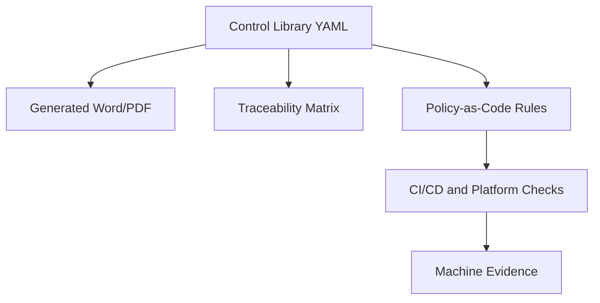

# AXIOM — Engineering Governance Runtime

<picture>
  <source media="(prefers-color-scheme: dark)" srcset="docs/publishing/branding/axiom-logo-dark.png">
  
</picture>

**AXIOM — Governance, engineered.**

AXIOM is an engineering governance runtime that connects governance rules,
architecture checks, document consistency review and traceable evidence through
controlled feedback. DevSecOps is a core application area of this runtime.

Aktueller Funktionsumfang: [detaillierter Katalog mit 22 Bereichen](docs/operations/guides/repository-function-catalog.md)
und [vollständige technische Funktionsliste](docs/operations/guides/repository-technical-function-inventory.md).

**AXIOM V2 ist die Grundlage der weiteren Produktentwicklung.** Die
[zentrale arc42-Architektur](docs/governance/architecture/governance-as-code-system-architecture.md)
beschreibt Produktkern, explizite Adapter, Laufzeit, getrennte Installation und
die offenen Produktentscheidungen. Der [geprüfte Installationskandidat](docs/operations/planning/axiom-v2-decoupling.md)
und das [vollständige Funktions-/Einstiegspunktinventar](docs/operations/planning/axiom-v2-function-inventory.md)
ordnen vorhandene Fähigkeiten und Betriebsgrenzen zu. Der Kandidat ist noch
keine allgemein veröffentlichte Produktversion oder neue Betriebsabnahme.
Die [vollständige technische Funktionsparität zu V1](docs/operations/planning/axiom-v2-functional-parity.md)
ist ein eigenes laufendes Goal. Der bereits entkoppelte V2-Kandidat ersetzt noch
nicht alle V1-Funktionen; ein source- und nachweisgebundenes Inventar führt die
gesamte Überführung und den Vergleich mit `ha-CPsWMS`.

<!-- V2_GOAL_PROGRESS:start -->
### V2-Goal: aktueller Fortschritt

**Goal offen.** Von 135 V1-Einstiegspunkten sind **0 vollständig nachgewiesen**, **81 in Arbeit** und **54 noch offen**.

| Umfang | Vollständig nachgewiesen¹ | In Arbeit | Noch offen | Insgesamt noch abzuschließen |
| --- | ---: | ---: | ---: | ---: |
| Funktionsbereiche (22) | 0 | 14 | 8 | 22 |
| V1-Einstiegspunkte (135) | 0 | 81 | 54 | 135 |
| V1-CI-Definitionen (37) | 0 | 0 | 37 | 37 |
| Betriebsabläufe (16) | 0 | 0 | 16 | 16 |

¹ Zustände der verbindlichen Paritätsmatrix; diese Anzeige führt keine Nachweis- oder Abschlussprüfung aus. „In Arbeit“ zählt nicht als erledigt.

**Letzter geprüfter Kandidat:** `cc32bcb` · 2,367 Tests (davon 1 übersprungen) · Mac 19 / VM 18 Prüfgruppen · 9 grüne CI-Workflow-Familien.

**Nächster Baustein:** Vollständige Bootstrap- und Betriebsabläufe anbieterneutral umsetzen.

Die Einheiten sind unterschiedlich groß. Aus diesen Zahlen lässt sich keine belastbare Restzeit ableiten; grüne Tests ersetzen keinen vollständigen Paritätsnachweis.

[Fortschritt, Nachweise und Restarbeiten](docs/operations/status/axiom-v2-goal-progress.md) · automatisch aus der Matrix erzeugt; veraltete Anzeigen werden in CI erkannt.
<!-- V2_GOAL_PROGRESS:end -->

Der [datierte Zwischenstand mit Mac-/VM-Nachweisen](docs/operations/status/axiom-v2-parity-progress-2026-11-15.md)
trennt reale Source-Auswertungen, synthetische Measured-Tests und den noch
unvollständigen frischen Consumer-Lauf. V2 bietet inzwischen auch private,
quellengebundene Assurance- und Staging-Zusammenführungen; die vollständige
Produkt- und Betriebsparität bleibt offen.
Der Intake-Kandidat ergänzt die vollständige Prüfung archivierter
Container-Nachweise und einen privaten, unveränderlichen Typed-Evidence-Index.
Bereitgestellte Bundles und native Aufnahmen behalten getrennte Historien;
dieser Kandidaten-Index erteilt keine Governance- oder Betriebsfreigabe.
DCR ergänzt Betriebsprüfung, vorbereitete Katalogpakete, einen expliziten
Git-Quellkontext und private redigierte Projektionen. Freigabe und öffentliche
Veröffentlichung bleiben eigene Schritte.
Der allgemeine `results`-Intake übernimmt lokale CI-Bundles und manuelle
Angaben in private, reproduzierbare Snapshots. Vollständige Ergebnisindizes
zeigen gemeldeten und wirksamen Trust getrennt. Der explizite native Adapter
liest zusätzlich abgeschlossene CI-Läufe samt Originalarchiven, Lauf-/Jobdaten
und verfügbarem Schutzstatus. Private Aufnahme und öffentliche Übergabe bleiben
getrennte Schritte; die vollständige Produktabnahme ist weiter offen.
`reports` erzeugt außerdem Kontrollabdeckungs-, Traceability-, Graph-,
Quellenherkunfts-, Änderungsfolgen- und Intake-Berichte aus dem festgehaltenen
Governance-Datenstand der installierten Version. Ihre Existenzprüfungen verwenden
den vollständigen Git-Baum; alte Skripte müssen dafür nicht installiert sein. Die
privaten Ausgaben lassen sich mit ihren ursprünglichen Git-Eingaben erneut prüfen.
Intake-Status, Entscheidungsvorlagen, explizite Anforderungsdeltas und der
Prozessstatus behalten Kandidaten, fehlende Herkunftsnachweise und offene
menschliche Entscheidungen sichtbar. Modellberichte ergänzen Automation,
Dokument-Kontroll-Zuordnung, offene Modelllücken und Pipeline-Platzierungen.
Automationsklassifikation zeigt deklarierte Modellwerte; sie aktiviert keine Gates.
Kandidaten-Reifegrad, historische Intake-Gesundheit und Replay-Einordnung ergänzen
die lesende Sicht. Das Zeitfenster für `intake-health` ist mit `--window-days`
explizit wählbar; die Berichte ändern keine Freigaben oder Trust-Einstufungen.
`reports build --kind portfolio` ergänzt die ursprüngliche Einführungsübersicht
aus committed Register und Ergebnisindizes. Unveränderte Werte behalten ihren
bisherigen Zeitstempel; die Sicht erteilt keine neue Betriebsfreigabe.
`reports configuration` ergänzt mit ausdrücklich gewähltem Providerprofil die
bisherige Intake-Konfigurationsprüfung. Sie prüft committed Textsignaturen und
belegt keine wirksame oder laufende CI-Konfiguration.
`source-inspection create` prüft außerdem die bisherigen Consumer-Integrations- und
Onboarding-Signaturen mit ausdrücklich gewähltem Profil an einem exakten Git-Commit.
`canonical-ci-signatures-v2` sortiert die gefundenen CI-Dateien vor der Auswertung
plattformunabhängig; `legacy-ci-signatures-v1` behält die ursprüngliche Dateireihenfolge.
Die privaten Quelldaten behalten einen erneut prüfbaren Git-Nachweis. Arbeitskopie,
Programme im Consumer und native APIs werden dabei nicht ausgeführt; die Auswertung
erteilt keine Einführungs- oder Betriebsfreigabe.
`source-inspection observe` ergänzt den ursprünglichen Arbeitsverzeichnis-Modus.
Das explizite Profil `legacy-worktree-signatures-v1` berücksichtigt auch geänderte
und unversionierte Dateien sowie Verzeichnisse ohne Git. Es bewahrt die beobachtete
Dateireihenfolge und begrenzte relevante Textdaten privat; `inspect-observation`
prüft daraus alle Berichte erneut, auch nach Entfernen des ursprünglichen Verzeichnisses.
Diese Eingaben haben keinen Commit-Nachweis und bleiben als lokale Beobachtung
mit ungeprüfter Identität gekennzeichnet. `--format legacy` erhält die ursprünglichen
JSON-/Markdown-Ausgaben und Exportoptionen; `--fail-on-findings` wählt deren lokale
Fehlercodes. Beispiele und Grenzen stehen im
[V2-Paritätsplan](docs/operations/planning/axiom-v2-functional-parity.md#explicit-native-working-directory-observation).
`reports build --kind blocking-readiness` und `--kind blocking-alignment` ergänzen
die bisherigen lesenden Entscheidungshilfen. Sie verwenden committed Eingaben
und eine explizite Bewertungszeit; angezeigte Freigabe- und Risikowerte erteilen
der privaten Installation keine neue Berechtigung und ändern keinen Consumer-Modus.
`provenance` ergänzt private Zuordnungen zwischen Agenten und Evidenz. Die ursprünglichen
Datensatz-, Konflikt-, Index- und Prüfausgaben bleiben erhalten. Angaben wie „reviewed“
oder „approved“ sind dort deklarierte Beteiligung; sie belegen keine ausgeführte
Agentenprüfung, menschliche Freigabe oder Echtheit der Evidenz.
`pipeline-evidence create/inspect` erhält den bisherigen Plattformkontext und die
deklarierten Pipeline-Nachweise über ein explizites Adapterprofil. Native
Umgebungsfelder bleiben im Adapter; Artefakt-, SBOM-, Scan- und Signaturdateien
werden begrenzt privat aufbewahrt und erneut geprüft. Angaben wie „success“,
„enforced“ und vorhandene Waiver belegen keine tatsächliche Pipeline-Ausführung,
Schutzkonfiguration oder Freigabe.
`agent-usage create/inspect` ergänzt die ursprüngliche Nutzungsstatistik aus einem
expliziten JSONL-Protokoll oder dem committed Legacy-Protokoll. Originale JSON- und
Markdown-Dateien bleiben privat und erneut prüfbar. Sie zählen deklarierte Rollen-
und Skill-Auswahl; tatsächliche Agentenausführung und Freigaben werden nicht abgeleitet.
`review-quality prepare/grade/inspect` erhält die bisherige Offline-Reviewbewertung.
Versionierte synthetische Datensätze erzeugen private Aufgabenpakete und Antwortschemas;
bereitgestellte Antworten werden mit den ursprünglichen Kriterien bewertet.
Laufzeit-Traces sind ausdrücklich angehängte, nicht authentifizierte Angaben.
`review-metadata receipt/parse-body/usage-summary/status/inspect` ergänzt die
ursprünglichen Receipt-Blöcke und Nutzungszahlen sowie Statusberichte aus
expliziten Angaben zum Ziel- und vorgeschlagenen Review-Umfang. Private Eingaben
und vollständige Ausgaben werden erneut geprüft. Aktuelle Git-Ableitung,
private Reviewtexte, tatsächliche Agentenausführung und menschliche Freigabe
werden damit nicht bestätigt; native PR-Identität und Live-Frische bleiben unbestätigt.
`review-plan prepare/check/inspect` ergänzt lokale Git-gebundene Reviewpläne:
HEAD, Vergleichsbasis, Index, Arbeitskopie sowie Rollen-, Skill- und Routingdaten
werden gelesen und vor einer Prüfung erneut verglichen. `--base-ref` löst eine
benannte lokale Basis bei der Vorbereitung auf einen exakten Commit auf;
alternativ wählt `--base-commit` den Commit direkt. SHA-1- und SHA-256-Repositories
sind unterstützt. Der Plan speichert die aufgelöste Basis und folgt späteren
Änderungen des Branch-Namens nicht. Gespeicherte Ergebnisse
lassen sich ohne den ursprünglichen Checkout nachlesen; dieses Nachlesen prüft
keinen aktuellen Git-Stand. Ergebnisse und Freigaben bleiben Selbstauskünfte.
`review-plan check-file` prüft außerdem externe V1-Plan- und Ergebnisdateien
direkt gegen den aktuellen lokalen Git-Stand und die tatsächlichen Review-Verträge.
Eine vorherige V2-Plan-ID ist dafür nicht erforderlich. Eingabebytes und der
vollständige ursprüngliche Prüfbericht bleiben privat erneut ableitbar;
externen Dateien wird keine V2-Planherkunft oder Freigabe zugeschrieben.
Review-Verträge unterstützen jetzt auch die ursprünglichen YAML-Verweise auf
Skalare, Listen und Mappings sowie gültige zusätzliche SafeLoader-Metadaten.
Die Auflösung ist nach Größe, Tiefe und Anzahl begrenzt; Pflichtfelder und
Berechtigungsangaben werden weiterhin geprüft. Dieselbe Vertragsprüfung gilt
für Planung, gewöhnliche Rollenauswahl, Receipts und committed PR-Status.
`review-receipts export/summary/inspect` exportiert die freigegebenen Metadatenfelder
eines solchen Plans in eine ausdrücklich gewählte Datei außerhalb der Checkouts.
Ein sauberer vollständiger Branch mit Vergleichsbasis wird vor und nach dem Export
erneut geprüft. Das optionale Nutzungsprotokoll erhält je Receipt genau einen Eintrag;
Wiederholungen bewahren die erste Datei und deren Zeitstempel. Private Reviewtexte
bleiben im privaten Knoten. Tatsächliche Review-Ausführung und native Live-Bestätigung
bleiben offen; ein Receipt erteilt keine Freigabe.
`review-pr status/inspect` ergänzt die PR-Metadatenprüfung aus tatsächlichen lokalen
Git-Commits. Vergleichsbasis, Änderungsumfang sowie Rollen und Validierungen beider
Branch-Verträge werden gelesen und zusammengeführt. Ein abweichender Arbeitsbaum
ändert diese committed Sicht nicht. Vollständige Originalberichte bleiben privat
erneut ableitbar; das Nachlesen bestätigt keinen aktuellen PR auf einer Plattform.
`review-dispatch` ergänzt die gewöhnliche Rollenauswahl und die ursprünglichen
Aufzeichnungsmodi: begrenztes Fenster, Daueraufzeichnung, Status und Statistik.
Standardmäßig liegen Zustandsdateien in einem privaten Workspace. Der explizite
Dateiadapter kann bestehende Zustands- und Logdateien eines separaten Checkouts
verwenden; Vorschau, gespeicherter Auftrag und Wiederaufnahme machen Teilfehler
nachvollziehbar. Provider-Reviews werden als Angaben protokolliert; der Befehl
startet keinen KI-Provider und erteilt keine Freigabe.
`review-run run/inspect/status` erhält den optionalen ursprünglichen Review-Runner.
Standardmäßig bereitet er vollständige private Aufgaben in einem neuen, ausdrücklich
gewählten Verzeichnis vor. Erst `--execute` startet Prozesse über den gewählten
Provider-Adapter; in CI ist das gesperrt. Fachreviews laufen begrenzt parallel,
der Steward folgt nach erfolgreichen Fachreviews. Private Protokolle unterscheiden
angeforderte Ausführung und tatsächlichen Prozessstart; unterbrochene Läufe werden
nicht automatisch wiederholt. Gespeicherte Ausgaben lassen sich ohne Zielcheckout
erneut prüfen. Modellangaben und Antworten bleiben unbestätigt; menschliche
Freigaben werden nicht erteilt. [Bedienung und Grenzen](docs/operations/planning/axiom-v2-functional-parity.md#optional-review-execution).
`attestation verify/inspect/status` erhält die ursprüngliche lokale Pilotprüfung:
Registerzuordnung, Signatur, Artefakt und Kontext. Ein kompatibles lokales OpenSSL
führt die kryptografische Prüfung aus; das gewählte neue oder vorhandene externe
Ausgabefile erhält den ursprünglichen Bericht. Vorherige Bytes, tatsächliche
Prozessbeobachtung und Schreibversuch bleiben privat nachvollziehbar. Die
Standard-Kontextwerte stammen wie in V1 aus der Attestierung; explizite erwartete
Werte sind möglich. Runner und Attestierung teilen eine begrenzte
Prozessgruppen-Bereinigung. Ein verweigertes macOS-Signal wird nur bei bestätigter
Abwesenheit oder ausschließlich beendeten Gruppenmitgliedern behandelt;
lebende oder unklare Gruppen bleiben ein Fehler.
[Prozessbeobachtung](docs/operations/planning/axiom-v2-functional-parity.md#owned-native-process-cleanup).
Pilotregister und historische Trust-Bezeichnungen werden
nicht als aktive V2-Autorität übernommen. [Bedienung und Grenzen](docs/operations/planning/axiom-v2-functional-parity.md#local-attestation-pilot).
`parity` prüft Nachweis-Metadaten aus dem mitgelieferten Paket oder einem expliziten
`--evidence-directory`. Hashes, Originalquelle, Implementierung und aktueller
Runtime-Stand werden gebunden; private Texte und Autoritätsbehauptungen sind
kein zulässiger Nachweis. Die Matrix wird dadurch nicht automatisch hochgestuft.
[Nachweise und Grenzen](docs/operations/planning/axiom-v2-functional-parity.md#subject-receipts-and-evidence-delivery).
Für die drei Intake-Einstiegspunkte sind nach dem vollständigen Funktionsaudit
je ein positiver, negativer und installierter Nachweis gebunden. Die Metadaten
benennen den tatsächlich ausgeführten Stand `8e0688b` und dessen unveränderte
Runtime; sie erklären einen späteren Metadaten-Commit nicht rückwirkend zum
getesteten Dateibaum. Die übrigen 132 Einstiegspunkte und alle CI-/Betriebsabläufe
bleiben im Goal. [Einzelentscheidungen](docs/operations/planning/axiom-v2-functional-parity.md#first-three-declared-subject-decisions).
`intake-records attempt/event/retry/inspect/status` erhält Fehlerprotokolle,
deklarierte Intake-Ereignisse und die ursprünglichen drei Wiederholungspläne.
Native Metadaten, CI-Umgebung und Routen liegen im expliziten Adapter; erste
Datensätze und Konflikte bleiben erhalten. Private Eingaben, Schreibversuche und
Vorher-/Nachher-Dateien sind offline prüfbar. Unabhängige Repo-Buckets können
parallel arbeiten; ein Retry-Plan startet keinen Workflow und aktualisiert keinen
offiziellen Ergebnisindex. Der native Zeitstempel folgt der ursprünglichen
Ablaufphase und wird getrennt vom Assessment-Start erhalten. Ungültige API-Basen
erzeugen den ursprünglichen Fallback-Datensatz; ein Retry-Ausgabeordner muss
bereits existieren. [Bedienung und Grenzen](docs/operations/planning/axiom-v2-functional-parity.md#intake-records-and-retry-preparation).
`vulnerability-evidence create/inspect` ergänzt die lokale Sammlung vorhandener
Scanberichte und Artefakte. Die ursprüngliche JSON-Ausgabe bleibt erhalten; Dateien
und deklarierte Herkunftsangaben werden privat für Wiederholungsprüfungen gespeichert.
Die Funktion startet keinen Scanner und bestätigt keine native Pipeline-Identität.
`evaluate --domain devsecops-release` ergänzt das bisherige Release-Gate.
`reports domain` schreibt originale JSON-/Markdown-Berichte aus privaten
Auswertungs-IDs; `reports combine` verbindet Architektur und Release-Gate bei
gleichem Produktstand, Zeitpunkt und explizit gleichem Ziel. Die Ausgaben bleiben
unverifizierte Operator-Diagnosen ohne Freigabe oder öffentliche Veröffentlichung.

<!-- DOCS_REFRESH_LATEST:start -->
## Implementation readback — 15 November 2026

Implementation source: `adc4643bb7a5c962e4efb1525298ad9e652c73d2`. The
[documentation reconciliation](docs/operations/status/repository-documentation-reconciliation-2026-11-15.md)
separates merged capabilities, the installed VM revision and remaining live acceptance.

- The private [Review Workbench](docs/operations/guides/governance-review-workbench.md)
  uses **Dokument wählen → Prüfen → Weitergeben** and shows exact requirement-to-rule
  bindings as review support. Only explicit declarations enter extraction; notes
  remain proposals. The public Viewer is read-only.
- macOS and Ubuntu VM operation are available in parallel with separate keys,
  sessions and drafts. The [Linux VM guide](docs/operations/guides/linux-vm-installation.md)
  covers Ansible installation, exact-commit updates, SSH access and verified backups.
  Mac and VM were aligned to `adc4643` on 15 November, with Workbench checks
  passed. The [dated platform state](docs/operations/status/current-governance-platform-state.md)
  records that observation and the diagnostic replay separately from accepted
  consumer evidence. A Git merge does not deploy a host.
- The [portable runtime and engineering matrix](docs/operations/planning/platform-portability-acceptance.md)
  are merged through #377. The shared evaluator, provider adapters, evidence verifier,
  persistent collector, recovery and prepared offline package are implemented.
  Pipeline-L1 covers five mapped controls; eleven remain `not_evaluated`.
- The VM retains its existing legacy collector configuration. Portable migration,
  publisher handoff and live GitLab/Bamboo/Bitbucket acceptance remain separate steps.
  Target versions and URLs remain open; measured 1,000/2,000-repository fixtures
  establish engineering evidence, not production capacity approval.
<!-- DOCS_REFRESH_LATEST:end -->
[Kapazitätsbewertung für 300 bis 1.500 Consumer-Repositories](docs/operations/planning/consumer-scale-capacity-assessment.md).
Der [GitHub-Lifecycle-Pilot](docs/operations/status/governance-lifecycle-current-state.md)
ist seit der persönlichen LD-07-Abnahme und den geprüften Merges #92/#93 am
13. September 2026 aktiv, manuell und report-only.

The latest published repository adoption release observed on 15 November is
[v0.2.0](docs/releases/v0.2.0-public-adoption.md).
[v0.3.0](docs/releases/v0.3.0-public-adoption.md) contains preparation assets;
no `v0.3.0-public-adoption` remote tag or published GitHub Release was present.
The [release index](docs/releases/index.md) distinguishes baseline tags,
repository releases and the versions pinned by accepted consumer results.

The dated operating observations, current-state source links, measured
ha-CPsWMS evidence and historical staging deployment are recorded in the
[current platform state](docs/operations/status/current-governance-platform-state.md).

For current pilot and central operations, start with the
[operations handbook](docs/operations/guides/governance-repository-operations-handbook.md).
It links the [daily report](docs/operations/status/daily-governance-operations.md),
[access maintenance](docs/operations/security/github-access-and-token-maintenance.md),
and [backup and recovery](docs/operations/processes/governance-repository-backup-and-recovery.md).
Dated reference runs and released documentation remain historical evidence.

This public repository provides reusable DevSecOps and architecture governance baselines that application repositories can consume from CI/CD without copying governance logic into every project.

It combines governance-as-code, policy-as-code, machine-readable evidence, released baselines, runtime architecture governance, onboarding guidance, and CI/CD adapter patterns for GitHub Actions, Bamboo/Bitbucket, Jenkins, and GitLab CI.

The repository models a governance stack where a `Policy` defines mandatory intent, a `Directive` defines binding operational execution, and structured baseline artifacts define detailed controls, platform expectations, evidence contracts, and executable checks.

For the technical system description, use the [arc42 architecture](docs/governance/architecture/governance-as-code-system-architecture.md): context, building blocks, runtime, Mac/VM deployment, decisions, quality scenarios and open risks.

## Start Here

| Need | Entry point |
|---|---|
| Review the public adoption state | `docs/onboarding/external-review-brief.md` |
| Run an external evaluation | `docs/onboarding/external-evaluator-guide.md` |
| Run a controlled adoption pilot | `docs/onboarding/pilot-runbook.md` |
| Try the framework in an application repo | `docs/onboarding/public-repo-quickstart.md` |
| Copy ready-to-use templates | `adoption-package/README.md` |
| Inspect the validated neutral consumer | `docs/onboarding/validated-demo-consumer.md` |
| Review publication status and baseline versions | [Release index](docs/releases/index.md) |
| Run the private Workbench on macOS and an Ubuntu VM | [Linux VM and parallel operation](docs/operations/guides/linux-vm-installation.md) |
| Review portable runtime support and open acceptance | [Engineering matrix](docs/operations/planning/platform-portability-acceptance.md) |
| Follow the five-phase requirement journey | [Source to OPA guide](docs/governance/architecture/document-intake-to-opa-rulebook.md) |
| Prepare document intake and requirement review locally | [Review Workbench](docs/operations/guides/governance-review-workbench.md) |
| Inspect current repository capabilities | `docs/operations/guides/repository-function-catalog.md` |
| Open the governance viewer | `https://joku-dev.github.io/devsecops-governance-framework/generated/viewer/app/index.html` |
| Open the published documentation | `https://joku-dev.github.io/devsecops-governance-framework/` |

## Use In Three Steps

1. Copy the workflows from `adoption-package/workflows/` into an application repository.
2. Keep the first runs in `report-only` and review the generated artifacts.
3. Replace placeholder evidence with real scanner, SBOM, repository-control and architecture evidence. New blocking additionally requires the [readiness assessment](docs/operations/status/blocking-readiness.md), accountable approval and a separate consumer change.

## Purpose

The repository separates these concerns:

| Area | Purpose |
|---|---|
| `docs/` | Human-readable governance documentation, onboarding guides, adapter guidance, and operational explanations. |
| `docs/governance/source-documents` | Registered source artifacts, including sanitized requirements extracts and candidate documents; source status and lineage are recorded in the register. |
| `model/documents` | Structured catalog of policy, directive, and standard source documents. |
| `model/controls` | Structured DevSecOps control baseline requirements. |
| `model/platform` | Platform Reference Architecture levels and platform capabilities. |
| `model/traceability` | Mapping between controls, platform capabilities, evidence, and policy candidates. |
| `architecture` | Architecture runtime governance levels, markers, guardrails, review gates, and remediation actions. |
| `pipeline-baseline` | Tool-agnostic CI/CD control baseline and platform-specific adapter templates. |
| `policies/opa` | Executable policy-as-code rules for automated checks. |
| `model/evidence` | Evidence type definitions expected from pipelines and platforms. |
| `model/waivers` | Waiver model and approval authority structure. |
| `schemas` | JSON Schemas for validating structured governance data. |
| `status` | Normalized downstream governance and architecture result snapshots. |
| `generated` | Derived reports, traceability, graph and viewer; generated document exports where configured. |
| `releases` | Versioned baseline packages for controlled publication. |

## Target Model

The long-term target is that structured sources become the controlled master data for software delivery governance. Word and PDF remain important output formats for reviews and audits, but original source documents are not published in this public repository.



## Initial Scope

The initial scope is based on:

- DevSecOps Control Baseline Standard aligned with Platform Levels
- DevSecOps Platform Reference Architecture Standard aligned with Control Baseline

The initial implementation established:

- Level 1 controls as complete structured data
- Platform Reference Architecture levels 1 to 3
- Traceability from control requirement to platform capability and expected evidence
- Initial automated checks for branch protection, SBOM, vulnerability evidence, artifact integrity, dependency source control, IaC, and waiver validity

## Runtime Governance Addendum

The repository now includes a first runtime governance addendum for the SDD Architecture Governance Framework:

- `docs/governance/architecture/runtime-governance-addendum.md`
- `architecture/quality-markers.yaml`
- `architecture/guardrails.yaml`
- `architecture/review-gates.yaml`
- `architecture/arch-l1.yaml`
- `architecture/arch-l2.yaml`
- `architecture/arch-l3.yaml`
- `architecture/arch-gov.yaml`
- `policies/opa/architecture_readiness.rego`
- `policies/opa/architecture_integration_readiness.rego`
- `policies/opa/architecture_operation_readiness.rego`
- `policies/opa/architecture_release_readiness.rego`

The addendum keeps the original framework document as the normative reference and adds machine-readable marker, guardrail, gate and policy artifacts for executable governance.

## Recommended Workflow

1. Maintain structured control and platform data in YAML.
2. Validate YAML against JSON Schemas.
3. Generate traceability views and documents from YAML.
4. Implement policy-as-code only for controls that can be objectively checked.
5. Store generated evidence from pipelines and platform checks.
6. Use waivers only as controlled, time-limited exceptions.

## Repository Layout

- `docs/` explains the governance model for people.
- `model/` contains the machine-readable governance source of truth.
- `generated/` contains rendered documents, reports, and viewer output.
- `releases/` is reserved for versioned baseline packages.
- `.github/workflows/` contains repository automation and reusable CI integration.

## Current Operational State

- `L1` is now available as a released and revision-protected baseline package via `l1-baseline-v1.1.3`.
- The current `L1 v1.1.3` package adds run-context-aware evaluation for release, pull-request, branch-validation, and diagnostic runs.
- `architecture-baseline-l1-v0.1.0` is available as the released architecture runtime governance baseline.
- GitHub Pages publishes the documentation and the read-only Governance Workspace with repository, finding, Repository Security, evidence, governance and operations views.
- A daily Self-Security refresh records every live assessment as a workflow artifact and proposes material JSON/Markdown report changes through one reviewed pull request; timestamps alone never create commits, and the Pages build regenerates the Viewer projection after merge.
- Release integrity verifies the directly signed operational-pilot tag and a signed, closed retrospective manifest for the three immutable historical tags; every future release tag requires a direct trusted signature.
- Central intake stores append-only DevSecOps, architecture, typed evidence, measured L1, control-assurance and staging-deployment snapshots under `status/`; reviewed operational PRs update the official indexes.
- Evidence Trust records integrity, provenance, freshness, replay, custody and attestation without turning evidence quality into a compliance or release decision.
- The ha-CPsWMS pilot produces real tests, SAST, five container builds, CycloneDX SBOMs, Trivy scans and HTTP/Neo4j integration evidence. The retained measured L1 assessment covers all 16 controls and leaves missing or partial evidence explicit.
- The retained ha-CPsWMS staging evidence records deployment of verified query-api and Neo4j images. Its first recorded deployment passed 19 health, function, persistence, restart, outage/recovery, identity and runtime-hardening checks; the Viewer keeps this staging-only decision separate from production approval and vulnerability risk acceptance.
- The manual closed-loop lifecycle pilot can record observations, decisions, actions, receipts, closure and revocation for its narrowly accepted scope. It remains report-only and subject to personal action consent.
- `governance-framework-demo-consumer` is the neutral public reference consumer for first adoption validation.
- Platform-neutral evidence generation, validation and bundle intake support adapter paths for GitHub Actions, Bamboo with Bitbucket Data Center, Bitbucket Pipelines, Jenkins and GitLab CI. The non-GitHub paths are reference implementations that require environment-specific integration and validation.

Historical accepted ha-CPsWMS reference runs from 19 September are DevSecOps
[`35428988040`](https://github.com/joku-dev/ha-CPsWMS/actions/runs/35428988040)
and architecture
[`35428987695`](https://github.com/joku-dev/ha-CPsWMS/actions/runs/35428987695).
The separate measured-evidence run
[`35428987714`](https://github.com/joku-dev/ha-CPsWMS/actions/runs/35428987714)
contains 62 passing tests, typed vulnerability and SBOM evidence, and the
per-control assurance projection. The real staging deployment of the same
application commit `dc303dcdabb3` adds 19 passed runtime checks. A governance
PASS remains distinct from open scanner findings, replay deviations and
production approval.

The [current-state overview](docs/operations/status/current-governance-platform-state.md)
records the 15 November implementation and deployment readback, preserves dated earlier observations
and links to the authoritative accepted indexes. The indexed ha-CPsWMS results
remain dated 2 October; repository validation does not refresh consumer evidence. The separate demo-consumer lifecycle case is now closed;
newly captured ha-CPsWMS container SBOM evidence reaches `provenance_verified`.
Neither statement grants production approval or retroactively promotes old evidence.
The [Closed-Loop Governance reading map](docs/operations/evidence/governance-lifecycle-overview.md)
distinguishes the kernel, synthetic scenarios and the two separately accepted pilots.
After that 3 October observation, PR #200 delivered read-only Lifecycle Next Step
guidance in the viewer, and PR #178 delivered the commit-bound repository SBOM
export. Neither grants production approval or changes the accepted governance
scope.

## AI And Agent Navigation

- Agent instructions: `AGENTS.md`
- AI navigation index: `docs/ai-index.md`
- AI working rules: `docs/operations/ai-working-rules.md`

## License And Permissions

- Proprietary license notice: `LICENSE`
- Repository license and permissions: `LICENSE_AND_PERMISSIONS.md`

## Governance Change Lifecycle

- Governance change lifecycle: `docs/governance/governance-change-lifecycle.md`
- Source document register: `model/documents/source-document-register.yaml`
- Source document intake process: `docs/operations/processes/source-document-intake-process.md`
- Source document intake status: `generated/reports/source-document-intake-status.md`
- Source document intake review briefs: `generated/reports/source-document-intake-review-briefs.md`
- Source document requirement delta: `generated/reports/source-document-requirement-delta.md`
- Change request template: `docs/governance/change-requests/TEMPLATE.md`

## Local Commands

Prepare the pinned local validation toolchain and run all required checks:

```bash
./scripts/bootstrap_validation_env.sh
./scripts/validate_all.sh
```

See `docs/operations/guides/local-validation-toolchain.md` for supported
platforms, custom installation paths, pinned dependencies, and troubleshooting.

For the focused commands below, activate the prepared environment first:

```bash
source .venv-validation/bin/activate
```

Validate repository consistency:

```bash
python scripts/validate_governance_repo.py
```

Generate the source-document intake status report:

```bash
python scripts/generate_source_document_intake_status.py
```

Generate source-document intake review briefs:

```bash
python scripts/generate_source_document_intake_review_briefs.py
```

Generate source-document requirement deltas for replacement candidates:

```bash
python scripts/generate_source_document_requirement_delta.py
```

Review the governance document hierarchy:

```bash
sed -n '1,200p' docs/governance/governance-document-hierarchy.md
```

Run the lightweight regression checks:

```bash
python -m unittest discover -s tests
```

Read the practical usage guide:

```bash
sed -n '1,240p' docs/operations/guides/how-to-use-this-repo.md
```

Read the GitHub reference path guardrails:

```bash
sed -n '1,240p' docs/operations/adapters/github-reference-path.md
```

Read the beginner step-by-step operations guide:

```bash
sed -n '1,320p' docs/operations/guides/beginner-step-by-step-operations-guide.md
```

Read how other repositories integrate this governance repository:

```bash
sed -n '1,320p' docs/onboarding/how-other-repos-use-this-governance-repo.md
```

Read the step-by-step central governance baseline integration guide:

```bash
sed -n '1,320p' docs/onboarding/how-other-repositories-use-the-central-governance-baseline.md
```

Read the application repository onboarding guide:

```bash
sed -n '1,260p' docs/onboarding/application-repo-onboarding.md
```

Use the copyable public adoption package:

```bash
sed -n '1,220p' adoption-package/README.md
```

Inspect the validated neutral demo consumer:

```bash
sed -n '1,220p' docs/onboarding/validated-demo-consumer.md
```

Read the explanation of policy, directive, baseline, verification, and governance as code:

```bash
sed -n '1,360p' docs/governance/policy-directive-baseline-verification-and-governance-as-code-explained.md
```

Read the explanation of the relationship between the control baseline and the platform architecture:

```bash
sed -n '1,320p' docs/platform/control-baseline-and-platform-architecture-relationship-explained.md
```

Use the generic GitHub Actions onboarding template:

```bash
sed -n '1,180p' examples/github-actions/workflows/application-devsecops-baseline-template.yml
```

Use the governance-input-aware onboarding template:

```bash
sed -n '1,260p' examples/github-actions/workflows/application-devsecops-baseline-with-governance-input-template.yml
```

Read the operational governance enforcement options:

```bash
sed -n '1,240p' docs/operations/processes/operational-governance-enforcement-options.md
```

Generate an extended machine-readable governance compliance result:

```bash
python3 scripts/generate_governance_compliance_result.py \
  --target-repo . \
  --input-file policies/example-input.release-candidate.json \
  --output-file governance-compliance-result.json
```

GitHub Actions runs the same core checks automatically on pushes and pull requests via `.github/workflows/governance-ci.yml`.

Generate the first traceability CSV:

```bash
python scripts/generate_traceability_csv.py
```

Generate the governance document authority matrix:

```bash
python scripts/generate_document_control_matrix.py
```

Generate the open gap report:

```bash
python scripts/generate_open_gap_report.py
```

Render the Policy and Directive into review-ready files:

```bash
python scripts/render_governance_documents.py
```

Generate the static governance status viewer:

```bash
python scripts/generate_status_viewer.py
```

Generate a control-by-control evaluation report for a specific governance run input:

```bash
python scripts/generate_control_evaluation_report.py \
  --input-file demo/inputs/release-candidate-green.json \
  --output-file generated/control-evaluation-report.json \
  --markdown-file generated/control-evaluation-report.md
```

Build the documentation site locally:

```bash
python3 -m venv .venv-docs
. .venv-docs/bin/activate
pip install --require-hashes -r requirements-docs.lock
mkdocs build --strict
mkdocs serve
```

Read the full step-by-step MkDocs and GitHub Pages guide:

```bash
sed -n '1,360p' docs/operations/guides/mkdocs-and-github-pages-step-by-step.md
```

Use the first versioned L1 baseline release package:

```bash
sed -n '1,240p' releases/l1/v1.0.0/baseline-package.md
sed -n '1,200p' docs/releases/l1-baseline-v1.0.0.md
```

Inspect the earlier L1 release package that introduced governance run input support:

```bash
sed -n '1,240p' releases/l1/v1.1.0/baseline-package.md
sed -n '1,220p' docs/releases/l1-baseline-v1.1.0.md
```

Inspect the current L1 release package with run-context-aware evaluation:

```bash
sed -n '1,240p' releases/l1/v1.1.3/baseline-package.md
sed -n '1,220p' docs/releases/l1-baseline-v1.1.3.md
```

Generate the central repository results index:

```bash
python3 scripts/generate_repository_results_index.py
sed -n '1,220p' status/repository-results-index.json
```

Run the local demonstration environment:

```bash
python scripts/run_demo.py
```

Generate the architecture runtime traceability CSV:

```bash
python3 scripts/generate_architecture_traceability_csv.py
```

Validate the runtime governance addendum:

```bash
python3 scripts/validate_runtime_governance.py
```

Generate a demo architecture release-readiness input for a local application repository:

```bash
python3 scripts/collect_architecture_release_input.py \
  --repo /workspace/governance-framework-demo-consumer \
  --output generated/demo/demo-consumer-architecture-release-input.json \
  --release-id demo-consumer \
  --baseline example-solution-baseline
```

Generate a demo architecture governance report:

```bash
python3 scripts/generate_architecture_governance_report.py \
  --input generated/demo/demo-consumer-architecture-release-input.json \
  --output-json generated/demo/demo-consumer-architecture-governance-report.json \
  --output-md generated/demo/demo-consumer-architecture-governance-report.md
```

Generate a demo DevSecOps governance report:

```bash
python3 scripts/collect_devsecops_release_input.py \
  --repo /workspace/governance-framework-demo-consumer \
  --output generated/demo/demo-consumer-devsecops-release-input.json \
  --release-id demo-consumer

python3 scripts/generate_devsecops_governance_report.py \
  --input generated/demo/demo-consumer-devsecops-release-input.json \
  --output-json generated/demo/demo-consumer-devsecops-governance-report.json \
  --output-md generated/demo/demo-consumer-devsecops-governance-report.md
```

By default, this local report is report-only. `--fail-on-findings` is the technical
blocking switch; use it in a consumer only after readiness review and accountable
approval. The released DevSecOps wrapper has a separate default of `block-on-error`.

Generate the combined end-to-end demo report:

```bash
python3 scripts/generate_end_to_end_governance_report.py \
  --architecture-json generated/demo/demo-consumer-architecture-governance-report.json \
  --devsecops-json generated/demo/demo-consumer-devsecops-governance-report.json \
  --output-json generated/demo/demo-consumer-end-to-end-governance-report.json \
  --output-md generated/demo/demo-consumer-end-to-end-governance-report.md
```

Intake a downstream Architecture Runtime Governance GitHub Actions run and refresh the architecture status index:

```bash
python3 scripts/intake_architecture_github_actions_run.py \
  --repository-id joku-dev/governance-framework-demo-consumer \
  --run-id 34606820390 \
  --architecture-baseline-ref architecture-baseline-l1-v0.1.0

python3 scripts/generate_architecture_results_index.py
python3 scripts/generate_status_viewer.py
```

The detailed live demo runbook is:

```text
docs/demos/demo-end-to-end-governance.md
```

The validated neutral demo consumer is documented here:

```text
docs/onboarding/validated-demo-consumer.md
```

The reusable GitHub Actions template for application repositories is:

```text
pipeline-baseline/templates/github-actions/architecture-governance.yml
```

For the minimal copy-paste app-repo workflow and onboarding guide, see:

```text
pipeline-baseline/templates/github-actions/app-repo-architecture-governance.yml
pipeline-baseline/templates/github-actions/ADOPTION.md
```

Optional app-repo evidence templates are available in:

```text
pipeline-baseline/templates/app-architecture-evidence/
```

The released Architecture Runtime Governance baseline is consumed like this:

```yaml
uses: joku-dev/devsecops-governance-framework/.github/workflows/architecture-baseline-l1-v0.1.0.yml@architecture-baseline-l1-v0.1.0
with:
  solution_baseline: example-solution-baseline
  fail_on_findings: false
```

`architecture-baseline-l1-v0.1.0` is the architecture governance baseline. `example-solution-baseline` is the solution/product baseline used by the application evidence.

## Important Principle

Not every requirement should become executable policy. Some requirements are governance obligations, some are evidence obligations, and some are enforceable technical gates. The repository keeps these concerns connected but distinct.
