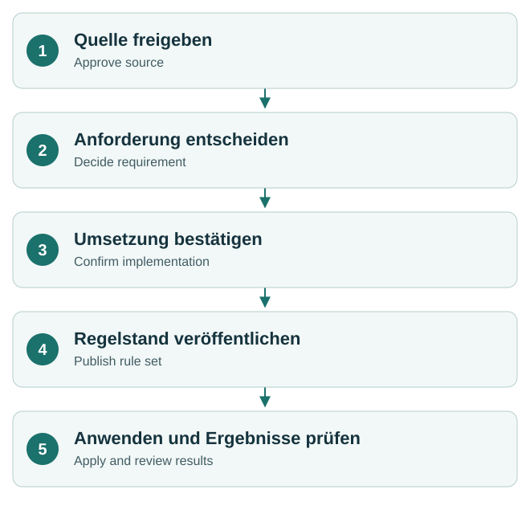
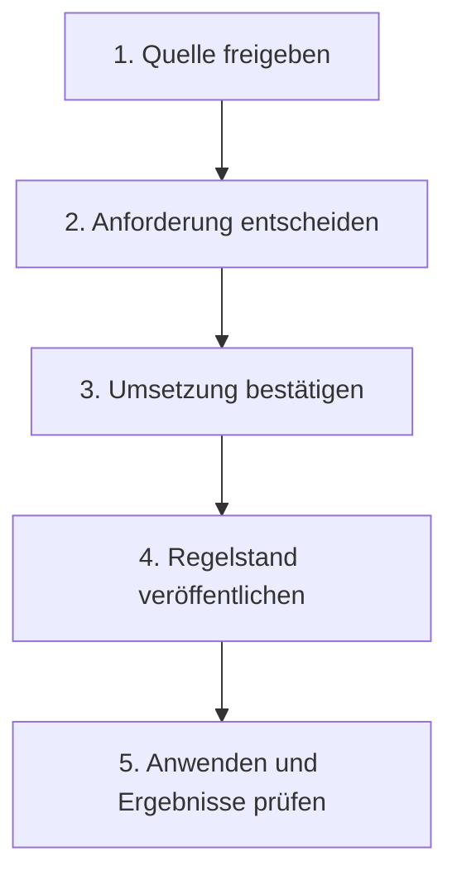

# Architektur vom Dokumenteingang bis zum ausführbaren OPA-Regelwerk

## Zweck und Geltungsbereich

Dieser Leitfaden erklärt, wie aus einer Anforderung in einem Dokument eine
nachvollziehbare Governance-Prüfung wird. Zuerst führt er ohne Git- oder
OPA-Vorkenntnisse durch fünf Phasen. Die anschließende Technikreferenz ordnet
Kennungen, Register und Implementierungsdetails diesen Phasen zu.

Die fünf Phasen sind eine Lesehilfe für das bestehende Verfahren. Ihre
Darstellung ändert keine Freigaben oder Zuständigkeiten. Eine Quellenfreigabe,
eine Requirement-Aktivierung, die Bestätigung einer Umsetzung und eine
Blocking-Freigabe bleiben getrennte Entscheidungen.

## Architekturüberblick



| Phase | Leitfrage | Ergebnis |
|---|---|---|
| **1. Quelle freigeben** | Dürfen wir diesen Dokumentstand als Grundlage verwenden? | Registrierte, versionierte und freigegebene Quelle |
| **2. Anforderung entscheiden** | Welche explizite Anforderung übernehmen wir? | Dokumentierte Entscheidung und gegebenenfalls aktive GRQ-Revision |
| **3. Umsetzung bestätigen** | Wie wird die Anforderung fachlich korrekt umgesetzt? | Bestätigte Artefakte einschließlich ihrer RTA-Zuordnungen |
| **4. Regelstand veröffentlichen** | Welche freigegebene Version sollen Consumer verwenden? | Veröffentlichter, unveränderlicher Baseline-Stand |
| **5. Anwenden und Ergebnisse prüfen** | Erfüllt ein konkreter Zustand die Regeln? | Prüfergebnis, Nachweise, Darstellung und freigegebene Gate-Wirkung |

Ein Consumer ist ein Repository oder System, das den veröffentlichten Regelstand
verwendet. Die Phasen können bei Rückfragen erneut durchlaufen werden. Ein
Duplikat, eine Ablehnung oder eine offene Klärung führt nicht automatisch zu
einer neuen Regel. Git-native Anforderungen beginnen mit einer versionierten
Anforderungsquelle direkt in Phase 2; ihre Herkunft bleibt nachvollziehbar.

## Leitfaden durch die fünf Phasen

### Phase 1: Quelle freigeben

- **Eingang:** Ein Dokument oder ein kontrollierter Requirements-Auszug mit
  bekanntem Dokumentstand.
- **Aufgabe:** Herkunft, Version, Eigentümer und betroffene Themen registrieren;
  Überschneidungen und mögliche Ersatzdokumente prüfen.
- **Menschliche Entscheidung:** Die zuständige Rolle entscheidet, ob genau
  dieser Dokumentstand als normative Quelle freigegeben wird.
- **Ergebnis:** Ein freigegebener Registereintrag mit nachvollziehbarem
  Entscheidungsnachweis. Ohne Freigabe bleibt das Dokument im Intake.
- **Warum diese Phase existiert:** Jede spätere Anforderung braucht eine
  eindeutig benannte und zulässige Grundlage. Ein Kandidat darf verglichen und
  geprüft werden, autorisiert aber keine normativen Runtime-Ableitungen.

### Phase 2: Anforderung entscheiden

- **Eingang:** Eine explizit deklarierte Anforderung aus einer freigegebenen
  Quelle oder eine versionierte Git-native Anforderung.
- **Aufgabe:** Die Aussage einzeln prüfen und mit vorhandenen Anforderungen
  vergleichen. Aus Fließtext werden keine Anforderungen abgeleitet.
- **Menschliche Entscheidung:** Annahme, Ablehnung oder Zurückstellung sowie
  die fachliche Behandlung von Duplikaten, Änderungen und Konflikten festhalten.
- **Ergebnis:** Eine dokumentierte Entscheidung und bei Aktivierung eine
  kanonische GRQ-Revision. Ein Duplikat kann auf ein vorhandenes GRQ verweisen;
  eine Ablehnung erzeugt kein neues GRQ. Ein freigegebener, ungelöster Konflikt
  verhindert die Aktivierung bis zur Auflösung.
- **Warum diese Phase existiert:** Die Freigabe eines Dokuments entscheidet
  noch nicht, welche seiner Aussagen als einzelne Anforderungen gelten sollen.
  Offene Vorschläge behalten ihren eigenen Status.

### Phase 3: Umsetzung bestätigen

- **Eingang:** Eine aktive GRQ-Revision und die für sie erlaubten Ableitungsarten.
- **Aufgabe:** Eine geeignete Umsetzung auswählen: beispielsweise ein Control,
  eine Plattformfähigkeit, ein Architekturmarker, ein Review oder eine OPA-Policy.
  Eine OPA-Policy ist eine maschinenlesbare Prüfregel in der Sprache Rego.
- **Menschliche Entscheidung:** Fachliche Gleichwertigkeit und zulässige
  Verwendung der vorhandenen oder neu erstellten Umsetzung bestätigen.
- **Ergebnis:** Bestätigte Artefakte mit einer RTA-Zuordnung, die GRQ-Revision,
  konkreten Artefaktinhalt und Entscheidung miteinander verbindet.
- **Warum diese Phase existiert:** Eine technische Prüfung muss tatsächlich
  die freigegebene Anforderung abdecken. Mehrere Anforderungen können dieselbe
  Umsetzung nutzen; eine Anforderung kann mehrere Artefakte benötigen.

### Phase 4: Regelstand veröffentlichen

- **Eingang:** Bestätigte Implementierungen und die zugehörigen Prüfungen,
  Datenverträge und Nachweise für eine Veröffentlichung.
- **Aufgabe:** Den vorgesehenen Regelstand vollständig validieren und als
  reproduzierbares Paket für Consumer vorbereiten.
- **Menschliche Entscheidung:** Die zuständige Rolle gibt den konkreten
  Release- beziehungsweise Baseline-Stand zur Veröffentlichung frei.
- **Ergebnis:** Eine veröffentlichte Version, auf die Consumer gezielt verweisen
  können. Eine bestehende veröffentlichte Baseline wird nicht überschrieben.
- **Warum diese Phase existiert:** Alle Beteiligten müssen wissen, welche
  zusammengehörigen Regelversionen angewendet wurden. Quellenfreigabe und
  erfolgreicher Testlauf ersetzen keine Release-Entscheidung. Eine rein
  erläuternde Änderung kann ohne neue Runtime-Baseline abgeschlossen werden.

### Phase 5: Anwenden und Ergebnisse prüfen

- **Eingang:** Der ausgewählte Regelstand und konkrete Fakten aus Repository,
  Pipeline, Scannern oder Architekturassessments.
- **Aufgabe:** Die Fakten nach einem definierten Datenformat bereitstellen,
  Regeln auswerten und Ergebnisse mit Lauf, Commit und Baseline speichern.
- **Menschliche Entscheidung:** Verantwortliche bearbeiten die Befunde nach
  dem geltenden Verfahren. Die automatische Workflow-Wirkung folgt dem bereits
  freigegebenen Enforcement-Modus; Blocking benötigt eine eigene Freigabe.
- **Ergebnis:** Nachvollziehbare Prüfergebnisse und Evidenz im Statusindex und
  lesenden Viewer. Ein Gate kann den Workflow im freigegebenen Modus blockieren.
- **Warum diese Phase existiert:** Eine veröffentlichte Regel allein belegt
  noch nicht, ob ein konkretes System sie erfüllt. Nicht maschinenprüfbare
  Anforderungen benötigen passende menschliche Reviews oder andere Nachweise.

## Durchgängiges Beispiel: Schutz geschützter Branches

Die folgende Zuordnung ist im Repository belegt. Die Quellanforderung
`DSCB-L1-REQ-003` verlangt, direkte Änderungen geschützter Branches zu verhindern.

| Phase | Beleg und Bedeutung |
|---|---|
| **1. Quelle freigeben** | Der [DSCB-Auszug](../source-documents/DSCB-STD-SRC-001.requirements.md) ist als Dokument `DSCB-STD-REQ-001` registriert und durch [GCR-2026-142](../change-requests/GCR-2026-142-normative-source-approval.md) freigegeben. |
| **2. Anforderung entscheiden** | Die Deklaration `DSCB-L1-REQ-003` steht an der technischen Fundstelle `DSCB-STD-SRC-001-REQ-012`. Das Proposal `RLC-DSCB-STD-REQ-001-MIGRATION-P0012` wurde durch [GCR-2026-145](../change-requests/GCR-2026-145-dscb-first-wave-requirement-approval.md) entschieden und als `GRQ-000003@rev1` aktiviert. |
| **3. Umsetzung bestätigen** | Das Control trägt ebenfalls `DSCB-L1-REQ-003`. Der Eintrag `RTA-000001` bestätigt die Übernahme von `policies/opa/branch_protection.rego` für `GRQ-000003@rev1`; [GCR-2026-146](../change-requests/GCR-2026-146-dscb-opa-adoption-decision.md) enthält die fachliche Entscheidung. Der RTA-Modus ist `enforcement: none`. |
| **4. Regelstand veröffentlichen — Prozessfortsetzung** | Eine Veröffentlichung müsste den konkret freigegebenen Paketstand und dessen Release-Nachweis benennen. Die obige RTA-Zuordnung allein belegt keine neue Veröffentlichung dieser Anforderung in einer bestimmten Baseline. |
| **5. Anwenden und Ergebnisse prüfen — Prozessfortsetzung** | Bei einer Auswertung prüft die Policy beispielsweise `input.repository.direct_push_allowed` und liefert über `data.devsecops.branch_protection.deny` Befunde. Für einen tatsächlichen Ergebnisnachweis müssten Lauf, Input, Commit und verwendete Baseline vorliegen. Das Beispiel behauptet keinen solchen Lauf. |

Die beobachtete Kette bis zur bestätigten Umsetzung lautet:

```text
DSCB-L1-REQ-003 im freigegebenen DSCB-Dokument
  -> RLC-DSCB-STD-REQ-001-MIGRATION-P0012
  -> GRQ-000003@rev1
  -> RTA-000001
  -> policies/opa/branch_protection.rego (enforcement: none)
```

Der Modus `none` bezeichnet die Wirkung dieser bestätigten Zuordnung. Er
ändert keine separat bestehenden Consumer-Workflows und belegt weder einen
neuen Blocking-Modus noch einen freigegebenen Produktionsbetrieb.

## Technikreferenz

Die folgenden Begriffe und Detailkapitel dienen der technischen Nachverfolgung.
Sie sind keine zusätzlichen Phasen, die Anwender nacheinander abarbeiten müssen.
Die bisherigen Abschnittsnummern und Direktlinks bleiben erhalten.

### Begriffe und Kennungen nach Phase

| Phase | Nomenklatur | Kennung oder Beispiel | Aufgabe und Existenzgrund |
|---|---|---|---|
| 1 | Source Document / Dokument-ID | `DSCB-STD-REQ-001` | Identifiziert die registrierte Dokumentquelle mit Version, Eigentümer und Status. Trotz `REQ` im Namen ist dies die Dokument-ID. |
| 2 | Source Requirement / deklarierte Anforderung | `DSCB-L1-REQ-003` | Identifiziert die ausdrücklich im Quelltext deklarierte Aussage; die ID allein bestätigt weder Urheberschaft noch fachliche Freigabe. |
| 2 | Quellfundstelle / technischer Locator | `DSCB-STD-SRC-001-REQ-012` | Verweist auf eine Extraktionszeile. Diese synthetische Kennung ist keine zusätzliche Anforderung und genügt nicht für den Import. |
| 2 | Requirement Lifecycle Case / Proposal | `RLC-DSCB-STD-REQ-001-MIGRATION` / `…-P0012` | Bewahrt Analyse, menschliche Entscheidung und Aktivierung eines Vorschlags. |
| 2 | Governance Requirement / GRQ-Revision | `GRQ-000003@rev1` | Führt die aktivierte, versionierte kanonische Anforderung; spätere Änderungen erzeugen neue Revisionen. |
| 3 | Control | `DSCB-L1-REQ-003` | Beschreibt Kontrollziel, erwartete Nachweise und Verifikation. Die Wiederverwendung der Quell-ID ist keine zweite kanonische Anforderung. |
| 3 | Platform Capability / Plattformfähigkeit | `branch_protection` | Benennt eine Fähigkeit, die eine Plattform zur Umsetzung bereitstellen soll. |
| 3 | Architecture Marker / Architekturmarker | `B1` | Identifiziert ein Architekturprüfkriterium; seine konkrete Definition steht im Architekturmodell. |
| 3 | Requirement-to-Artifact / RTA | `RTA-000001` | Bindet eine exakte GRQ-Revision an ein bestätigtes Artefakt, dessen SHA-256 und die Übernahme- oder Ableitungsentscheidung. |
| 3 | OPA Policy / Rego-Modul | `branch_protection.rego` | Implementiert den objektiv maschinenprüfbaren Teil einer Anforderung. |
| 4 | Release / Runtime-Baseline | z. B. `l1-baseline-v1.1.3` | Stellt einen unveränderlichen Regelstand für Consumer bereit. Der Beispielname ist keine zusätzliche GRQ-zu-Release-Zuordnung. |
| 5 | Evidence / Evidenz | Eingabedaten und Nachweise mit Herkunft und Laufbezug | Belegt, welche Fakten einer Prüfung zugrunde lagen. |
| 5 | Finding / Befund | Prüfergebnis mit Regel- und Kontextbezug | Hält eine festgestellte Abweichung für Bericht und Bearbeitung fest. |
| 5 | Enforcement / Gate | `none`, `report_only`, `blocking` | Trennt das fachliche Prüfergebnis von seiner freigegebenen Workflow-Wirkung. |
| 5 | Statusindex / Viewer | Akzeptierte Resultate und lesende Projektion | Macht Ergebnisse und Herkunft zugänglich; die Anzeige erteilt keine Freigabe. |

`L1`, `L2` und `L3` bezeichnen Baseline- beziehungsweise Reifegradkategorien;
`GOV` bezeichnet Governance-Anforderungen. Sie sind keine Lebenszyklusphasen.

### Begleitende Nachweise

Der **Requirement Authority Ledger** bestimmt, ob für eine Aussage noch das
freigegebene Dokument oder bereits die aktivierte Git-Revision maßgeblich ist.
Der **Governance Change Request (GCR)** dokumentiert eine fachliche Entscheidung,
ihre Begründung und ihre Referenzen. Beide begleiten die fünf Phasen; ihre
Dateien sind keine zusätzlichen Benutzeraufgaben. SHA-256-Prüfsummen binden
Freigaben an genaue Dateiinhalte.

Der aktuelle Quellen- und Betriebsstand steht im
[aktuellen Plattformstatus](../../operations/status/current-governance-platform-state.md)
und in der [Quellenabhängigkeitsübersicht](../../operations/guides/source-document-dependency-map.md).
Die spätere Momentaufnahme vom 9. Oktober ist als Historie zu lesen.

### Zuordnung der Detailkapitel

| Phase | Vertiefung |
|---|---|
| 1 | [Dokumenteingang und Registrierung](#1-eingang-und-klassifizierung-eines-dokuments) |
| 2 | [Proposals](#3-zerlegung-in-requirement-proposals), [Katalogaktivierung](#4-aktivierung-im-kanonischen-requirement-katalog) und [hybrider Lifecycle](../../operations/processes/hybrid-requirement-lifecycle.md) |
| 3 | [Artefaktzuordnung](#5-vom-requirement-zum-governance-artefakt) und [Controls/OPA](#6-ableitung-von-controls-und-opa-policies) |
| 4 | Release-Schutz in [Validierung und Gates](#8-validierungs-und-governance-gates) sowie das [Release- und Migrationsmodell](../../releases/release-and-migration-model.md) |
| 5 | [OPA zur Laufzeit](#7-funktionsweise-von-opa-zur-laufzeit) |
| Begleitend | [Autorität](#2-autoritat-wahrend-der-mischphase), [Versionierung](#9-versionierung-und-nachvollziehbarkeit), [historische Momentaufnahme](#10-aktueller-implementierungsstand-am-9-oktober-2026) und [operative Befehlsfolge](#11-operativer-ablauf-fur-neue-anderungen) |

### Mermaid-Quelle des Übersichtsdiagramms

Die oben eingebundene SVG-Grafik bleibt auch in der bestehenden MkDocs-Ausgabe
sichtbar, die Mermaid-Blöcke als Quelltext darstellt. Dieselben fünf Phasen
lassen sich für Mermaid-fähige Leser so darstellen:



Das OPA-Regelwerk ist der automatisierbare Teil des Governance-Systems. Im
Zielzustand besteht die vollständige normative Wahrheit aus den aktiven
kanonischen Requirements im Git-Repository. Während der Mischphase bleiben
freigegebene Eingangsdokumente für noch nicht migrierte Anforderungen normativ.
Anforderungen, die menschliches Urteil benötigen, werden durch Reviews,
Evidenzanforderungen oder Freigaben umgesetzt.

## 1. Eingang und Klassifizierung eines Dokuments

### 1.1 Ablage

Ein normatives Eingangsdokument oder ein kontrollierter Requirements-Auszug
wird unter `docs/governance/source-documents/` abgelegt. Private
Originaldokumente können außerhalb des Repositories verbleiben; dann wird ein
bereinigter, eindeutig versionierter Requirements-Auszug eingecheckt.

Vor der Nutzung wird das Artefakt nach dem New Artifact Intake Process
klassifiziert. Dadurch wird verhindert, dass beispielsweise ein Bericht, ein
Evidenzresultat oder eine erläuternde Dokumentation irrtümlich als normative
Quelle behandelt wird.

### 1.2 Registrierung

Jede Quelle erhält in
`model/documents/source-document-register.yaml` mindestens:

- eine stabile Source-ID,
- Pfad, Version und Eigentümer,
- Governance-Domänen,
- Intake- und Freigabestatus,
- Beziehungen zu Vorgänger- oder Ersatzdokumenten,
- die grundsätzlich betroffenen Artefaktbereiche.

Unklare, überlappende oder möglicherweise ersetzende Quellen beginnen als
`candidate`. Dieser Status erlaubt Vergleich, Analyse und Review, aber keine
Ableitung von Controls, Architekturregeln, OPA-Policies, Schemas, Workflows
oder Releases.

### 1.3 Intake Review

Der Intake erzeugt reproduzierbare Entscheidungsgrundlagen:

- Intake-Status,
- Review Brief,
- Requirement Delta zu möglichen Vorgängern,
- Change Impact Report,
- bei Architekturquellen eine Source Replacement Assessment.

Ein Mensch mit der passenden Rolle entscheidet anschließend, ob die Quelle
neu, verwandt, dupliziert, ersetzend, superseded oder retired ist. Die
Entscheidung wird in einem Governance Change Request unter
`docs/governance/change-requests/` versioniert. Erst eine freigegebene Quelle
darf in den Requirement Lifecycle eingehen.

## 2. Autorität während der Mischphase

`model/requirements/requirement-authority-ledger.yaml` steuert pro Quelle,
welche Darstellung normativ ist. Der Speicherort allein ändert keine
Autorität.

| Modus | Bedeutung |
|---|---|
| `external_authoritative` | Das externe beziehungsweise registrierte Dokument ist die normative Quelle. |
| `migration_in_progress` | Aktivierte Requirements gelten in Git; für noch offene Requirements bleibt das Dokument normativ. |
| `git_authoritative` | Alle Requirements der Quelle wurden entschieden und aktiviert; Git ist die normative Wahrheit. |
| `retired` | Die Quelle wird für neue Ableitungen nicht mehr verwendet; ihre Historie bleibt erhalten. |

Der Ledger bindet den Zustand an den SHA-256-Fingerprint des Dokuments und
führt `total`, `analyzed`, `decided`, `effective` und `unresolved`. Der Wechsel
zu `git_authoritative` ist erst erlaubt, wenn die Abdeckung vollständig ist
und `complete-migration` eine Katalogfreigabe dokumentiert.

## 3. Zerlegung in Requirement Proposals

Für eine freigegebene Dokumentquelle erzeugt `import-source` einen Lifecycle
Case unter `model/requirements/lifecycle-cases/`. Nur explizit deklarierte Anforderungen,
beispielsweise `DSCB-L1-REQ-001`, werden zu einzeln entscheidbaren Proposals.
Aus Fließtext werden keine Anforderungen abgeleitet. ID-Verweise und synthetische
Extraktionszeilen-IDs sind keine Requirement-Deklarationen. Eine explizite ID
bestätigt weder die Urheberschaft noch die fachliche Gültigkeit; P1 benötigt
zusätzlich bestätigte `author_provided`-Provenienz im Register. Intake-Daten und spätere
Entscheidungen bleiben als append-only Historie erhalten.

Der Analyseprozess vergleicht das Proposal deterministisch mit dem vorhandenen
Katalog. Er schlägt passende bestehende Requirements, eine Klassifikation und
einen Confidence-Wert vor. Diese Analyse unterstützt die Moderation, besitzt
aber keine Entscheidungsbefugnis.

Die zulässigen fachlichen Entscheidungen sind:

| Klassifikation | Wirkung bei Freigabe |
|---|---|
| `new` | Erzeugt ein neues kanonisches Requirement. |
| `duplicate` | Verweist auf ein bestehendes oder im selben Fall aktiviertes Requirement; erzeugt kein zweites Requirement. |
| `extend` | Erzeugt ein eigenständiges Requirement mit Beziehung zum erweiterten Requirement. |
| `change` | Erzeugt eine neue Revision und beendet die Gültigkeit der vorherigen Revision. |
| `supersede` | Erzeugt eine neue Revision beziehungsweise Nachfolge und schließt den ersetzten Stand. |
| `conflict` | Blockiert Aktivierung und Ableitung bis zur fachlichen Auflösung. |

Die menschliche Entscheidung enthält Entscheider, Rolle, Begründung,
Entscheidungsreferenz und die erlaubten Ableitungsarten. Damit werden
inhaltliche Annahme und technische Verwendung gemeinsam nachvollziehbar.

### Lokale Vorbereitung in der Workbench

Die [Review Workbench](../../operations/guides/governance-review-workbench.md)
führt durch Aufnahme, Prüfung und Weitergabe. Für registrierte Dokumente kann
eine Prüfung der vorhandenen Version ohne erneuten Upload vorbereitet werden.
Prüfnotizen mit Name und Begründung bleiben `proposal_only`. Der Fortschritt
zählt Anforderungen mit Prüfnotiz; ein ZIP kann offene Klärungsfragen enthalten.
Quellenfreigabe, Lifecycle-Entscheidung und Aktivierung erfolgen anschließend
über die dafür vorgesehenen versionierten Verfahren.

Frühere Lifecycle-Proposals, Entscheidungen und Aktivierungen bleiben erhalten.
Sie werden separat angezeigt und zählen nicht als heutige Extraktion. Die
Umstellung auf explizite Deklarationen verwirft keine historischen Entscheidungen
und erklärt keine offenen Proposals automatisch für genehmigt oder abgelehnt.

## 4. Aktivierung im kanonischen Requirement-Katalog

`activate` schreibt ein freigegebenes Proposal als `GRQ-xxxxxx@revN` nach
`model/requirements/governance-requirement-catalog.yaml`. Eine aktive Revision
enthält unter anderem:

- normativen Text und Stärke,
- Domäne und Eigentümer,
- Gültigkeitszeitraum,
- genaue Source-Requirement-Referenzen,
- Beziehungen zu anderen Requirements,
- Entscheidungsreferenz,
- `authorized_derivations`,
- den freigegebenen Runtime-Enforcement-Modus.

Alte Revisionen werden nicht überschrieben. Eine Änderung erzeugt eine neue
Revision; `active_revision` zeigt auf den aktuellen Stand. Ein Lifecycle Case
kann `partially_activated` sein: freigegebene Proposals werden wirksam,
während offene Proposals derselben Dokumentquelle weiterhin durch das
Ursprungsdokument autorisiert bleiben.

Git-native Anforderungen starten über eine versionierte Markdown-Quelle unter
`docs/governance/requirements/native-sources/` und `start-native`. Danach
durchlaufen sie dieselbe Analyse, Entscheidung, Aktivierung und
Artefaktableitung. Sie benötigen keinen Dokumentmigrations-Ledger, weil sie
bereits nativ in Git entstehen.

## 5. Vom Requirement zum Governance-Artefakt

Ein aktives GRQ Requirement erzeugt nicht automatisch Code. Zuerst wird
entschieden, welche Umsetzung fachlich geeignet ist. Mögliche Artefakttypen
sind Dokumentation, Controls, Plattformmodelle, Architekturregeln, Policies,
Schemas, Workflows und Releases.

Die n:m Zuordnung steht in
`model/requirements/requirement-to-artifact-register.yaml`. Jeder Eintrag
verbindet eine **exakte** GRQ Revision mit einem konkreten Artefakt und enthält:

- Source-Requirement-Referenzen,
- Artefaktpfad, Typ und fachliche Artefakt-ID,
- SHA-256 des übernommenen oder abgeleiteten Artefakts,
- Beziehung wie `implements`, `enforces` oder `supports`,
- Entscheidungstyp `adoption` oder `derivation`,
- Entscheider, Rolle, Zeitpunkt und Entscheidungsreferenz,
- Ergebnis der Gleichwertigkeitsprüfung und deren Evidenz,
- Enforcement-Modus `none`, `report_only` oder `blocking`.

`adoption` übernimmt eine bereits vorhandene Implementierung nach bestätigter
inhaltlicher Gleichwertigkeit. `derivation` dokumentiert die kontrollierte
Neuerstellung oder Änderung aus dem aktiven Requirement. Ein Requirement kann
mehrere Artefakte autorisieren; ein Artefakt kann mehrere Requirements
umsetzen.

## 6. Ableitung von Controls und OPA-Policies

Controls bilden die fachliche Kontrollstruktur, stabile Runtime-IDs,
Evidenzerwartungen und Maturity-Zuordnung ab. OPA-Policies implementieren nur
die objektiv maschinenprüfbaren Bedingungen daraus.

Die Ableitung einer OPA-Policy umfasst:

1. Das Requirement muss als genaue aktive `GRQ-*` Revision existieren.
2. Seine `authorized_derivations` müssen `policies` enthalten.
3. Fachliche Bedingung, benötigte Eingabedaten und erwartete Findings werden
   festgelegt.
4. Die Rego-Regel wird unter `policies/opa/` erstellt oder angepasst.
5. Repräsentative Inputs prüfen positive, negative und Ausnahmefälle.
6. Ein fachlicher Review bestätigt die Gleichwertigkeit zwischen GRQ Revision
   und Rego-Verhalten.
7. Ein RTA-Eintrag bindet die Revision an Pfad und SHA-256 der Policy.
8. Eine getrennte Entscheidung setzt den Betriebsmodus.

Der Artefakt-Hash macht die Freigabe inhaltsgebunden. Ändert sich die
Rego-Datei, stimmt der Hash nicht mehr und die Validierung verlangt eine neue
Ableitungsentscheidung. Eine bloße Pfadreferenz kann daher keine nachträgliche
inhaltliche Änderung autorisieren.

## 7. Funktionsweise von OPA zur Laufzeit

OPA erhält zwei getrennte Eingaben:

- **Policy Data:** die versionierte Rego-Logik aus `policies/opa/`,
- **Runtime Input:** normalisierte Fakten aus Repository, Pipeline, Scannern,
  Architekturassessments oder Evidenzsammlern.

Die Adapter und Collectors übersetzen anbieterspezifische Daten in stabile
JSON-Verträge. Dadurch bleibt eine Policy unabhängig davon, ob die Fakten
beispielsweise aus GitHub, GitLab, Jenkins, Azure DevOps, SonarQube oder einem
Artefakt-Repository stammen.

Ein typischer Ablauf ist:

```text
Plattform- und Scanner-Daten
  -> normalisiertes JSON nach Schema
  -> opa eval gegen Rego-Paket und Query
  -> allow/deny beziehungsweise Finding-Liste
  -> Governance-Report und Evidenzdatensatz
  -> Statusindex und Viewer
  -> optionales Workflow-Gate
```

Einzelregeln prüfen beispielsweise Branch Protection, SBOM-Vorhandensein,
Vulnerability-Schwellen, Artefaktintegrität, erlaubte Dependency-Quellen,
Infrastructure as Code oder Pipeline Security Gates. Aggregierende Policies
wie `devsecops_release_readiness.rego` verbinden einzelne Ergebnisse zu einer
Release-Readiness-Bewertung.

Der Enforcement-Modus wird außerhalb der reinen fachlichen Regelwirkung
kontrolliert:

- `none`: Zuordnung ist nachvollziehbar, aber ohne aktive Laufzeitwirkung.
- `report_only`: Findings werden gespeichert, angezeigt und zur Bearbeitung
  weitergegeben; der Consumer-Workflow bleibt erfolgreich.
- `blocking`: Ein Finding lässt den aufrufenden Workflow fehlschlagen. Dieser
  Modus benötigt eine explizite, abgegrenzte Freigabe.

OPA selbst erzeugt eine Entscheidung oder Finding-Liste. Der aufrufende
Workflow entscheidet anhand des freigegebenen Modus, ob dieses Ergebnis nur
berichtet oder als Blocker behandelt wird.

## 8. Validierungs- und Governance-Gates

Die CI schützt die Kette auf mehreren Ebenen:

1. **Source Protection:** Kandidaten dürfen keine abgeleiteten Runtime-Artefakte erzeugen.
2. **Schema Validation:** Register, Ledger, Lifecycle Cases, Requirements und Evidenz folgen versionierten JSON Schemas.
3. **Immutable History:** Bereits aktivierte Revisionen und Intake-Fakten dürfen nicht nachträglich verändert werden.
4. **Authority Check:** Nur aktive GRQ Revisionen dürfen Ableitungen autorisieren.
5. **Derivation Check:** Der Artefakttyp muss in `authorized_derivations` erlaubt sein.
6. **Integrity Check:** Der aktuelle Artefakt-Hash muss dem freigegebenen RTA-Eintrag entsprechen.
7. **OPA Syntax Check:** `opa check policies/opa` validiert alle Rego-Module mit der gepinnten OPA-Version.
8. **Behavior Tests:** Unit- und Runtime-Tests prüfen erlaubte und abgelehnte Szenarien.
9. **Publication Check:** Generierte HTML-, Word- und PDF-Ausgaben müssen aus dem aktiven Katalog reproduzierbar sein.
10. **Release Protection:** Veröffentlichte Baselines werden nicht in-place verändert; fachliche Änderungen benötigen einen neuen Releasefluss.

Die zentrale lokale Prüfung ist:

```bash
./scripts/bootstrap_validation_env.sh
./scripts/validate_all.sh
```

Der Requirement Lifecycle besitzt zusätzlich einen eigenen CI-Workflow. Er
generiert die Publikationsquellen und Migrationsberichte neu, verlangt einen
leeren Diff zu eingecheckten Projektionen, validiert die Historie und baut
HTML-, Word- und PDF-Previews als CI-Artefakt.

## 9. Versionierung und Nachvollziehbarkeit

Eine vollständige Nachweiskette sieht so aus:

```text
Source-Dokument + SHA-256
  -> Source-ID + menschliche Freigabe
  -> Source-Requirement-ID
  -> Lifecycle Proposal + Analyse
  -> menschliche Requirement-Entscheidung
  -> GRQ-000123@rev1
  -> menschliche Artefakt-/Gleichwertigkeitsentscheidung
  -> Control / Plattformmodell / Architekturregel
  -> OPA-Policy + SHA-256
  -> freigegebener Release-/Baseline-Stand
  -> Workflow-Ausführung + Commit + Input + verwendete Baseline
  -> OPA-Ergebnis + Evidenz
  -> Statusindex und Viewer
```

Jede Stufe ist in Git versioniert. Fachliche Entscheidungen werden über
Change Requests und Review-Pakete referenziert. Hashes binden Entscheidungen
an konkrete Dateiinhalte. Releases und Laufzeitresultate bewahren zusätzlich
den ausgewerteten Commit und die verwendete Baseline. Damit kann später
beantwortet werden, welche Regelversion aus welcher Anforderung abgeleitet
wurde und warum sie bei einem bestimmten Lauf zu einem Ergebnis führte.

## 10. Aktueller Implementierungsstand am 9. Oktober 2026

**Historische Momentaufnahme vom 9. Oktober 2026.** Die Zahlen und offenen
Entscheidungen dieses Abschnitts beschreiben den damaligen Stand. Für spätere
Freigaben und aktuelle Zustände gelten der
[aktuelle Plattformstatus](../../operations/status/current-governance-platform-state.md),
das Quellenregister und die versionierten Entscheidungsnachweise.

- Sechs freigegebene Dokumentquellen befinden sich in
  `migration_in_progress`.
- 867 Source Requirements sind analysiert.
- 46 DSCB Requirements wurden entschieden und als aktive `GRQ-*` Revisionen
  übernommen; neun DSCB Requirements sind noch offen.
- PRA sowie die vier freigegebenen Architekturquellen sind analysiert, aber
  ihre Requirement-Entscheidungen stehen noch aus.
- Acht OPA-Zuordnungen sind als gleichwertige, effektive RTA-Einträge bestätigt.
- Diese acht Zuordnungen besitzen `enforcement: none`; ihre Übernahme hat das
  bestehende OPA- oder Blocking-Verhalten nicht verändert.
- Insgesamt liegen 15 Rego-Module für DevSecOps und Architecture Runtime
  Governance vor. Nicht jedes Modul besitzt bereits eine kanonisch bestätigte
  GRQ-Zuordnung.

Damit ist die Zielarchitektur technisch vorhanden und für die erste
Migrationswelle aktiv. Die vollständige Umstellung auf Git als normative
Wahrheit ist erst erreicht, wenn alle offenen Proposals entschieden, alle
benötigten Ableitungen bestätigt und die betroffenen Quellen kontrolliert auf
`git_authoritative` umgestellt wurden.

## 11. Operativer Ablauf für neue Änderungen

### Neues externes Dokument

1. Artefakt klassifizieren und als Kandidat registrieren.
2. Intake Reports und Delta erzeugen.
3. Quelle durch den zuständigen Menschen freigeben.
4. Requirements importieren und analysieren.
5. Jedes Proposal moderiert entscheiden.
6. Freigegebene GRQ Revisionen aktivieren.
7. Controls und weitere Artefakte fachlich entwerfen.
8. OPA nur für objektiv prüfbare Teile erstellen.
9. Gleichwertigkeit und Enforcement getrennt freigeben.
10. Vollständig validieren, per PR reviewen und mergen.
11. Bei vollständiger Migration die Quelle auf `git_authoritative` setzen.

### Neue Git-native Anforderung

1. Native Requirement-Quelldatei aus dem Template anlegen.
2. Lifecycle Case mit `start-native` öffnen.
3. Vergleich und menschliche Klassifikation durchführen.
4. GRQ Revision aktivieren.
5. Geeignete Artefakte ableiten und per RTA-Eintrag autorisieren.
6. OPA-Verhalten, Tests und Enforcement-Modus reviewen.
7. Vollständig validieren und per PR aktivieren.

## Maßgebliche Implementierungsartefakte

| Funktion | Pfad |
|---|---|
| Source Documents | `docs/governance/source-documents/` |
| Source Register | `model/documents/source-document-register.yaml` |
| Authority Ledger | `model/requirements/requirement-authority-ledger.yaml` |
| Lifecycle Cases | `model/requirements/lifecycle-cases/` |
| Kanonischer Requirement-Katalog | `model/requirements/governance-requirement-catalog.yaml` |
| Requirement-to-Artifact Register | `model/requirements/requirement-to-artifact-register.yaml` |
| Controls | `model/controls/` |
| Plattform- und Traceability-Modelle | `model/platform/`, `model/traceability/` |
| Architektur-Governance | `architecture/` |
| OPA Policies | `policies/opa/` |
| Datenverträge | `schemas/` |
| Lifecycle CLI | `scripts/manage_requirement_lifecycle.py` |
| Lifecycle Validator | `scripts/validate_requirement_lifecycle.py` |
| Gesamtvalidierung | `scripts/validate_all.sh` |
| Status und Ergebnisse | `status/` |
| Releases | `releases/`, `docs/releases/` |
| Viewer | `generated/viewer/app/index.html` |

