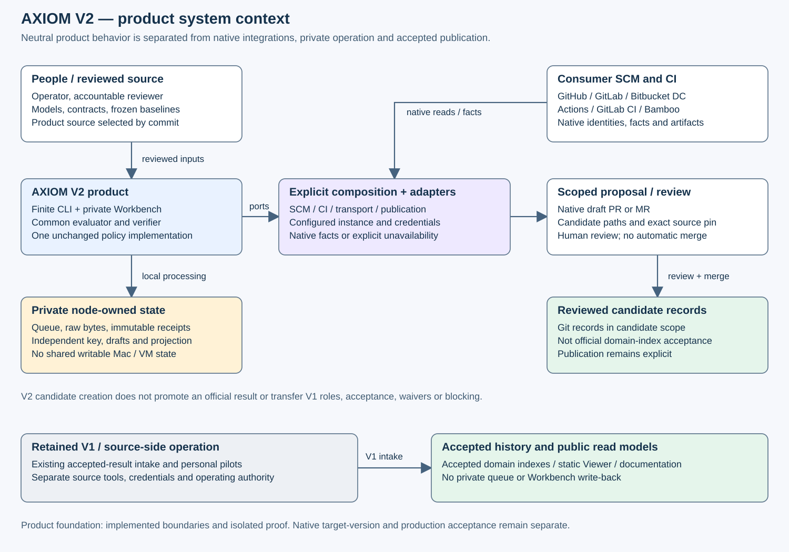
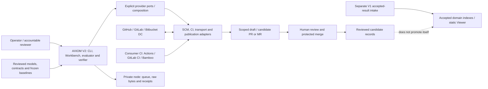
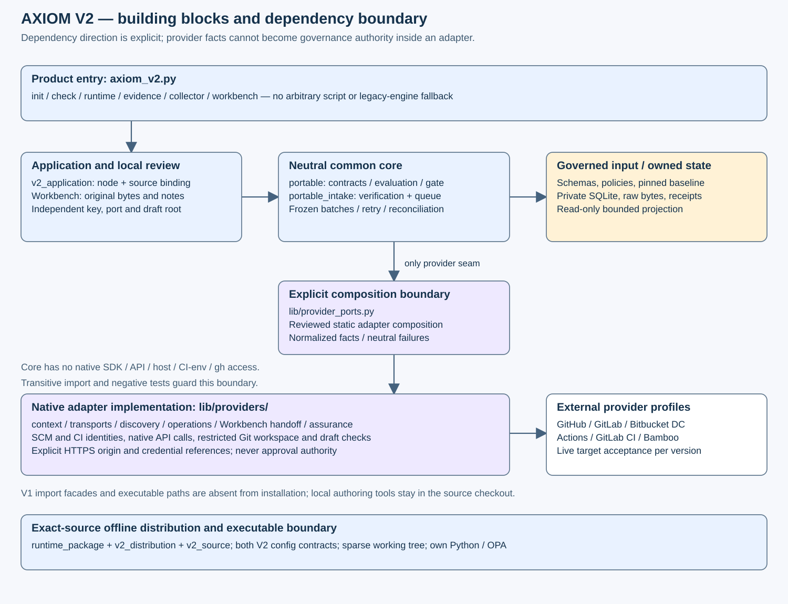
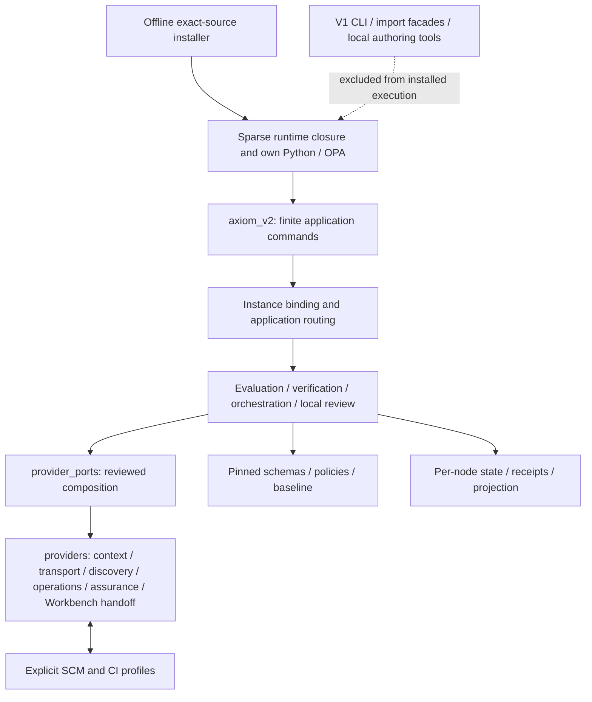
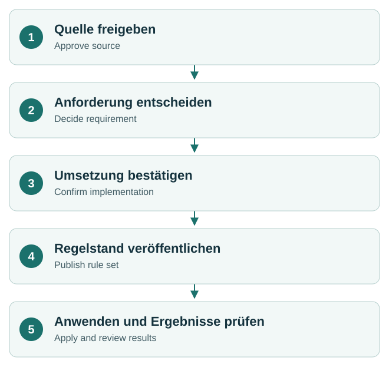
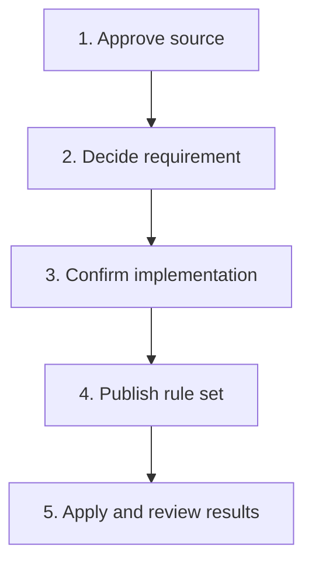
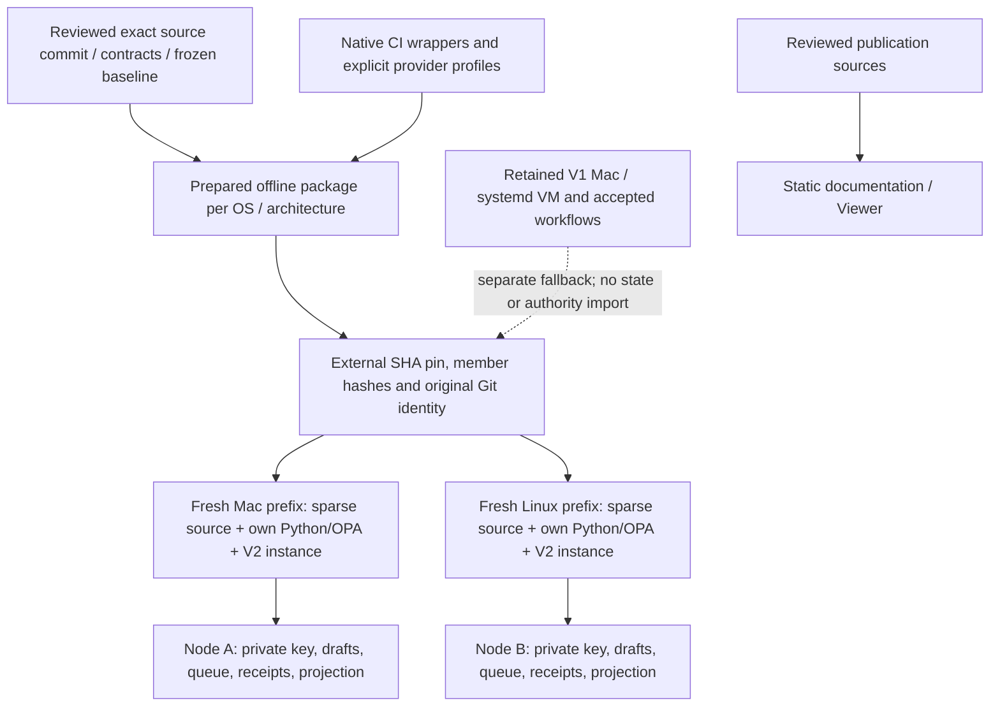

# Governance-as-Code System Architecture

## Document Status

| Attribute | Value |
|---|---|
| Document type | Current-state system architecture, organized with arc42 |
| Status | V2 product-development architecture; implemented candidate, retained V1 operation and future product decisions are distinguished |
| Effective date | 2026-07-17; original document identity retained |
| Last implementation review | 2026-11-19; published parity stack through draft PR #427 (`59c3112`), followed by the complete native compliance application described below. Exact source and validation bindings remain in PR receipts and `config/axiom-v2-functional-parity.json` |
| Operating observation | Installed Mac `73b93bb`: complete fixed ha-CPsWMS report equality, complete integration/onboarding equality and complete own controller exit 0 with 2,509 tests (one known skip). The earlier `735e241` controller exit 2 remains failed. Scoped `0f43709` Workbench proof retains 63 cases per host and fixed-report equality on Mac/target VM. New target-VM delivery is deferred by the maintainer; historical broader proof, V1 activation and full V2 systemd/update/recovery acceptance remain separate |
| Requirement journey explanation | `GCR-2026-161`; existing five-phase reading guide retained |
| Owner | Governance Platform Maintainers |
| Change request | `GCR-2026-035`; prior refreshes `GCR-2026-058`, `GCR-2026-078`, `GCR-2026-154`, `GCR-2026-161`; arc42 reconciliation `GCR-2026-183`; V2 product foundation `GCR-2026-185` |
| Governance / released baseline effect | None; documentation-only, no new requirement or runtime decision |
| Source Document Intake | Not required; no new governance source |

This page uses the twelve-part [arc42 structure](https://arc42.org/overview/)
to explain this repository. The text and diagrams describe its implementation;
existing section anchors remain usable. Operating procedures and detailed
engineering evidence are linked to their maintained guides. The
[platform state](../../operations/status/current-governance-platform-state.md)
is the entry point for later dated observations.

**Read the three states separately:** implemented source, locally/isolated
verified behavior, and actually activated operation. A merged adapter is not a
live provider acceptance. A private candidate is not an accepted Git result.

## 1. Introduction and Goals

### Purpose

This is the central technical architecture description for **AXIOM V2 as the
foundation for product development**. It describes the executable V2 candidate,
its development environment and the retained V1 operating boundary within one
system context. Detailed implementation and installation guides support this
page; they are not competing architecture descriptions.

V2 connects reviewed governance models and baselines to one evaluator, evidence
verification, bounded collection and an authenticated local Review Workbench.
Native SCM/CI/transport/publication behavior is isolated behind explicit ports
and adapters. The broader repository also owns source-authoring tools, accepted
Git result history and static reporting; those are not all installed V2 commands.

This is an explanatory architecture document. It does not create policy,
approve a control, change an enforcement mode, or modify a released baseline.
Where it conflicts with an approved policy, directive, source document,
machine-readable model, schema, or released package, those authoritative
artifacts take precedence.

The document complements rather than replaces:

- `docs/foundation/04_REFERENCE_ARCHITECTURE.md` for the target layer model
- `docs/governance/architecture/ado-devsecops-integrated-governance-model.md`
  for the organisation and decision operating model
- `docs/governance/architecture/runtime-governance-addendum.md` for runtime
  architecture governance concepts
- `docs/operations/status/current-governance-platform-state.md` for current
  operational status

### Stakeholders and top quality goals

| Stakeholder | Architectural need |
|---|---|
| Maintainer and accountable reviewer | Traceable changes, exact source/version binding and explicit authority |
| Consumer team | Reusable checks, clear evidence contracts, actionable findings and independent release decisions |
| Operator | Reproducible installation, isolated credentials/state and recoverable updates |
| Auditor / governance owner | Source lineage, immutable history, bounded Trust and reproducible projections |

The top technical goals are traceability, integrity, reproducibility,
recoverability and provider/host portability. Section 10 makes them concrete
using existing tests and observations; it adds no normative control.

### Architecture Drivers

The implementation follows these repository guardrails:

1. Governance intent, executable controls, runtime evidence, and intelligence
   projections are separate concerns.
2. Human accountability remains explicit; automation produces evidence and
   recommendations, not unreviewed governance authority.
3. Released baselines are immutable snapshots and consumer repositories pin a
   release tag or commit SHA rather than depending on mutable `main`.
4. Evidence is evaluated independently from the governance outcome it reports.
5. Historical result snapshots are append-only; conflicting writes are visible
   and quarantined.
   A legacy identity that lacks only `artifact_digest` can be matched to an
   otherwise identical enriched identity without rewriting history; two
   different present artifact digests remain a conflict.
6. Generated reports, indexes, graph data, and the viewer are projections. They
   do not become new sources of truth.
7. Report-only and blocking behavior are explicit configuration choices.
8. Platform-specific adapters surround a model- and schema-based governance
   core.

### Product development baseline

The maintainer designated V2 as the product-development foundation on
15 November 2026. The implemented separation and its reproducible candidate are
the starting point for subsequent changes. This designation is an engineering
direction, not general availability, a new governance baseline or production
operating acceptance.

| Product concern | Implemented starting point | Development boundary |
|---|---|---|
| Product interface | Finite `axiom_v2.py` CLI and private Workbench | A public multi-user/API service is a separate design decision |
| Common behavior | One evaluator/verifier and source-bound schemas/policies | A new provider must not introduce a second policy implementation |
| Integration | Explicit provider ports, native adapters and reviewed profiles | Missing capabilities remain missing/error/unsupported, never an inferred pass |
| Distribution | Exact-source offline package, private fresh prefix and own tools | Product release/signing/support and long-lived service lifecycle need explicit decisions |
| State ownership | Independent node, credentials, key, queue and projection | No shared writable Mac/VM database or inherited publisher authority |
| Scope | Complete frozen V1 parity matrix, first full diagnostic and candidate authoring routes | Remaining capabilities and installed proof remain open; see [functional parity](../../operations/planning/axiom-v2-functional-parity.md) |

Product expansion should use these boundaries and the evidence/decision table
in section 11. Existing approved policies and source registers still own
normative intent.

## 2. Architecture Constraints

| Constraint | Source and implementation consequence |
|---|---|
| Preserve approved and released identities | [Agent rules](https://github.com/joku-dev/devsecops-governance-framework/blob/adc4643bb7a5c962e4efb1525298ad9e652c73d2/AGENTS.md), release packages/checksums and the 24-file operating-acceptance manifest; use additive successors where required |
| Human decisions stay explicit | Source/requirement approval, role authority, release, waiver and blocking remain separate governed operations |
| Separate version axes | Product `2.0.0-candidate`, portable contract/runtime `1.0.0`, baseline `l1-baseline-v1.1.3`, exact source commit and tool hashes have distinct meanings |
| Existing consumer scope remains | ha-CPsWMS retains its recorded legacy blocking risk; new pilots explicitly select report-only |
| Portable evaluator has bounded scope | Five mapped pipeline-L1 controls; eleven L1 controls remain `not_evaluated`; no full-baseline claim |
| Protect private state | Workbench uploads/keys, collector raw data/SQLite and provider credentials remain outside public projections |
| Closed V2 execution surface | `config/axiom-v2-distribution.json` selects installed code/data; V1 scripts/facades are absent from the installed working tree |
| Explicit adapter composition | `lib/provider_ports.py` composes reviewed implementations; no downloaded/discovered runtime plugins or implicit CLI authentication |
| Separate technical description from normative architecture governance | Product architecture documentation changes no architecture marker, gate, source decision or released baseline |

Foundation direction and the [reference layer model](../../foundation/04_REFERENCE_ARCHITECTURE.md)
provide strategic guardrails. Existing approved sources and versioned decisions
remain authoritative for their respective subjects.

## 3. Context and Scope

### Scope

In scope:

- the central `devsecops-governance-framework` repository
- authenticated local document intake and requirement-review preparation
- hybrid external/Git requirement authority, canonical revisions and artifact mappings
- multiple application and service repositories consuming released baselines
- DevSecOps and architecture runtime evaluation
- V2 collector, evidence, Trust, replay and failure handling; retained accepted-ledger workflows are explicitly separate
- result indexes, portfolio reporting, governance graph, and static viewer
- governance change control, releases, validation, and agent review routing

Out of scope:

- deployment architecture of consumer applications
- a centrally hosted multi-user governance API, database, or event broker
- Kubernetes as the current runtime platform
- automatic approval by an AI agent
- enterprise-wide approval workflows outside this repository

### System Context





SCM and CI are independent axes. Implemented adapter profiles cover
GitHub/Actions, GitLab/GitLab CI and Bitbucket Data Center/Bamboo; this is not a
blanket certification of unspecified editions or target versions. The
[support matrix](../../operations/planning/platform-portability-acceptance.md)
retains native target acceptance limits.

V2 proposes independently verified candidates. A merged candidate is a reviewed
Git record in its own scope; it does not become an accepted DevSecOps/architecture
domain-index result automatically. Retained accepted-result publishers and
personal lifecycle workflows belong to V1/source-side operation, not hidden V2
execution routes. Public views remain read-only projections of their stated scope.

## 4. Solution Strategy

### Four-Layer Architecture

| Layer | Responsibility | Main implementation |
|---|---|---|
| Governance Intent | Explain authority, direction, roles, lifecycle, and source lineage | `docs/foundation/`, `docs/governance/`, `model/documents/`, `governance/` |
| Governance Model | Express controls, mappings, evidence types, architecture guardrails, schemas, and policies | `model/`, `architecture/`, `schemas/`, `policies/opa/` |
| Governance Runtime | Execute shared V2 checks/verification and bounded collection; development tools separately validate/publish reviewed source | V2 launcher, neutral libraries, explicit provider ports/adapters; native CI wrappers remain adapters |
| Governance Intelligence | Project history into indexes, reports, portfolio status, graph, and viewer | `status/`, `generated/reports/`, `generated/graph/`, `generated/viewer/` |

Dependencies flow down through controlled contracts. Runtime and intelligence
feed evidence back upward for review, but they do not silently rewrite intent
or released models.

### Shared evaluation with explicit provider boundaries

The same Python/OPA evaluator serves CI, local use and collector verification.
The neutral core consumes normalized context and evidence; only the composition
module and provider adapters select native implementations. Discovery/evaluation
never implicitly dispatches another provider job. Repository/execution identities
are namespaced by provider and instance; display names are not identities.

### V2 product boundaries

The executable boundary is defined by two reviewed source contracts:

- `config/axiom-v2-boundaries.json` names neutral roots, composition, adapters,
  browser modules and source-only compatibility facades. The architecture checker
  follows local imports transitively and rejects native SDK/HTTP/CLI/host/env and
  legacy-client access in the neutral closure.
- `config/axiom-v2-distribution.json` selects the installed code/data. Sparse
  admission removes V1-only executable paths physically, while preserving the
  original Git commit/tree. The finite launcher never falls back to a script
  name, old engine or old migration command.

Provider transport/identity failures use neutral error contracts. An adapter
must return facts or explicit unavailability; it must not decide governance
approval. Port composition is static reviewed code. Profiles select supported
provider/instance/credential bindings, not executable plugins.

A new provider extension therefore changes the reviewed adapter/composition and
profile contracts, supplies native identity/permission/artifact/draft/error
fixtures, and proves parity through the common evaluator. Real version-specific
permission and mutation behavior still needs native target acceptance. Public
API compatibility and a third-party plugin marketplace are not implemented V2
extension promises.

The frozen baseline is selected independently of the runtime source digest.
The current portable result assesses five pipeline-L1 controls; execution,
outcome, Trust and requested/observed enforcement remain separate. Existing
released consumer wrappers keep their original pins and authority.

## 5. Building Block View

### Logical Components

| Component / scope | Responsibility | Current implementation |
|---|---|---|
| V2 product entry / instance | Finite commands; fresh node/key/state; exact source/tool/dependency binding | `scripts/axiom_v2.py`, `scripts/lib/v2_application.py` |
| Neutral evaluation | Context/input contracts, physical evidence preparation, unchanged OPA decisions and gate | `scripts/governance_runtime.py`, `scripts/lib/portable/contracts.py`, `runtime.py`, `scripts/control_evaluation.py` |
| Source-only collection | Frozen local Git blobs at an exact revision; native CI-layout observations through ports; unverified declaration inputs | `scripts/lib/source_collection.py`, `controls_collection.py`, `architecture_collection.py`, `providers/source_inspection.py` |
| Full diagnostic assessment | All 46 V1 control report records and four architecture gates; explicit frozen inputs/pinned OPA; private unverified report-only receipts | `scripts/lib/full_evaluation.py`, `architecture_assessment.py`, `tool_integrity.py` |
| Candidate data authoring | Finite requirement/DCR routes, explicit workspace context, lock/staging/generation transactions; no inherited authority | `scripts/lib/candidate_workspace.py`, `requirement_application.py`, `requirement_workspace.py`, `dcr_application.py`, `dcr_*.py` |
| Full measured evidence | One neutral sixteen-control function; explicit native run/artifact/raw-byte normalization and bounded credential-free ZIP range transport; private unverified wrapper | `scripts/lib/measurement_logic.py`, `measured_application.py`, `providers/measured_*.py` |
| Measured supplements | Explicit-context per-control assurance, staging bundle/approval consistency and exact run/attempt/commit consolidation; source-bound private replay with no authority transfer | `scripts/lib/supplement_application.py`, `assurance_projection.py`, `evidence_freshness.py`, `staging_projection.py`, `consolidated_projection.py` |
| Complete typed image verification | Stream-hash archived configurations/layers; original typed Trust and replay rules; explicit native full-archive reader; separate private operator/native ledger histories and paged index | `scripts/lib/evidence_verification.py`, `artifact_integrity.py`, `typed_evidence_application.py`, `typed_result_ledger.py`, `providers/typed_*.py` |
| General result candidates and indices | Explicit metadata and bounded immutable raw copies; source/node/runtime-bound replay, atomic scoped ledger and complete reported/effective index projections; no public status writes | `scripts/lib/ci_bundle_results.py`, `ci_bundle_storage.py`, `result_assessments.py`, `result_snapshot_store.py`, `results_projection.py`, `result_index_application.py`, `result_application.py`; native event identifiers in `providers/result_profiles.py` |
| Native general result reader | Explicit repository/credential/run/attempt; bounded original ZIPs, attempt-specific jobs, artifact/run rechecks and nullable branch-protection facts; complete V1 wire mappings and private source-bound replay/intake | Neutral `scripts/lib/native_result_logic.py`, `native_result_assessments.py`; native transport and normalization in `providers/general_results.py`, composed by `providers/general_result_ports.py` |
| Committed-data reporting | Exact Git data snapshots and complete committed membership; control coverage, three traceability CSVs, graph, source lineage and change impact; explicit clock, private immutable outputs and full recomputation | `scripts/lib/report_sources.py`, `report_data.py`, `control_reporting.py`, `report_graph.py`, `report_lineage.py`, `report_impact.py`, `report_outputs.py`, `report_application.py` |
| Source-intake reporting | Existing advisory replacement assessment, intake status, human briefs, explicit identifier deltas and process/lifecycle status; direct pure dependencies, preserved candidate/provenance blockers and no source decisions. Process status retains its original committed-input report profile | `scripts/lib/report_source_replacement.py`, `report_source_intake.py`, `report_source_briefs.py`, `report_requirement_delta.py`, `report_source_process.py` |
| Model reporting | Automation, document/control authority, open model gaps and pipeline placement reports; explicit same-control placement values fill absent classification fields in the read-only view, without changing models or enforcement | `scripts/lib/report_model_followup.py` |
| Domain and combined reporting | Separate original release-readiness gate; original JSON/Markdown files from immutable operator assessment IDs; same product, tool, clock and declared target labels required for combinations; private unverified diagnostic envelope | `scripts/lib/release_assessment.py`, `domain_reporting.py`, `combined_reporting.py` |
| Candidate and historical health reporting | Existing non-normative maturity mapping, explicit-window historical intake metrics and replay interpretation; exact committed membership, original lifecycle and Trust boundaries; no accepted status write | `scripts/lib/report_candidate_maturity.py`, `report_intake_health.py`, `report_replay_triage.py`, `collection_attempts.py` |
| Portfolio reporting | Original registry/index projection with explicit assessment time and committed previous projection; stable timestamps for unchanged rows; informational adoption labels without transferred acceptance | `scripts/lib/report_portfolio.py` |
| Blocking decision aids | Original read-only criteria and time-bounded mode/risk interpretation; bounded committed conflict membership; alignment consumes committed raw readiness, not a fresh private report; inner approval/activation fields grant no node authority | `scripts/lib/report_blocking_readiness.py`, `report_blocking_alignment.py`, `report_outputs.py` |
| Declared agent/evidence associations | Original record/index/check semantics in isolated private immutable workspace generations; bounded retained source JSON and logical labels; append-only conflict handling; stale index visibility; no verified agency, human approval or subject authenticity | `scripts/lib/evidence_agent_provenance.py`, `provenance_application.py`, `candidate_workspace.py` |
| Local Git-bound review planning | Bounded read-only local HEAD/base/merge-base/index/worktree and role/skill/routing capture for native SHA-1/SHA-256 objects. An explicit adapter resolves named bases; admission checks resolution again, then retains a frozen exact base as in V1. Later checks use that commit and recheck source/index/contracts. `check-file` accepts bounded external plan/results bytes without a node plan ID, rederives the whole plan from actual current contracts and Git and retains a version-2 assessment with explicit external origin and no parent. Original version-1 prepare/check records keep their format. Replay does not consult live Git or caller files. Every retained commit and index object must match HEAD's object format. Strict execution protocol and authority checks remain; no model execution or approval | `scripts/lib/review_planning.py`, `review_git.py`, `review_planning_application.py`; `providers/review_planning.py` through ports |
| Ordinary dispatch and recording | Original role selection and JSON/text, recording windows, continuous state, counters and summaries. Explicit paths need no Git; working selection uses bounded Git observations and minimal inert role/skill/routing contracts. Private workspace generations preserve complete before/after bytes. No provider/model starts | `scripts/lib/review_dispatch.py`, `review_dispatch_application.py`; `providers/review_dispatch.py` through ports |
| Technical parity subject evidence | Strict declared metadata from a packaged configuration directory or explicit operator directory, bounded held reads and exact matrix/receipt/source/runtime bindings. The published `ab0c7cb` F8 checkpoint has nine receipts for three audited intake entrypoints, bound to actually executed source `8dc38fa` and renewed local/CI/installed proof. The following runtime change returns those three states to in-progress pending fresh proof; all 18 old/F8 files remain historical. Later trees are not relabelled as earlier execution. All other entrypoints/CI/operating flows remain open. No invalid-evidence fallback, raw private artifacts, native execution, automatic state promotion or authority | `functional_parity.py`; closed `axiom-v2-parity-receipt.schema.json`; matrix metadata remains outside runtime digest |
| Intake telemetry and retry preparation | First-identity append-only attempts/events, exact native retry JSON/output appends and report-only declarations. Explicit HTTPS metadata/environment/routes adapter; actual client observations, initial and selected-conflict successor inputs, private shared immutable content, pre-effect intent and retained offline reconstruction. Native attempt clock after metadata resolution, event completion before ledger scan, separate assessment-start time. Per-bucket coordination; no global conflict enumeration, automatic retry, workflow dispatch, accepted-index update or native outcome authentication | `intake_recording.py`, `intake_record_files.py`, `intake_recording_application.py`; `providers/intake_recording.py` through ports; closed private schema |
| Product runtime self-validation | Separate committed-product and explicitly selected exact-base Working-Tree data profiles. Held bounded current-file acquisition and original policy-rule existence facts; all nine original functions and three trusted in-process generators. Current Rego first passes bounded native parse and an offline compiler-schema metadata guard, then four finite pinned-OPA queries with fingerprinted offline capabilities, no ambient credentials/runtime introspection or file-resolving schema builtins. Python schema references resolve offline. Pre-execution private journal and ordered parse/eval replay from retained bytes after caller deletion; no invented eval process, supplied Python/shell execution or inherited authority. Explicit guard/compatibility limits and actual native diagnostic contexts remain visible. Full repository/bootstrap/test orchestration remains unfinished | `runtime_validation.py`, `validation_files.py`, `validation_operations.py`, `validation_queries.py`, `validation_sources.py`, `validation_replay.py`, `validation_application.py`; `providers/validation_tools.py`, `providers/validation_worktree.py` through ports; `config/axiom-v2-validation-capabilities.json` |
| Private release-integrity verification | All ten original release decisions through explicit bounded Git/SSH ports. Held current-data acquisition and complete original matching refs, both Git formats, nested/lightweight/chained targets and raw object identity checks. Private isolated Git objects and temporary verification inputs, intent plus per-process start journals, re-acquisition before admission and declared offline reconstruction after caller deletion. Missing/unverified tags remain report-only; incomplete operations require review. SSH-native environment profile and input/resource/diagnostic limits are explicit. Whole repository/bootstrap/test orchestration remains unfinished | `release_verification.py`, `release_reference_facts.py`, `release_inputs.py`, `release_requests.py`, `release_replay.py`, `release_validation_application.py`; `providers/release_references.py`, `providers/release_verification.py` through ports |
| Owned native process cleanup | Shared bounded POSIX group signalling/waits; confirmed absence cached against repeated signals. macOS-only denied-signal fallback requires strict read-only native process-table evidence of absence or exclusively defunct members; Linux, live/unknown groups and observation failure remain errors. Paired cleanup facts are retained and checked offline; no raw process table or authority transfer | Explicit `providers/process_groups.py` through review/crypto ports; optional paired fields in execution/attestation schemas |
| Local attestation pilot | Original ordered root/signature/subject/context decisions over retained operator bytes; compatible bounded native crypto port with actual tool path/hash/process/streams. Default context/subject are statement declarations; explicit expected inputs are supported. New or existing external output file, before/after journal and no automatic pending retries. Offline replay rederives reports without rerunning crypto or checking caller state. Legacy level labels remain declarations; no registry activation, key-algorithm/date enforcement or effective Trust promotion | `attestation_assessment.py`, `attestation_application.py`, `attestation_files.py`; `providers/attestation_verification.py` through ports; closed private schema |
| Optional review execution | Actual clean full-branch/base/source/index/contract checks; default native private task preparation in a fresh operator directory. Explicit execute-only provider port, forbidden in CI; bounded specialist pool followed by Steward only after specialist completion. Separate durable intent/start journal, no automatic retries/resume, original results/traces and exits, private raw capture and offline control-output reconstruction. Partial failures remain partial. Process starts are observations; requested/observed model fields and responses are unauthenticated and grant no approval | Neutral `review_execution.py`, `review_execution_application.py`; explicit `providers/review_execution.py` through ports; closed execution assessment schema |
| Explicit native dispatch files | Separate caller checkout and explicit file profile; durable frozen intent precedes log-first/state-second writes under shared file locks and before/after checks. Files replace atomically individually; the pair is not a transaction. Pending intent resumes without duplicate append; completed intent only verifies outputs. Explicit abandonment preserves history without rollback or success. One operating owner per shared file set; no distributed lease or transferred authority | `scripts/lib/review_dispatch_external.py`, `providers/review_dispatch_files.py`, `schemas/axiom-v2-review-dispatch-external.schema.json` |
| Explicit review receipt export | Actual local Git clean/full-branch/base checks around an explicit external allowlisted receipt write and optional locked JSONL append. Retained before/after bytes preserve original first-file/time/idempotence semantics; offline replay rederives complete output without claiming current target/file checks. No private-review publication, execution authentication or approval | `scripts/lib/review_receipts.py`, `review_receipt_files.py`, `review_receipts_application.py`; reuses Git/planning ports |
| Committed PR review scope | Actual pinned local target/head/merge-base, changed paths and regular role/skill/routing blobs at both commits; target/proposed role and validation union, with original complete private JSON/Markdown status wires. Dirty worktree/unrelated current HEAD are outside this committed scope. Original observation needs no execution protocol; execution/approval authority remains separate. Offline replay checks retained observations, without current platform identity/freshness | `scripts/lib/review_committed.py`, `review_pr_application.py`; finite layout/event adapters through `provider_ports.py` |
| Declared review metadata | Original receipt validation/block parsing, new-format usage counters and status logic over explicit operator-declared target/proposed scope; retained complete input/output recomputation, no current Git-scope check, private-review authentication or review/model execution. Native platform identity/freshness remain unverified | `scripts/lib/review_metadata.py`, `review_metadata_application.py`; finite event envelope in `providers/review_metadata.py` through `provider_ports.py` |
| Declared agent-selection statistics | Original JSON/Markdown counters over a retained bounded operator JSONL log or exact committed legacy Git blob; explicit source label, full clock and requested/effective latest count; immutable recomputation without actual agent/model invocation or approval inference | `scripts/lib/agent_usage.py`, `agent_usage_application.py` |
| Offline review quality | Original synthetic packet/schema/manifest preparation and structured-label grading; exact committed role/skill program data, explicit operator datasets/responses and bounded attached trace bytes; complete private replay, with supplied trace metrics and no inferred model execution or approval | `scripts/lib/review_quality.py`, `review_quality_application.py` |
| Local vulnerability collection | Original scan normalization and local trust report from retained bounded scan/subject/declared metadata bytes and explicit time; private replay, no scanner execution or native source authentication | `scripts/lib/vulnerability_evidence.py`, `vulnerability_application.py` |
| Declared pipeline evidence | Explicit legacy environment-view adapter, original context/evidence/gate wires, bounded retained artifact/SBOM/scan/signature bytes and complete offline recomputation; success/gate/waiver labels remain declarations, without execution, protection, signature or approval verification | Neutral `scripts/lib/pipeline_evidence.py`, `pipeline_application.py`; native fields in `providers/pipeline_environment.py` through `provider_ports.py` |
| Consumer source inspection | Original integration and onboarding source-signature criteria; version-2 private assessments bind the initially observed finite CI-path sequence from the retained Git snapshot for legacy replay, while `canonical-ci-signatures-v2` orders CI paths before evaluation for portable wire order and replay; retained exact Git commit/tree/blob/mode proof and SHA-256 manifest; source identity remains unverified and no inspected code runs | `scripts/lib/source_inspection_application.py`, `source_snapshot_proof.py`, `onboarding_readiness.py`, `providers/source_inspection.py` |
| Local source observation | Explicit `legacy-worktree-signatures-v1` mode observes native directory order, dirty/untracked or non-Git data through a bounded inert-data adapter. Separate closed private assessments bind ordered metadata and content-addressed relevant text blobs, then rederive original JSON/Markdown offline. Two bounded reads detect intervening changes; this is not an atomic filesystem snapshot or a Git/SCM identity proof. Reports remain unverified, report-only and without approval authority | `scripts/lib/local_source_application.py`, `providers/local_source_observation.py`, `onboarding_readiness.py`, `schemas/axiom-v2-local-source-inspection.schema.json` |
| Explicit configuration reporting | Original central-intake readiness from committed raw dependencies and normalized literal-signature observations; provider/profile choice explicit; native filenames, expressions and profile factory belong to adapter; no effective/live configuration attestation | `scripts/lib/report_multi_consumer.py`, `report_application.py`, `provider_ports.py`, `providers/source_inspection.py` |
| Neutral verification | Bundle integrity, source/config/run binding, freshness/replay, immutable receipts | `scripts/intake_portable_evidence.py`, `scripts/lib/portable_intake/bundle.py`, `schemas/portable-intake-*-v2.schema.json` |
| Collection / proposal coordination | Bounded poll/work, frozen batches, retries, independent candidate reconciliation | `scripts/portable_consumer_intake.py`, `scripts/lib/portable_intake/controller.py`, `publisher.py`, `candidate_index.py` |
| Operational persistence | Node-owned SQLite transactions, receipts, raw bytes, backups and inactive restore candidate | `scripts/lib/portable_intake/store.py`, `scripts/lib/consumer_intake_store.py` |
| Private Workbench | Registered-source/candidate preparation, original bytes, append-only notes, rule-impact hints and scoped handoff | `scripts/serve_governance_workbench.py`, `scripts/workbench/`, `scripts/lib/workbench_impact.py` |
| Provider composition | Shared read/proposal/execution contracts and explicit adapter selection | `scripts/lib/provider_ports.py` |
| Native adapters | Context/facts, HTTPS transport, discovery, SCM/Git proposals, draft verification and provider assurance | `scripts/lib/providers/context.py`, `transports.py`, `discovery.py`, `operations.py`, `workbench.py`, `assurance.py`, `github_security.py`, `legacy_interop.py` |
| Shared integrity helpers | Neutral failure/retry types, private-file and archive checks, Trust and dependency hashes | `scripts/lib/provider_errors.py`, `private_credentials.py`, `safe_archive.py`, `evidence_trust.py`, `v2_source.py` |
| Product distribution | Externally pinned archive admission, offline environment, sparse execution closure, private fresh prefix | `scripts/install_axiom_v2.py`, `scripts/lib/v2_distribution.py`, `runtime_package.py` |
| Architecture regression check | Enforce neutral import closure and explicit provider boundary | `scripts/lib/v2_boundary.py`, `scripts/validate_axiom_v2.py`, both V2 config contracts |
| Shared governed data | Reviewed controls, mappings, evidence schemas, policies and frozen baselines | `model/`, `architecture/`, `schemas/`, `policies/opa/`, `releases/` |
| Source-authoring / release tools | Source approval, requirement authority, model changes, release creation, graph/report/Viewer generation and agent reviews | Development checkout: `scripts/`, `.agents/`, `.codex/`, `docs/`, native workflow adapters; only the explicit runtime closure is installed as executable V2 code |
| Retained accepted-result / pilot operation | Existing immutable domain results, approved intake/publishers and personally accepted lifecycle scope | V1/source-side workflows, `scripts/lib/result_ledger.py`, `scripts/lib/governance_lifecycle/`, `status/`; no transferred V2 operating authority |
| Retained V1 deployment | Existing Ansible/systemd installation, state-preserving update and explicit legacy/portable migration | `infra/ansible/`, `scripts/deploy_vm.py`, `scripts/lib/vm_deployment.py`; separate from the fresh-prefix V2 installer |





The four former portable import locations are V1 **source-test aliases**, not
runtime modules: `lib/portable/adapters.py` and
`lib/portable_intake/{assurance,operations,transport}.py`. Actual native behavior
is under `lib/providers/`; the aliases are not installed. Likewise, retained
`legacy_interop.py` checks old-state/ownership boundaries through the adapter;
it does not expose a V2 legacy-engine or migration command.

The [complete function inventory](../../operations/planning/axiom-v2-function-inventory.md)
maps all 22 catalogue areas and every Python/Shell/Node entrypoint to this scope.
A capability present in the development repository is not automatically an
installed or operating V2 feature.

### Local preparation, requirement authority and public projection

The [Review Workbench](../../operations/guides/governance-review-workbench.md)
is a loopback HTTP service, separate from the static public Viewer. It reads
registered sources and stores private candidate drafts and append-only review
notes outside the tracked governance model. Markdown/DOCX and optional text-PDF
extraction use the shared explicit-declaration parser. A label such as
`DSCB-L1-REQ-001` identifies a declaration; prose and synthetic row identifiers
are excluded. Identifier origin remains a separate provenance assertion.

The guided intake prepares a candidate. Registered-source review prepares the
existing version and exact source bytes. Item review combines the original
locator and context with proposal-only confirmation, rejection or clarification
notes. A review ZIP can carry incomplete preparation and open questions to the
human review process. Retained lifecycle proposals and decisions are read-only
history, outside current extraction and note-progress counts.

Authentication, CSRF protection, source hashes, stale-draft and publication
guards constrain local writes. Threaded connection handling prevents idle browser
sockets from blocking the service; actual request handlers serialize session and
draft operations. This remains a local operational surface, with no hosted
enterprise identity or automatic governance approval.

The document-to-runtime journey is explained through five phases. The Workbench
prepares source and requirement reviews; formal decisions use the existing
versioned procedures. Native Git requirements enter phase 2 with a versioned
native source. Cases, catalogs, mappings and evidence records support these
phases rather than adding separate user steps.





Source approval precedes individual requirement decisions. An active requirement
needs a separately reviewed implementation and exact artifact mapping. A release
decision publishes a baseline for consumers; evaluation then uses that selected
version and concrete evidence. Gate behavior follows its separately authorized
enforcement mode. A rejected proposal or unresolved conflict does not advance
automatically, and documentation-only work need not publish a new runtime baseline.

The Requirement Authority Ledger distinguishes external authority, migration
in progress and complete Git authority. Immutable canonical revisions carry
explicit decisions and authorized derivations. Activation does not approve an
OPA equivalence mapping, release or blocking mode. The
[document-to-OPA rulebook](document-intake-to-opa-rulebook.md) describes these
boundaries. The [dated reconciliation](../../operations/status/repository-documentation-reconciliation-2026-11-15.md)
records current implementation coverage without refreshing consumer evidence.

The current Workbench presents **Dokument wählen → Prüfen → Weitergeben**.
Its session scope can keep architecture topics parked. Exact requirement-to-artifact
bindings support review; they do not establish actual consumer rule application
or calculate a semantic change probability. Mac and VM have independent keys,
port-bound cookies and draft roots. The static Viewer reads only public projections.

### Sources of Truth and Read Models

| Information | Authoritative location | Derived projection |
|---|---|---|
| Governance authority and source status | approved documents and `model/documents/source-document-register.yaml` | source lineage and intake reports |
| Control and platform model | `model/controls/`, `model/platform/`, `model/traceability/` | coverage, automation, and traceability reports |
| Architecture governance model | `architecture/` | runtime governance reports and result indexes |
| Executable policy | `policies/opa/` | evaluation output and test results |
| Released baseline | versioned package under `releases/` plus checksums | release documentation |
| Downstream result history | append-only JSON snapshots under `status/` | latest indexes, portfolio report, graph, viewer |
| Intake conflict history | `status/intake-conflicts/` | viewer conflict summaries |
| Failed collection history | `status/collection-attempts/` | derived `open`, `resolved`, or `permanent` lifecycle |
| Intake operation history | `status/intake-events/` | Intake Health success-rate and latency projection |
| Consumer registry and isolated result paths | `status/application-repository-integrations.yaml`, result history under `status/` | portfolio and Multi-Consumer Readiness reports |
| Private preparation | Per-host Workbench drafts/notes and source-bound uploads | Review ZIP; no automatic source/requirement approval |
| Private collector operation | Per-node SQLite queue/cache/raw artifacts and immutable verification receipts | Bounded `consumers.json` / candidate views; no official latest-result promotion |
| Agent involvement | explicit records under `status/evidence-agent-provenance/` | provenance index and viewer |

The generated files are reproducible read models. A reader must follow their
source references when making an audit or governance decision.

### Two collector engines and their activation boundary

This heading retains its existing link anchor. It describes the **retained
V1 deployment**, whose legacy `consumer_intake.py` and portable successor had
separate engine/state/activation paths. That installed VM still selects the
legacy engine in the dated observation. Its migration and schema2-to-legacy
recovery procedures remain in the [V1 collector guide](../../operations/guides/portable-consumer-service.md).

V2 is a fresh product instance, not a third choice in that V1 engine switch.
Its launcher routes collection only through the common portable implementation.
It refuses initialization over existing roots and exposes neither old engine
selection nor legacy state migration. Default registries are empty and collection
is paused. Development instances additionally cannot collect or publish.

Shadow/publisher ownership checks, bounded frozen batches and lost/terminal
proposal reconciliation remain in the common coordinator. They are necessary
technical safeguards, not imported permission to operate an old route. A copied
database/node identifier does not transfer authority; a new V2 operating profile
must be reviewed and accepted for its own scope.

### Whole repository validation candidate

The development increment adds `validation repository`, `repository-inspect`
and `repository-status`. The neutral `repository_validation.py` retains the
whole original decision sequence; `repository_engine.py` composes the original
generator functions, subvalidators, snapshot families, closed schemas and
historical lifecycle readers over `RepositoryDataset`. Inspected programs are
inert captured bytes. Concrete legacy capture formats and finite native
Git/SSH/OPA/crypto implementations remain explicit provider adapters.

`repository_capture.py` closes either all committed Git blobs, including sparse
omissions, or held current working data at the exact product revision/tree.
`repository_operation.py` defines node/runtime/source/profile/authority bindings.
The private operation store persists immutable content and a durable ordered
hash chain before acquisition and each native/effect operation. The registered
CLI is published as candidate `cc32bcb` in PR #417. Its complete local pinned
suite and nine CI families passed; fresh installations passed 19 Mac groups and
18 Linux groups. The additional Linux technical group exposed a Python 3.12
test-only AST quote comparison defect, corrected separately in PR #418. Fresh
complete installed proof for the follow-up source remains required.

The follow-up branch adds an explicitly selected bounded replay worker through
`repository-inspect --bounded-worker`. The neutral message contract admits one
retained operation and its exact node/runtime/source binding. The provider starts
a fixed isolated Python entrypoint, limits CPU and streams, monitors wall time
and RSS, and terminates its own process group on failure. Linux additionally
limits address space; polled RSS is not a kernel-enforced peak RSS guarantee.
The child replays closed evidence without invoking producer programs or native
verification ports. It preserves the complete existing inspection result and
adds a declared worker observation. Existing evidence and authority stay bound
to their original operation. Full creation/test worker orchestration remains
open. The worker source passed 2,381 pinned local tests with one known deployment
skip. It is published as `cff5fcc` in PR #419 with source-bound coordinator
reviews and seven successful CI families. Both exact-source test installations
completed their drivers successfully; Mac has a complete post-test package audit.
The Linux audit and final host comparison await renewed SSH access. The separate
hygiene implementation and its local validation are a later source scope.

### Local public-artifact hygiene component

The explicit `artifact-hygiene check` route uses `artifact_hygiene` for pure text
decisions and `artifact_hygiene_application` for the closed compatibility profile.
Only the local `providers/artifact_hygiene` adapter reads files, Office ZIP members
and the configured environment variable, through the composition port. Inputs
remain read-only and ephemeral; no product evidence or publication is implied.
The original complete output profile and additional acquisition/matching guards
are distinguished in the [guide](../../operations/guides/axiom-v2-artifact-hygiene.md).


### Retained portable candidate index

The `candidate-index` application captures candidate data through the explicit
`providers/candidate_index_source` port, then invokes the complete neutral
`portable_intake/candidate_index.build_from_documents` projection. Working-tree
acquisition and immutable Git-object acquisition are explicit choices. The
default reads the installed product's committed candidate data, including sparse
objects, without running producer code or contacting a CI provider.

Private input manifests and complete index bytes bind the node, runtime and
product revision. Inspection reprojects retained inputs after producer removal.
The closed assessment schema fixes candidate-only, unverified, report-only and
unpublished semantics. Explicit exports preserve before bytes and prepared/
completed file-effect records. They require a single destination owner; node
locking does not establish a distributed lease. See the
[candidate-index guide](../../operations/guides/axiom-v2-candidate-index.md).
Exact-source validation and installed host proofs remain separate delivery
steps. This component does not promote candidates into official latest indexes.

Shared report readers preserve the original UTF-8 text boundary before JSON or
YAML parsing, including filesystem and captured-memory generator data. Parser
byte-encoding autodetection must not admit source formats rejected by the
original readers. This boundary does not change source authority or result Trust.

## 6. Runtime View

### Candidate authoring transaction

`requirements` and `dcr` bind an explicit instance and named private workspace.
Committed document/model data seed the initial generation. A writer locks the
workspace, clones the current verified data generation into staging and runs one
reviewed capability with explicit paths. Success publishes a new content-bound
generation and atomically updates its pointer; failure leaves the previous
pointer and historical generations intact. Source CLI dispatch and mutable
process-global source roots are absent.

The wrapper always identifies candidate-only authority. Historical payload
approval fields and explicit candidate decision/activation commands confer no
new human or operating acceptance. DCR schema resources belong to the installed
product, while source bytes belong to the workspace. Candidate generations have
no reviewed Git commit; DCR-009 retains that missing freshness evidence. Supplied
semantic responses are normalized/validated without invoking a model; findings
remain unconfirmed or quarantined. DCR operating contracts, trigger scope and prepared synthetic catalogue packages
are explicit finite routes. A separate committed-source context verifies the
fixed product Git root and document/model/schema bytes, rechecking the same
revision across review operations; it records technical provenance only.
Hash-bound supplied decision assertions can prepare a private redacted snapshot;
reviewer identities are not authenticated and no public status is overwritten.
Full public handoff and installed parity acceptance remain open. This state is separate from the old accepted report-only
pilot and its fingerprinted files.


### General result input and index boundary

The finite `results` command accepts explicit declared metadata and bounded local
CI bundles or manual summaries. It copies regular input bytes into a private
content-addressed pool before normalization. A ZIP is retained and re-extracted
on inspection; directory input uses its exact retained file inventory. Assessment
IDs bind the node, runtime, source revision, explicit diagnostic time and input
hashes. Re-sealing an altered outcome does not bypass reconstruction from sources.

A separate SQLite ledger partitions origin, provider/instance and native
repository ID. Display names and URLs remain descriptive versioned metadata;
rename does not rewrite old records. Original identity/replay rules preserve the
first compatible snapshot, quarantine changed target identities and retain
outcome-independent Trust. Indexed context/subject queries select the same V1
replay candidates without repeatedly scanning an entire portfolio. Failed
transactions roll back all their writes.

Index projection reads a stable database snapshot, verifies every original
assessment, and materializes normalized snapshots beneath a private projection
root. It retains the complete V1 index shape and an explicit effective view;
operator evidence remains unverified in the effective view. Classification uses
explicit branch/event profiles through the adapter boundary. Membership and
source-file hashes bind a projection generation, so later records cannot rewrite
its contents. Offline inspection does not refresh native API facts. Neither a
private snapshot nor an index projection overwrites accepted product status.
Full native general capture and reviewed public handoff remain open work.

### End-to-End Flow

#### 1. Governance Change and Baseline Publication

```text
classify artifact
      -> register/review source when required
      -> analyse impacted requirements and controls
      -> update models, schemas, policy and tests
      -> validate repository
      -> create explicit release candidate/release
      -> publish immutable package and checksums
```

A documentation-only explanation can stop after classification, GCR, review,
and validation. A behavior or contract change must update the corresponding
models, tests, documentation, and release decision.

#### 2. Consumer Evaluation

1. A consumer's native CI wrapper selects a reviewed V2 runtime source and
   baseline pin and supplies an explicit SCM/CI profile to the shared runtime.
2. Through the provider port, the adapter resolves the actual checkout, native
   source/target/tested revisions and available protection facts.
3. Physical artifact/SBOM/scan bindings and normalized inputs enter the one
   provider-free evaluator and pinned OPA implementation.
4. Runtime result, input/context, diagnostics and physical files are retained as
   CI artifacts under the evidence contract. Missing facts remain incomplete.
5. Completed report-only findings remain findings with a non-blocking gate;
   execution errors/incompleteness return exit 2. Synthetic proof cannot become
   a live blocking-success claim.
6. Collection and proposal creation are separate from that CI run. Evaluation
   does not dispatch native CI or promote a result to official accepted indexes.

Existing released V1 DevSecOps/architecture wrappers keep their own pinned
contracts. Reusing their authority or full-L1 scope is not part of a V2 runtime
version change.

#### 3. Central Intake and Trust Evaluation

```text
explicit reviewed profile + producer locator
   -> native discovery/download through provider ports and adapters
   -> bind physical artifact, native run/job/attempt/configuration and revision
   -> common integrity, OPA recomputation, Trust/freshness/replay verification
   -> immutable receipt and private queue state, or explicit hold/quarantine
   -> bounded node-owned projection / frozen candidate batch
   -> adapter reconciles or proposes a scoped PR/MR when separately enabled
   -> human review and protected merge record a candidate
   -> no automatic promotion to accepted domain indexes
```

The queue namespaces source and execution identities by provider and instance.
A stored batch freezes base/source/paths and reconciles prior native replies;
a lost mutation response does not authorize duplicate publication. Reads,
proposal writes and optional dispatch have distinct explicit credentials and
budgets. V2 does not run the old GitHub-only intake/publisher scripts.

The existing `repository_dispatch`/manual GitHub accepted-result flow remains
V1/source-side operation. It independently verifies artifacts, appends or
quarantines snapshots and publishes allowlisted Git updates for review. Its
accepted indexes do not become the V2 queue or change on candidate creation.

#### 4. Failed Collection and Retry

V2 preserves the failure/hold in private operational state with bounded retries,
request/storage budgets and replay identity. Missing native proof cannot be
relabelled as successful intake. A projection summarizes the state and excludes
raw artifacts/credentials. Retained V1 append-only collection-attempt history
and its retry workflows keep their separate contract and historical records.

#### 5. Intelligence Projection

V2 exposes a bounded private consumer projection and local review preparation.
Official result indexes, portfolio, governance graph and static Viewer are
read models of their stated accepted/candidate sources. Their source-side
builders retain separate release/review authority. A newer candidate, pull-request
run or refreshed page does not silently replace accepted mainline history.

#### 6. Portable evaluation and verification

1. A reviewed consumer profile binds separate SCM/CI identities and exact
   baseline/runtime digests. The adapter checks the actual checkout against
   native source/target/tested revisions.
2. The application supplies real artifact, SBOM and scanner output. Runtime
   preparation checks physical digests and subject associations; it does not
   synthesize scanner success or fill missing producer proof.
3. The provider-free core evaluates normalized context/input with pinned OPA.
   A technical or incomplete result has exit 2; completed report-only findings
   remain findings even when the gate exits 0.
4. Native collection independently reacquires run/job/artifact/configuration
   metadata and invokes the common verifier. Original results keep their Trust;
   a separate immutable verification receipt records supported checks.
5. The private queue retains raw files, failures and replay identity. A candidate
   projection or PR/MR proposal remains distinct from accepted domain indexes.

#### 7. Exact-source update and failed activation

For V2 the operator admits an independently hash-pinned source archive into a
**new private prefix**. Admission verifies every member and reconstructs the
original Git commit/tree before execution. Offline environment preparation uses
both hash-locked dependency sets and the target's checksum-approved OPA. Sparse
selection then removes excluded executables, checks the import boundary and
retains a clean original source identity. Instance initialization records source,
runtime/active dependency and tool bindings and writes its admission marker last.

A failed/partial prefix is not an active instance and is not retried over old
state. Updates use another exact-source package/prefix and fresh instance; V2
exposes no automatic active-pointer/service takeover. Evidence restore stages a
separate inactive candidate. Recovery therefore retains the old installation
and compatible backups until a separately accepted cutover/state procedure.

For **retained V1 only**, the Ansible controller prepares a candidate while the
installed service remains available, checks engine/state compatibility, verifies
VM/controller backups, and restores a compatible executable on failed activation.
Its legacy/schema2 migration and service names are not the V2 installer. The
[V1 recovery runbook](../../operations/guides/portable-vm-update-and-recovery.md)
continues to own that path.

#### 8. Workbench review and explicit publication

The browser authenticates against its node's loopback Workbench. Source/candidate
preparation retains exact original bytes, source hashes and proposal-only notes.
A local ZIP needs no provider connection. Explicit publication requires a private
profile, independent reader/publisher credentials and the operator's confirmation.
Through the composition port, the adapter verifies native repository identity,
clone URL, clean source/base and candidate-only paths, then creates a native
draft proposal in a private Git workspace. The native response must confirm draft
state. Unknown write outcomes stop for reconciliation; neither the Workbench nor
an adapter merges or approves source/requirements. Browser links require the
returned explicit matching HTTPS instance, including for self-hosted providers.

The V2 Workbench application binds drafts and uploads to the explicit private
instance's `state/workbench`, with a process-owned lease covering the entire
server lifetime. Data acquisition and native Git identity are explicit local
ports; requirement extraction and process projection call neutral functions.
The old producer scripts are not installed as Workbench dependencies. The
existing complete HTTP/authentication, note/history, impact and packet flows
remain, including live observations of newly registered and missing sources.
Upload `source_path` metadata uses a documented logical private namespace.

A separate draft-only archive format retains exact JSON/upload bytes and pinned
source/runtime metadata. Verification does not create a workspace. Restore
requires an empty destination and explicit archive SHA; cross-source historical
imports need an explicit operator choice and preserve original context/stale
semantics. No executable, key, session, credential, publisher or operating
acceptance is copied. Native publication worktrees stay separate for manual
reconciliation. This is not a full installation backup or update takeover.
Current implementation and delivery evidence remain distinct; see the
[V2 Workbench guide](../../operations/guides/axiom-v2-workbench.md).

### Runtime Context and Latest-State Semantics

The system distinguishes mainline, pull-request, branch, and manual or
diagnostic runs. Historical records from every relevant context may remain
visible, while portfolio and management views must use accepted mainline,
release, or explicitly accepted manual evidence. A newer pull-request run must
not silently replace the accepted mainline state.

### Implemented closed-loop pilot

This section describes retained V1 operating authority, not an active V2 product feature.

The [manual GitHub GRS-002 pilot](../../operations/status/governance-lifecycle-current-state.md)
extends the as-built runtime with immutable evidence receipts, action-bound
personal consent, remediation progress, evidence-bound closure/reopening and
withdrawal handling. Versioned roles and operating values remain separate from
individual statements. Effective LD-07 acceptance binds implementation digests;
changed/withdrawn consent or a changed implementation prevents new valid operation.

The manual `lifecycle-pilot-update.yml` workflow captures acceptance, observations
or action statements, or refreshes projections. Its `lifecycle-pilot` publisher
scope creates PRs with independently checked provider proof. A separate
`status/governance-lifecycle-live.json` projection records official pilot state;
technical validation records and synthetic histories keep their original labels.
Actual #92/#93 workflow publications prove the acceptance/PASS path. No real
remediation or closure is claimed. Consumer indexes and the main status viewer
retain their existing scope; the separate scenario viewer remains synthetic.

There is no scheduled lifecycle daemon, automatic remediation executor, live-waiver
adapter, cross-consumer lifecycle portfolio or Bitbucket personal-consent adapter.
The [function catalog](../../operations/guides/repository-function-catalog.md) and
[technical inventory](../../operations/guides/repository-technical-function-inventory.md)
provide the complete implementation entrypoints.

### Whole repository operation and offline inspection

The explicit legacy profile selects existing provider-format interpretation,
schema identifiers and source configuration mapping. A private pending header
precedes source acquisition. Every Git acquisition call and every verification
intent, process start and raw completion is retained separately. The engine
records original generator clocks and ordered partial effects; it writes no
inspected checkout files. Completion binds the complete retained input/output
graph and native contexts.

Inspection first checks the current node/runtime/source binding and all stored
bytes. It replays the complete acquisition transcript, then the whole engine
against one ordered trace of native observations, clocks and generator effects.
The separate caller checkout and native capsule may already be absent. The
installed product remains necessary for runtime admission. No native verifier
is rerun during replay. An original child failure whose traceback semantics
cannot be preserved remains incomplete exit 2; it is never manufactured as a
completed original result.

Pending, recorded incomplete, recorded complete but unverified, and declared
replay-consistent operations are distinct. None transfers historical consent,
operating acceptance, independent execution authenticity or publication rights.
See the [candidate operating guide](../../operations/guides/axiom-v2-repository-validation.md).

## 7. Deployment View

### Runtime and Deployment View




| Execution surface | V2 deployment / state | Activation limit |
|---|---|---|
| Mac candidate | Fresh private prefix, own Python/OPA, independent node/key/state; loopback Workbench | Actual candidate tested on port 18875; test process stopped, no permanent V2 service installed |
| Ubuntu candidate | Same source contract, Linux OPA/wheels, independent prefix/node/key/state | Actual candidate tested on port 18876; test process stopped, no V1 unit/path replacement |
| Consumer CI | Native wrapper calls shared evaluation with pinned source/baseline and explicit profile | Native edition/version/permissions require their own acceptance |
| Development repository / CI | Source authoring, validation, releases and projections; native workflow adapters | Source-side tools and CI metadata are not arbitrary installed V2 commands |
| Retained V1 operation | Existing Mac Workbench and VM systemd/collector installations | VM observation remains `adc4643`, port 8766, legacy engine; no V2 authority inherited |
| Public documentation / Viewer | Static outputs from separately reviewed publication | No private keys, uploads, raw evidence, SQLite access or write-back API |

### V2 installation layout and ownership

| Location below a fresh prefix | Responsibility |
|---|---|
| `package/source/` | Original exact Git identity with reviewed sparse working-tree code/data |
| `venv/` | Own offline hash-locked Python dependencies and pinned OPA; no dependency on a V1 environment |
| `instance/instance.json` | Node/product/version, source/revision/runtime/active-dependency/tool binding and configured port |
| `instance/workbench-key.json`, `instance/credentials/` | Private independent key and explicitly referenced provider credentials |
| `instance/state/consumers/`, `instance/state/evidence/`, `instance/state/evidence-restore-candidate/` | Private queue, receipts/raw processing data and separately inactive restore slot |
| `instance/projection/` | Bounded redacted collector view for this instance |
| `instance/state/workbench/` | Private draft/upload/note state, bound to the instance; separate native publication recovery under `state/workbench-publications/` |
| `installation.json`, `axiom-v2` | Private install receipt and prefix-relative finite product launcher |

The installer creates no system service and starts collection paused. The private
Workbench binds loopback; the default V2 port is 8875, with distinct operator-
selected ports for parallel instances. A VM browser connection uses its own SSH
tunnel. Two nodes share executable contracts, not credentials, writable state,
sessions or publisher ownership. They are independent installations, not an HA
pair or automatic replication arrangement.

### Current Deployment Decision and Kubernetes

The product foundation is a direct local/Linux process with a reproducible
prefix, explicit adapter composition and embedded SQLite. This is the observed
candidate architecture, not a Docker/Kubernetes deployment or hosted control
plane. A long-lived service manager, container image, cluster topology, shared
authentication and external persistence remain explicit product decisions.

Future deployment must preserve exact source/tool/baseline identities, provider
boundaries, independent credentials/state, replay and human decision semantics.
Choose workers or external immutable storage only with representative volume,
quotas, retention and availability measurements. The [capacity profile](../../operations/guides/portable-capacity-profile.md)
provides engineering fixtures, not production sizing approval.

The [V2 installation guide](../../operations/planning/axiom-v2-decoupling.md)
owns package/admission commands and candidate update/recovery; the
[dated candidate record](../../operations/status/axiom-v2-candidate-readiness-2026-11-15.md)
binds the actual Mac/Linux test to `756a28e`. A later documentation commit does
not claim that newer full Git snapshot was already installed on either host.

### Dated host observation

This is the retained V1 alignment/replay observation; V2 proof is separately
linked above and does not replace these historical source/input bindings.

On 15 November 2026 the maintainer requested alignment and a private diagnostic
comparison. The Mac checkout and the active Proxmox VM both reached `adc4643`;
Workbench smoke checks passed. The VM update used the existing IaC path with
legacy engine preserved. No portable migration or publisher activation followed.
A later documentation merge does not automatically redeploy either host.

The same ha-CPsWMS commit `5c3b5cb` and eleven unchanged producer files from run
`36997125273`, attempt 1, dated 2 October were replayed on both hosts. Three
repository-integration checks and the same 16 applicable legacy L1 decisions
passed; 30 controls were not applicable. Host time/path/list-order fields differed,
while all business results matched. The portable preflight rejected the original
SBOM (`invalid_sbom`); it lacked `metadata.component`, and the scan also lacked
`artifact_sha256`. No portable evaluation, fresh application test/scan or official
intake was claimed. Private raw reports remain outside this public checkout.
The [dated platform state](../../operations/status/current-governance-platform-state.md)
records this observation independently of current consumer evidence.

## 8. Crosscutting Concepts

### Evidence and Trust Architecture

Governance outcome and Evidence Trust answer different questions:

- the outcome says whether the evaluated subject passed, failed, or produced
  report-only findings
- the Trust record says how strongly the collected bytes and their provenance
  have been verified

The current Trust ladder is:

| Level | Meaning |
|---|---|
| `unverified` | Evidence was captured, but integrity has not been established. |
| `integrity_verified` | A subject identity exists and the collected bytes match a verified digest. |
| `provenance_verified` | Integrity plus the required source, run, commit, artifact, freshness, replay, and custody checks are verified. |
| `attested` | A trusted issuer has cryptographically attested the subject under an accepted policy. |

Supported legacy GitHub profiles and the common portable verifier can derive
`provenance_verified` only when their independent identity, run/job, commit,
artifact, configuration, freshness, replay and custody checks pass. Local imports
are limited to integrity verification; Bamboo provenance closure remains open.
A downloaded artifact or a producer JSON flag cannot supply its own proof.
The signed-attestation pilot remains separate from production issuer/key
acceptance and does not enable general operational `attested` promotion.

Retained governance outcomes and historical Trust are not rewritten. Legacy
freshness/replay observations remain separate from the reported control outcome.
Portable verification can hold stale, conflicting or incomplete candidates
without converting the original producer result into an accepted fresh result.
The replay identity binds repository, commit, workflow, run, run attempt,
artifact, and subject digest.

Replay Triage is a derived interpretation layer over the immutable ledger. It
replays the current compatibility rules against stored chronology, preserves
the recorded result alongside the recalculated result, and exposes an operator
classification and action. It cannot write snapshots, move latest pointers,
change Trust, or authorize enforcement.

Agent provenance is also independent. It records an explicitly asserted
`selected`, `executed`, `reviewed`, or `approved` relationship to a known
subject digest. It is not a cryptographic attestation and cannot raise the
Evidence Trust level by itself.

### Result Ledger and Consistency Model

The central evidence store follows four rules:

1. A new result identity creates a new immutable snapshot.
2. An identical retry is an idempotent no-op.
3. A changed payload targeting an existing identity never replaces the
   original; a conflict record is created for review.
4. Latest-state, portfolio, graph, and viewer data are recomputed projections
   over the retained history.

Git provides versioning and optimistic concurrency rather than database
transactions. Intake workflows mitigate concurrent updates with scoped
concurrency groups, allowlisted PR publication, deterministic generators,
schema validation and reviewed reconciliation. This is suitable for the current event rate,
but it is a deliberate scalability boundary.

The private V2 SQLite store provides transactional queue/receipt persistence,
cache/watermarks, bounded retries and restart recovery. Its schema2 namespace
separates provider/instance/repository and native execution identities. Fresh V2
initialization does not import old state; restore is a separate inactive candidate.
The retained V1 backup-first legacy/schema2 migration is a different operating
path. Neither restore nor copied node data authorizes a second publisher.
Git accepted-result history remains outside that private operational store.

### Multi-Consumer Model

Multiple consumer repositories are first-class. Each consumer has a normalized
`owner/name` identity, its own result history, baseline target, adoption state,
owner, and architecture scope. Repository-specific paths prevent cross-consumer
result collision. Portfolio projection reads the integration registry and the
central indexes; it does not grant onboarding or waive missing evidence.

Adding a consumer therefore does not require copying central policies. It
requires registration, a pinned workflow integration, required permissions,
an initial accepted run, central intake, and ownership of follow-up findings.

Portable identities additionally bind SCM provider/instance/native repository
ID and CI provider/instance/run/physical job/attempt. IDs remain opaque strings;
GitLab subgroup paths or Bamboo keys are not cast into a GitHub identity.
Read models retain per-profile scope and original Trust. Candidate state is
kept separate from the existing accepted integration registry and indexes.

### Security and Trust Boundaries

| Boundary | Main control |
|---|---|
| Governance maintainer to released consumer contract | reviewed release, version pin, checksums, branch protection |
| Consumer repository to central intake | explicit dispatch, named artifact, repository/run identity, scoped token |
| Downloaded bytes to accepted subject | schema validation, SHA-256 binding, Trust checks, replay evaluation |
| Automated writer to Git history | least-required permissions, scoped concurrency, allowlisted automation branch, validation, append-only ledger and reviewed PR |
| Generated view to governance decision | read-only projection, source links, human accountability |
| AI agent to evidence | explicit provenance record; no inferred authority and no automatic Trust elevation |

For the retained V1 GitHub workflow, `GH_RESULT_INTAKE_TOKEN` is required when
the default token cannot read a different repository's run artifacts. The token should have only the repository
and Actions access needed for that operation. Workflow write permissions in the
central repository are limited to the jobs that must persist results.

V2 uses its own private instance key plus separate explicit API/Git reader and
publisher credential references. Publication has no implicit `gh` authentication
fallback; configured native identity/origin/clone/draft checks still apply.
The installer does not create V1 service identities or inherit their credentials.
Retained V1 VM Workbench/intake/publisher identities keep their separate scope.
Private SQLite/raw/configuration are not served by the Workbench; its consumer view reads only a bounded public projection. Local keys
and port-bound cookies isolate parallel Workbench sessions. Provider observation
candidates cannot assign live roles or grant personal consent. Exact details
are in the [collector](../../operations/guides/portable-consumer-service.md) and
[provider-assurance](../../operations/guides/provider-assurance-candidates.md) guides.

### Enforcement Model

New portable candidates and new consumer pilots explicitly use report-only.
The released legacy DevSecOps wrapper defaults to blocking if its mode is
omitted; the preexisting ha-CPsWMS integration is a separately recorded legacy
blocking risk, with review due 12 December 2026, 23:59:59 Europe/Berlin.
Architecture evaluation remains report-only.
Findings remain visible in artifacts, indexes, portfolio views, and the viewer.
Blocking requires an explicit workflow or policy decision and must include the
corresponding documentation, tests, migration impact, and release decision.

Evidence freshness, replay findings, intake conflicts, collection failures,
agent provenance, graph relationships, and portfolio projections do not by
themselves change an underlying governance outcome.

Blocking Readiness is likewise a read-only decision projection. It combines
released baseline pinning, mainline stability, Trust, replay, Typed Evidence,
Architecture, intake health, conflict, waiver, rollback, and accountable
approval signals. Its schema fixes `enforcement_change_authorized` to `false`;
consumer workflow and branch-protection activation remains a separate reviewed
change with release and migration analysis.

Blocking Mode Alignment adds a guard around the integration registry. A newly
blocking consumer is aligned only when technical readiness and accountable
approval are both present. A demonstrably preexisting mode may be represented
as `legacy_risk_active` until a fixed review date, but remains invalid as a new
activation and cannot authorize policy, workflow, or branch-rule mutation.
Unsafe, incomplete, expired, or orphaned alignment state fails central
repository validation while leaving external consumer state untouched.

### Change Impact Rules

Use this document as the orientation map, then update the authoritative area:

| Intended change | Required review focus |
|---|---|
| Governance intent or source | source intake, lineage, requirements, human approval |
| Control, marker, or review gate | traceability, OPA, tests, evidence and release impact |
| Evidence or Trust contract | backward compatibility, schema version, collector, indexes and viewer |
| Enforcement behavior | report-only/blocking semantics, consumer migration, release decision |
| Result intake or ledger | idempotency, conflict retention, concurrency, latest-state semantics |
| Graph, report, or viewer | deterministic projection and unchanged source-of-truth boundaries |
| Blocking readiness or activation | technical criteria, accountable approval, waiver tests, rollback, consumer migration and release decision |
| Runtime platform | security, availability, state migration, contract preservation and operating ownership |
| V2 adapter / composition | native identity/error/draft/permission contracts, profile validation, parity tests and target acceptance |
| V2 execution/distribution closure | transitive imports, retired paths, active dependency digests, exact admission and fresh-prefix host tests |
| Product-facing interface | explicit version/compatibility policy and consumer impact; private Workbench endpoints are not a promised public API |

### Bounded Original Review Contract Parsing

The shared neutral `review_planning` parser preserves original SafeLoader
scalar, sequence and mapping references. Valid additional safe metadata, such
as dates, binary values, sets and non-finite extension values, stays inert;
the parser does not coerce an entire role document into JSON. Only separately
validated role/routing/skill/protocol fields influence plans and declarations.
Exact original YAML bytes and fingerprints remain the retained evidence.

Before constructing Python values, the loader bounds composition depth, nodes
and aliases, then walks the expanded node graph with active-path cycle
detection and node/byte accounting. Per document the source limit is 1 MiB,
composition and expanded traversal each allow at most 100,000 nodes, alias
events at most 4,096, depth at most 64 and expanded graph accounting at most
8 MiB. Recursive references and excessive expansion fail before construction.
These are explicit finite resource limits; they do not claim that V1 rejected
every otherwise parseable graph. Duplicate/non-string mapping keys, unsafe
Python tags and original-unsupported merge keys remain rejected. Authority,
required-field and source/index freshness checks remain separate and mandatory.

Planning, external checks, ordinary dispatch, receipt export and committed PR
scope share this parser. No provider code is involved. Existing private record
formats remain unchanged; earlier records retain their pinned runtime and are
not automatically reinterpreted or relabelled by a newer installation.

## 9. Architecture Decisions

This index points to recorded decisions and implemented choices; it does not
retroactively create operating authority or a baseline release.

| Decision / recorded choice | Rationale and consequence | Maintained record |
|---|---|---|
| Separate intent/model/runtime/intelligence | Derived views do not become authority | [Reference model](../../foundation/04_REFERENCE_ARCHITECTURE.md) |
| Freeze baseline packages independently of runtime | Reproducible consumer pins and explicit migrations | [Release model](../../releases/release-and-migration-model.md) |
| One provider-free portable evaluator | Avoid divergent gate semantics across CI and VM | [ADR-PORT-001](../../operations/planning/portable-governance-runtime-adr.md) and [runtime](../../operations/adapters/portable-governance-runtime.md) |
| Shared physical/native evidence verification | A producer assertion is insufficient for central proof | [Evidence intake](../../operations/evidence/portable-evidence-intake.md) |
| Private provider-bound SQLite plus accepted Git history | Durable processing without replacing accepted ledger semantics | [Collector](../../operations/guides/portable-consumer-service.md) |
| Exact-commit VM install with checked backups/recovery | Preserve private state and fail safely on incompatible source/schema | [VM recovery](../../operations/guides/portable-vm-update-and-recovery.md) |
| V2 as product-development foundation | Build on explicit neutral runtime/adapters and repeatable isolated installation; do not keep the old engines as hidden compatibility routes | [GCR-2026-185](../change-requests/GCR-2026-185-axiom-v2-decoupling.md), [V2 product boundaries](#v2-product-boundaries) |
| Static composition and closed execution set | Reviewed contracts prevent native access in core and installation of retired entrypoints | `provider_ports.py`, both V2 config contracts and architecture/distribution tests |
| Fresh node per V2 installation | State/authority is not implicitly migrated with code; old installation remains a separate fallback | V2 instance/installer modules and [candidate proof](../../operations/status/axiom-v2-candidate-readiness-2026-11-15.md) |
| arc42 organization of this explanatory page | Make context, structure, behavior, deployment, decisions and risks independently readable | [GCR-2026-183](../change-requests/GCR-2026-183-arc42-system-architecture.md) |

Earlier increment ADRs retain their original source observations. Their linked
integrated addenda/matrix supersede implementation-progress statements; live
acceptance remains separately scoped.

## 10. Quality Requirements

### Quality Attributes

| Attribute | Current architectural response |
|---|---|
| Auditability | Git history, source lineage, GCRs, immutable releases, append-only result and conflict records |
| Reproducibility | pinned validation dependencies and OPA version, deterministic generators, schemas, tests, checksums |
| Integrity | subject and artifact digests, central verification, append-only ledger |
| Portability | shared evaluator/verifier and separate SCM/CI adapters; native live acceptance per target profile |
| Availability | independent local/VM services and CI jobs; public static outputs remain readable without the private Workbench |
| Observability | workflow logs, collection attempts, conflicts, result indexes, portfolio report, graph, viewer |
| Scalability | bounded durable queue/API/storage budgets and measured 1,000/2,000-identity fixtures; production SLO/retention approval remains open |
| Maintainability | separation of authoritative models, implementation scripts, generated outputs, and versioned releases |

### Existing quality scenarios and evidence limits

These scenarios explain existing technical behavior. They are not newly approved
service levels or governance requirements.

| Scenario | Observable response / evidence | Remaining limit |
|---|---|---|
| Same V2 source/input on Mac and Linux | Actual separate installations at `756a28e`: nine synthetic pass/finding/missing-fact cases with the same business/runtime digests | Real OPA is used; synthetic provider facts are not native API or consumer compliance acceptance |
| Tampered/missing artifact or native binding | Verifier/CLI negative tests reject mismatches; old producer SBOM rejected equally on both hosts | Consumer must produce the new physical evidence contract |
| Candidate admission/update fails | V2 rejects existing prefixes, source/tool/dependency drift, invalid package hashes and retired runtime files; partial init lacks an admission marker. V1 separately tests service rollback | Automated V2 service cutover, active-state migration and production RPO/RTO are not implemented acceptance claims |
| Unauthorized browser/API request | Login/CSRF/host checks; independent keys/cookies; actual VM anonymous API returns 401 | Multi-user hosting, SSO and reverse proxy operation remain unaccepted |
| Provider access enters neutral core | Transitive boundary checks reject SDK/HTTP/native CLI/host/env and relative/legacy import escapes | A regression checker complements source review; it is not a malicious-code sandbox |
| Old executable reappears in installed V2 | Actual Mac/Linux startup tests reject an undeclared script before collector execution; aliases/old migration commands absent | Source development tools remain separately available, never implied runtime routes |
| Offline distribution is rebuilt | Repeated Mac build at exact source/tools/wheels yields the same package SHA; both host-specific packages are admitted offline | Future supported Python/OS/architecture profiles require their own prepared dependencies and execution proof |
| Restart, replay, lost provider reply | Persistent tests retain task/receipt identity and reconcile the same frozen proposal | Live provider/version behavior and shadow/ownership handoff remain open |
| 1,000/2,000 repository identities arrive | Versioned distinct-identity load/audit fixtures measure queue/API/CPU/RSS/storage behavior | Real payload, arrival distribution, quotas, retention and hardware SLOs still need capacity approval |

### Parentless own-product test inputs

The full own test suite includes comparisons with immutable V1 and lifecycle
producer bytes. An admitted V2 source snapshot intentionally has no parent
history; missing reference objects must not turn these checks into skips or
substitute a smaller test set. The engineering fixtures under
`tests/fixtures/product-test-reference-inputs/` retain the complete original
`6b557fe` and `c225032` source trees as closed SHA-pinned data archives. Admission
reconstructs their exact commits/trees and checks every original blob, mode,
length and SHA-256 before test preparation.

`tests/acceptance/product_reference_inputs.py` accepts only a fresh private
parentless test clone. It adds two separate reference roots and immutable Git
object data while retaining current HEAD/tree/working files; it neither restores
parent history nor starts archived launchers. Existing tests can explicitly run
their known pinned original functions. This is not a production fallback to
inspected consumer code, a new authoritative governance source or inherited
operating approval. Corrupt or coherently changed archives, shared Git state
and automatic reuse of interrupted preparations are rejected.

Six new fixture tests and 137 unchanged previously affected regressions pass.
The latter use a controlled complete `0f43709` copy with separately supplied
prototype fixtures; they are not relabelled as self-contained `0f43709` package
evidence. The complete unchanged suite with those separately supplied inputs
passes 2,490 tests (one known deployment skip). A fixed exact-source engineering
controller can admit a prepared package, prepare the reference data and run the
complete discovery command with bounded output/wall time. Its four native
runner tests pass; actual new-package controller execution, the full compliance
orchestrator and full V2 operating recovery still need their own source proof.
The full suite regenerates nineteen known reports/viewer metadata files. The
controller retains exact before/after bytes and permits only their closed
timestamp/display-path changes while checking every other source byte and mode.
Four negative/retention cases protect this distinction; generated governance
meaning changes cannot be treated as harmless test noise.

The actual installed `735e241` suite passes all 2,504 tests (one known skip),
but its controller rejects the final physical-file audit with exit 2: the normal
Git-ignored primary Viewer payload is an additional file outside the tracked
package inventory. That failed controller outcome remains retained. The next
source-bound correction classifies exactly `generated/viewer/app/data.json`,
compares its complete canonical bytes with the shared own `project_data` function
and retains the artifact. A fixed bounded own-source phase computes that
projection in the same source context, without writing Viewer files; existing
lifecycle read/replay/OPA operations remain explicit prerequisites. Every other
unknown file and every semantic mismatch is rejected. The nineteen tracked
metadata checks and complete original test command stay intact. New corrected
package execution remains required; neither unit success nor an explanatory
probe reclassifies the failed controller as passing.

Subsequent actual `73b93bb` Mac package execution closes that specific controller
failure: all 2,509 tests pass in 1,371.603 seconds (one known deployment skip),
the enclosing controller exits 0, all 2,627 source files/modes remain admitted,
and the complete 678,168-byte payload equals the native shared projection.
The post-run installed-package audit independently rechecks all 2,637 manifest
entries, all 2,627 Git blobs, 1,872 selected physical files and 918 active files.
The matching target-Linux package is locally prepared; its execution remains
deferred. The complete repository primitive/replay at this source also preserves
2,627 files, 7,375 ordered records and all native result/output bytes.

### Complete compliance decisions and acquisition adapters

`lib/compliance_result.py` preserves the complete original extended-compliance
decision order behind explicit environment ports. The default still requests
integration, whole own repository validation, whole own unit discovery, OPA check,
all ten ordered outer queries, the complete control report, eight artifact slots
and adjacent/control/combined outputs. Artifact presence is inventoried and is
not an additional original pass predicate. Explicit unit skipping preserves its
original wire value but must remain an actual `not_run` in the acquisition record.
The original empty-integration-stdout/native-error vacuous pass is retained as a
known wire limitation; it never establishes successful acquisition or approval.

`lib/compliance_replay.py` records every environment call, result, attempted
write, returned write or original exception. Replay resolves retained path
labels without inspecting their former filesystem and starts no programs or
exports. `providers/compliance_decisions.py` flushes each intent before calling
the port, retains a private exact decision record, and compares its complete
ordered trace during replay. Nested JSON insertion order is preserved in memory
and on disk, so canonical journal hashing never rewrites the original report
wire. Whole original-main comparisons cover direct and recorded execution.
A crash leaves `pending_incomplete`; records are
never resumed. Decision consistency explicitly does not verify native
acquisition. It is not authentication against a writer able to replace the
entire private declaration coherently, nor proof of actual partial OS file bytes.

Native mechanisms stay in adapters. `providers/compliance_opa.py` freezes input
bytes and the complete exact committed own policy inventory, pins OPA 1.18.2,
and permits only the whole check and ten named queries. It retains actual raw
streams, command/tool/input/policy bindings and bounded outcomes.
`providers/product_test_worker.py` freezes and readmits a prepared exact-source
package, selects only the known own controller, supervises its process group,
and requires the full discovery report and raw stream pins. Consumer programs,
caller-selected commands and archived launcher fallbacks are not selected.
Timeout, output overflow, changed source/tool/input or incomplete controller
results cannot become a complete worker outcome. This is same-user engineering
execution, not kernel network or process-tree isolation.

The following implementation adds `validation compliance`, `compliance-inspect`
and `compliance-status`. Neutral request/options/status contracts and the CLI
compose closed native adapters through provider ports. A fixed, current committed
own worker readmits the exact prepared package and executes integration, the
whole repository validator, default whole own unit discovery and all original
OPA/control decisions in order. The inspected consumer remains data. Working
worker overrides and caller-selected programs are rejected.

One complete owned source projection retains the actual repository generator
outputs before the unit phase. Unit changes must match the closed metadata
classifier and the entire canonical Viewer payload; every other source byte,
mode and member stays bound. Actual raw unit/OPA streams, suboperation references,
clock, node, package and sequential source effects are retained. Export attempts
retain before/after bytes even after a partial OS write failure; aliases and
reruns preserve original chronology and do not roll back effects.

The parent supervises the fixed worker for 4,200 seconds with 64 KiB per stream;
the complete inner discovery allows 3,600 seconds and 8 MiB per stream. A known
Python controller receives cooperative interruption before forced process-group
cleanup, allowing its own finally cleanup. No hard memory, network or kernel
process-tree isolation is claimed. Exports must be three explicitly selected
ordinary paths outside the installed product and private instance; symlinks, hard links,
special files and oversized input/exports are visible admission failures.

Inspection rechecks retained full package Git blobs, native streams, full
repository replay, default unit discovery, both sets of ten OPA queries, all
46 control decisions and whole final source/export effects. It grants no
independent execution authentication or authority. Incomplete runs cannot become
complete through the original empty-check vacuous pass. Modern report-only exit
status separates own readiness/acquisition from consumer findings; explicit
legacy output retains the original finding exit when returned. An original
uncaught exception remains a typed incomplete outcome with exit 2, without a
fabricated original process traceback.

The runtime fingerprint includes every neutral compliance module and the shared
generated-effect classifier as well as native adapters. Mutation tests cover the
registered compliance and validation modules. Inspection separately binds the
original UTC whole-second clock to the supplied instant, legacy stdout to print
effects and artifact presence to the retained own source/export sequence.

The published predecessor `59c3112` passes its complete installed own-suite parent
with 2,547 tests/one known deployment skip and all seven observed CI families.
That is not acceptance of this new complete macro. Fresh matching Mac/Linux
packages and whole default/explicit-skip/error original-oracle comparisons remain
required. Linux target execution is deferred by the maintainer. No matrix entry
is promoted to verified; all Goal subjects and historical receipts remain.

### Validation

Use the repository-pinned validation entry points before committing current-state
architecture documentation:

```bash
./scripts/bootstrap_validation_env.sh
./scripts/validate_all.sh
mkdocs build --strict
```

Focused checks include `opa check policies/opa`, both governance validators and
`python3 -m unittest discover -s tests`. Routing may additionally require the
local demo/viewer generators. Keep generated timestamp/private-path noise out
of the documentation commit. Review the exact changed paths and protected
fingerprints, validate local links and rendered anchors, and retain revision-bound
role review evidence privately. Successful technical checks do not replace
CODEOWNER approval or a separately scoped operating acceptance.

## 11. Risks and Technical Debt

### Known Limitations and Risks

| Limitation / technical debt | Current consequence or next evidence |
|---|---|
| Git accepted-result storage has finite write/regeneration capacity | Production scale needs measured retention/arrival limits and potentially external immutable evidence storage |
| Static public Viewer | Read-only projection freshness follows accepted publication; no live private-state query or write-back |
| New native profiles lack installed-version live acceptance | GitLab/Bamboo/Bitbucket DC target versions/URLs, import, runs and least-privilege access remain open |
| Portable candidate scope is five pipeline-L1 controls | Eleven L1 controls are not evaluated by that result; legacy full-L1 reports are a different path |
| Historical consumer evidence may not meet the V2 physical binding contract | Earlier replay gaps describe those retained artifacts, not the later producer or V2 host fixtures; require a new exact producer/runtime binding for live V2 intake |
| Retained VM still uses V1 operation; V2 is a separate candidate | No automatic service replacement, old queue import, personal pilot acceptance or publisher handoff |
| Full own tests require immutable historical comparison inputs | Parentless fixture preparation preserves every existing assertion; complete default test/compliance orchestration and actual packaged execution remain separate work |
| Operational attestation/role authority is not generally enabled | Candidate observations and demo issuer proof cannot grant real roles or production `attested` Trust |
| Per-host private drafts/keys and queues | No automatic Mac/VM synchronization; explicit draft import and schema-compatible recovery only |
| Timers, checks or a governance PASS may be overinterpreted | Timer activity is not collection; successful execution is not freshness, compliance, accepted risk or production approval |
| Measured capacity fixtures use a bounded engineering workload | No production capacity promise for 1,000–2,000 consumers without representative payload/quotas/retention and agreed SLOs |
| Current-state documentation can drift | Review changed components/contracts/activation after implementation PRs; dated host evidence remains separately bound |

### Evolution Priorities

V2 is the starting product architecture. The following backlog distinguishes
implemented mechanisms from decisions/evidence still needed. It is not a
commitment to a deployment technology, delivery date, service level or additional
normative control.

| Product development area | Implemented foundation | Next decision / demonstrable exit evidence |
|---|---|---|
| Product scope and ownership | 22-area function map, explicit runtime versus source-tool/V1 scope | Name product/operating/support owners and select which retained capabilities become supported V2 product features |
| Release and compatibility | Product identity separate from contract/baseline/source/tool pins; deterministic exact-source package | Define supported Python/OS/architecture versions, release/signing/update policy and compatibility/support period; release an explicitly versioned product candidate |
| Provider support | Reviewed ports/adapters and native-shaped regression fixtures | Choose actual GitLab/Bamboo/Bitbucket editions/instances; prove least-privilege reads, artifact identity, draft confirmation, error/retry and reconciliation on each target |
| Consumer onboarding | Physical evidence contracts and common five-control evaluator/verifier | Reproduce one scoped real consumer end-to-end on V2 with a new exact producer/source binding; retain missing-fact/finding and accepted-index boundaries |
| Operability and update | Fresh private prefix, independent key/node, backups and inactive restore candidate | Select service management and prove accepted source/config/state cutover, recovery, credential rotation, logs/alerts and deployment ownership |
| Product access model | Local authenticated Workbench with host/CSRF/session isolation | Decide single-operator versus hosted/multi-user product scope; if hosted, design identity/roles/tenancy/API before exposing it |
| Scale and persistence | Bounded SQLite queue and API/storage budgets; 1,000/2,000-identity engineering fixtures | Agree representative workload, retention, quotas, latency/availability and recovery objectives; then decide workers/external storage or clusters |
| Lifecycle and governance authority | V1 pilot history retained separately; V2 candidate cannot inherit authority | Define explicit new product capability/role/consent contracts and obtain separate scoped acceptance before live actions, waivers or blocking |
| Architecture stewardship | Central arc42 views, executable boundary/distribution contracts and revision-bound reviews | Maintain decisions, diagrams, interfaces and quality evidence together on each structural product change |

A product increment should update the affected arc42 views, contract/decision
record, tests and migration evidence together. Product capabilities must not be
marked supported because a source-side tool exists, a fixture passes or a Git
merge completed. The [V2 implementation/installation record](../../operations/planning/axiom-v2-decoupling.md)
and [function inventory](../../operations/planning/axiom-v2-function-inventory.md)
provide the supporting delivery details.

## 12. Glossary

| Term | Meaning in this repository |
|---|---|
| Approved source | Exact registered governance document/version accepted through the source process |
| Canonical requirement | Immutable GRQ revision with a separately recorded decision |
| Artifact mapping | Exact requirement-to-implementation binding; not proof of runtime application |
| Baseline | Frozen controls/schemas/policies package selected by an immutable consumer pin |
| V2 product foundation | Reviewed candidate architecture on which product increments are built; not a released governance baseline or production acceptance |
| V2 instance | Fresh private prefix/node with bound source/tools, independent key/state and finite application routes |
| Runtime | Shared executable implementation, with its own version/source digest |
| SCM adapter / CI adapter | Independent repository-operation and execution-context boundaries |
| Evidence / subject | Producer bytes and the concrete artifact identity they describe |
| Trust receipt | Source-bound verification result separate from original outcome/Trust |
| Candidate | Private or proposed result that is not an accepted domain-index entry |
| Accepted ledger | Reviewed immutable Git snapshots and their authoritative domain indexes |
| Operational store | Private SQLite queue/cache/watermarks/raw processing state |
| Shadow / publisher ownership | Comparison-only operation / explicit authority for the scoped writer |
| Report-only / blocking | Findings recorded / gate failure according to separately authorized mode |
| Engineering proof / live acceptance | Local or isolated tested behavior / scoped real target operation |

### Related Documents

- [V2 implementation and installation](../../operations/planning/axiom-v2-decoupling.md), [function/entrypoint inventory](../../operations/planning/axiom-v2-function-inventory.md) and [dated host proof](../../operations/status/axiom-v2-candidate-readiness-2026-11-15.md).
- [Reference architecture](../../foundation/04_REFERENCE_ARCHITECTURE.md) and [foundation principles](../../foundation/03_ARCHITECTURE_PRINCIPLES.md).
- [Five-phase document-to-OPA guide](document-intake-to-opa-rulebook.md) and [organizational operating model](ado-devsecops-integrated-governance-model.md).
- [Current platform state](../../operations/status/current-governance-platform-state.md) and [15 November reconciliation](../../operations/status/repository-documentation-reconciliation-2026-11-15.md).
- [M1/M2 engineering and live acceptance matrix](../../operations/planning/platform-portability-acceptance.md).
- [Workbench](../../operations/guides/governance-review-workbench.md), [VM installation](../../operations/guides/linux-vm-installation.md), [portable recovery](../../operations/guides/portable-vm-update-and-recovery.md).
- [Portable runtime](../../operations/adapters/portable-governance-runtime.md), [intake](../../operations/evidence/portable-evidence-intake.md), [operations](../../operations/adapters/portable-operations.md), [collector](../../operations/guides/portable-consumer-service.md).
- [Trust model](../../operations/evidence/evidence-trust-model.md), [accepted result intake/viewer](../../operations/evidence/governance-result-intake-and-viewer-usage.md).
- [Prepared runtime package](../../operations/guides/prepared-runtime-package.md) and [capacity measurements](../../operations/guides/portable-capacity-profile.md).
- [Function catalogue](../../operations/guides/repository-function-catalog.md), [technical inventory](../../operations/guides/repository-technical-function-inventory.md) and [review protocol](../../operations/agents/how-to-run-agent-review.md).
