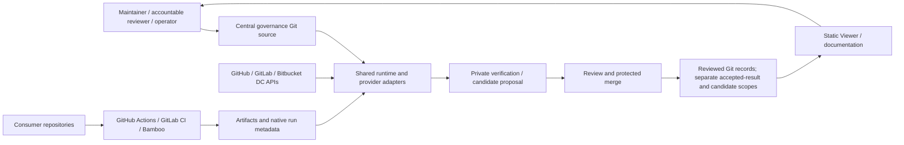
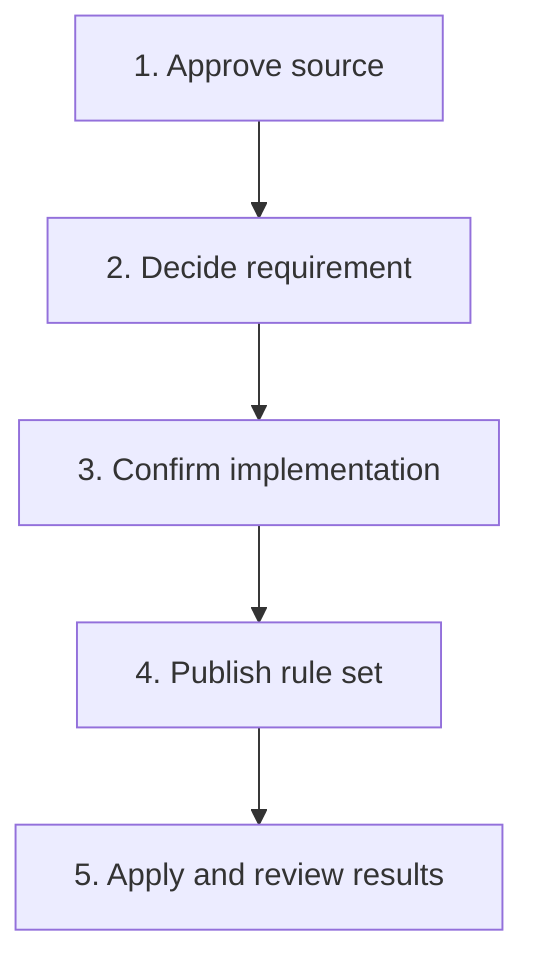
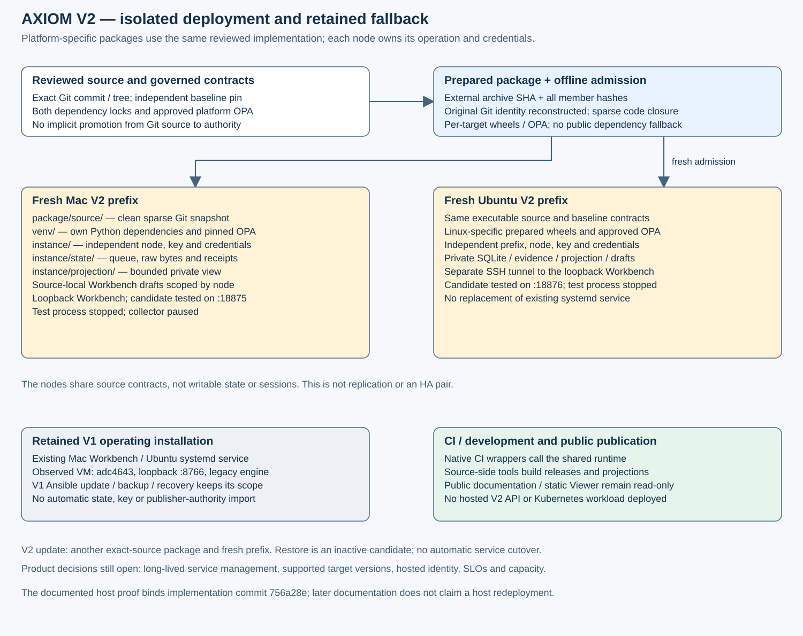
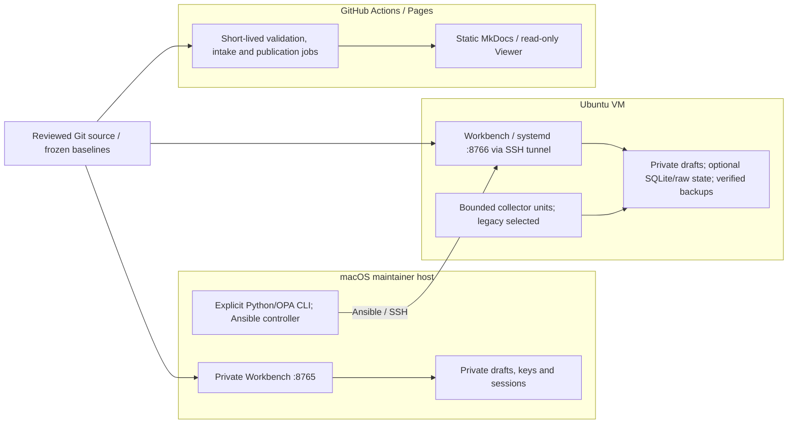

# Governance-as-Code System Architecture

## Document Status

| Attribute | Value |
|---|---|
| Document type | Current-state system architecture, organized with arc42 |
| Status | Explanatory as-built description; implementation, engineering proof and live activation are distinguished |
| Effective date | 2026-07-17; original document identity retained |
| Last implementation review | 2026-11-15, source `adc4643bb7a5c962e4efb1525298ad9e652c73d2` |
| Operating observation | 2026-11-15: Mac and Proxmox VM aligned to `adc4643`; legacy collector engine retained |
| Requirement journey explanation | `GCR-2026-161`; existing five-phase reading guide retained |
| Owner | Governance Platform Maintainers |
| Change request | `GCR-2026-035`; prior refreshes `GCR-2026-058`, `GCR-2026-078`, `GCR-2026-154`, `GCR-2026-161`; arc42 reconciliation `GCR-2026-183` |
| Governance / released baseline effect | None; documentation-only, no new requirement or runtime decision |
| Source Document Intake | Not required; no new governance source |

This page uses the twelve-part [arc42 structure](https://arc42.org/overview/)
to explain this repository. The text and diagrams describe its implementation;
existing section anchors remain usable. Operating procedures and detailed
engineering evidence are linked to their maintained guides. The
[platform state](../../operations/status/current-governance-platform-state.md)
is the entry point for later dated observations.

**Read the three states separately:** implemented source, locally/isolated
verified behavior, and actually activated operation. A merged adapter is not a
live provider acceptance. A private candidate is not an accepted Git result.

## 1. Introduction and Goals

### Purpose

This document describes how the implemented Governance-as-Code system works as
one technical system. It connects the foundation, structured governance models,
released baselines, downstream workflows, evidence intake, Trust evaluation,
append-only history, portfolio projections, graph, and viewer.

This is an explanatory architecture document. It does not create policy,
approve a control, change an enforcement mode, or modify a released baseline.
Where it conflicts with an approved policy, directive, source document,
machine-readable model, schema, or released package, those authoritative
artifacts take precedence.

The document complements rather than replaces:

- `docs/foundation/04_REFERENCE_ARCHITECTURE.md` for the target layer model
- `docs/governance/architecture/ado-devsecops-integrated-governance-model.md`
  for the organisation and decision operating model
- `docs/governance/architecture/runtime-governance-addendum.md` for runtime
  architecture governance concepts
- `docs/operations/status/current-governance-platform-state.md` for current
  operational status

### Stakeholders and top quality goals

| Stakeholder | Architectural need |
|---|---|
| Maintainer and accountable reviewer | Traceable changes, exact source/version binding and explicit authority |
| Consumer team | Reusable checks, clear evidence contracts, actionable findings and independent release decisions |
| Operator | Reproducible installation, isolated credentials/state and recoverable updates |
| Auditor / governance owner | Source lineage, immutable history, bounded Trust and reproducible projections |

The top technical goals are traceability, integrity, reproducibility,
recoverability and provider/host portability. Section 10 makes them concrete
using existing tests and observations; it adds no normative control.

### Architecture Drivers

The implementation follows these repository guardrails:

1. Governance intent, executable controls, runtime evidence, and intelligence
   projections are separate concerns.
2. Human accountability remains explicit; automation produces evidence and
   recommendations, not unreviewed governance authority.
3. Released baselines are immutable snapshots and consumer repositories pin a
   release tag or commit SHA rather than depending on mutable `main`.
4. Evidence is evaluated independently from the governance outcome it reports.
5. Historical result snapshots are append-only; conflicting writes are visible
   and quarantined.
   A legacy identity that lacks only `artifact_digest` can be matched to an
   otherwise identical enriched identity without rewriting history; two
   different present artifact digests remain a conflict.
6. Generated reports, indexes, graph data, and the viewer are projections. They
   do not become new sources of truth.
7. Report-only and blocking behavior are explicit configuration choices.
8. Platform-specific adapters surround a model- and schema-based governance
   core.

## 2. Architecture Constraints

| Constraint | Source and implementation consequence |
|---|---|
| Preserve approved and released identities | [Agent rules](https://github.com/joku-dev/devsecops-governance-framework/blob/adc4643bb7a5c962e4efb1525298ad9e652c73d2/AGENTS.md), release packages/checksums and the 24-file operating-acceptance manifest; use additive successors where required |
| Human decisions stay explicit | Source/requirement approval, role authority, release, waiver and blocking remain separate governed operations |
| Source, baseline, runtime and adapter versions differ | Consumer pins select frozen packages; prepared runtime/VM updates bind a reviewed full commit |
| Existing consumer scope remains | ha-CPsWMS retains its recorded legacy blocking risk; new pilots explicitly select report-only |
| Portable evaluator has bounded scope | Five mapped pipeline-L1 controls; eleven L1 controls remain `not_evaluated`; no full-baseline claim |
| Protect private state | Workbench uploads/keys, collector raw data/SQLite and provider credentials remain outside public projections |
| Separate technical description from normative architecture governance | This reorganization changes no architecture marker, gate, source decision or architecture baseline |

Foundation direction and the [reference layer model](../../foundation/04_REFERENCE_ARCHITECTURE.md)
provide strategic guardrails. Existing approved sources and versioned decisions
remain authoritative for their respective subjects.

## 3. Context and Scope

### Scope

In scope:

- the central `devsecops-governance-framework` repository
- authenticated local document intake and requirement-review preparation
- hybrid external/Git requirement authority, canonical revisions and artifact mappings
- multiple application and service repositories consuming released baselines
- DevSecOps and architecture runtime evaluation
- collector, evidence, Trust, replay, ledger, and failed-attempt handling
- result indexes, portfolio reporting, governance graph, and static viewer
- governance change control, releases, validation, and agent review routing

Out of scope:

- deployment architecture of consumer applications
- a centrally hosted multi-user governance API, database, or event broker
- Kubernetes as the current runtime platform
- automatic approval by an AI agent
- enterprise-wide approval workflows outside this repository

### System Context




The Git provider and CI provider are independent axes. The first implemented
profiles are GitHub/Actions, GitLab/GitLab CI and Bitbucket Data Center/Bamboo.
Native target versions, permissions and live acceptance are recorded separately
in the [support and acceptance matrix](../../operations/planning/platform-portability-acceptance.md).
The portable path proposes candidates through supported SCM APIs. Accepted
GitHub result intake and its reviewed publishers retain their existing contracts.
Merging a portable candidate proposal records that candidate in Git; it does
not admit it to the existing accepted DevSecOps/architecture domain indexes.
The diagram's reviewed-history step preserves this scope distinction; projection
readers apply their own accepted-result or candidate contract.

## 4. Solution Strategy

### Four-Layer Architecture

| Layer | Responsibility | Main implementation |
|---|---|---|
| Governance Intent | Explain authority, direction, roles, lifecycle, and source lineage | `docs/foundation/`, `docs/governance/`, `model/documents/`, `governance/` |
| Governance Model | Express controls, mappings, evidence types, architecture guardrails, schemas, and policies | `model/`, `architecture/`, `schemas/`, `policies/opa/` |
| Governance Runtime | Validate the central repo, publish baselines, execute consumer checks, collect results, and evaluate Trust | `.github/workflows/`, `scripts/`, `releases/` |
| Governance Intelligence | Project history into indexes, reports, portfolio status, graph, and viewer | `status/`, `generated/reports/`, `generated/graph/`, `generated/viewer/` |

Dependencies flow down through controlled contracts. Runtime and intelligence
feed evidence back upward for review, but they do not silently rewrite intent
or released models.

### Shared evaluation with explicit provider boundaries

The same Python/OPA evaluator serves CI, local evaluation and the portable VM
service. Native context acquisition, artifact transport, SCM proposal operations
and CI dispatch surround that core. Discovery or evaluation does not implicitly
start another provider job. Native repository and execution identities are
namespaced by provider/instance; display names are not identity substitutes.

A checksum-verified frozen baseline is selected independently of the runtime
source digest. The new portable result assesses five pipeline-L1 controls and
keeps outcome, execution, evidence Trust and requested/observed enforcement
separate. Existing released consumer wrappers remain callable at their old pins.

The [portable runtime ADR](../../operations/planning/portable-governance-runtime-adr.md)
and [engineering matrix](../../operations/planning/platform-portability-acceptance.md)
record the delivered M1/M2 work and the remaining external acceptance boundaries.

## 5. Building Block View

### Logical Components

| Component | Responsibility | Key locations |
|---|---|---|
| Source and change intake | Classify new artifacts, register candidate sources, record impact and review decisions | `model/documents/`, `docs/governance/change-requests/`, `docs/operations/processes/` |
| DevSecOps control baseline | Define controls, platform mappings, traceability, evidence requirements, and OPA behavior | `model/controls/`, `model/platform/`, `model/traceability/`, `policies/opa/` |
| Architecture runtime governance | Define levels, markers, review gates, exceptions, release candidates, and runtime policy | `architecture/`, architecture rules under `policies/opa/`, `schemas/architecture-*.schema.json` |
| Release manager | Freeze reviewed models, schemas, policies, workflow wrappers, metadata, and checksums | `releases/`, `docs/releases/`, versioned workflows in `.github/workflows/` |
| Consumer workflow adapter | Load a pinned baseline, collect repository context, evaluate it, and publish artifacts | reusable and versioned workflows under `.github/workflows/` |
| Evidence collectors | Acquire a named artifact, bind subjects and digests, normalize a contract-specific result | `scripts/intake_*`, `scripts/collect_*`, `model/evidence/evidence-collector-contract.yaml` |
| Evidence Trust verifier | Evaluate subject integrity, source metadata, custody, freshness, and replay without changing the underlying outcome | `scripts/lib/evidence_trust.py`, `model/evidence/`, Trust schemas |
| Append-only result ledger | Accept new snapshots, treat identical intake as idempotent, quarantine conflicting identity reuse | `scripts/lib/result_ledger.py`, `status/results/`, `status/architecture-results/`, `status/typed-evidence-results/`, `status/intake-conflicts/` |
| Collection attempt, intake telemetry, and health | Record failed or partial collection for retry, record every intake execution, and project report-only operational indicators | `scripts/record_collection_attempt.py`, `scripts/record_intake_event.py`, `scripts/generate_intake_health.py`, `status/collection-attempts/`, `status/intake-events/`, `status/intake-health.json` |
| Status and portfolio projections | Select context-aware latest results, summarize adoption, and validate multi-consumer isolation | result index generators, `scripts/generate_multi_consumer_readiness.py`, `status/*-index.json`, `governance/portfolio-adoption-reporting.yaml` |
| Governance Intelligence Graph | Join stable identifiers into a deterministic read-only relationship graph | `scripts/generate_governance_graph.py`, `schemas/governance-graph.schema.json`, `generated/graph/` |
| Viewer and documentation | Present status, Trust, Intake Health, attempts, portfolio information, lineage, and graph navigation | `scripts/generate_status_viewer.py`, `generated/viewer/`, `mkdocs.yml` |
| Private Review Workbench | Source/requirement preparation, notes, explicit impact hints and review ZIPs | `scripts/serve_governance_workbench.py`, `scripts/workbench/`, `scripts/lib/workbench_impact.py` |
| Portable evaluator and CI/SCM context adapters | Shared context/evaluate/gate/run contract and exact baseline/runtime binding | `scripts/governance_runtime.py`, `scripts/lib/portable/` |
| Common portable verifier and native transports | Independently validate physical files, native run/job/configuration identity, replay and provenance | `scripts/lib/portable_intake/bundle.py`, `transport.py`, `schemas/portable-intake-*-v2.schema.json` |
| Persistent collector and proposal coordinator | Bounded discovery/work, provider-bound SQLite queue, paused/shadow ownership and frozen batches | `scripts/portable_consumer_intake.py`, `scripts/lib/portable_intake/controller.py`, `store.py`, `publisher.py` |
| Provider operation adapters | SCM PR/MR reconciliation, separately requested CI dispatch and restricted Git scratch workspaces | `scripts/lib/portable_intake/operations.py` |
| VM deployment and prepared distribution | Exact-source install/update, compatibility, verified backup/recovery and prepared offline evaluation package | `infra/ansible/`, `scripts/deploy_vm.py`, `scripts/lib/vm_deployment.py`, `scripts/package_governance_runtime.py` |
| Agent review system | Route bounded governance reviews using model-neutral roles and skills; record explicit agent involvement separately | `.agents/`, `.codex/agents/`, `tests/agent_harness/`, `status/evidence-agent-provenance/` |

### Local preparation, requirement authority and public projection

The [Review Workbench](../../operations/guides/governance-review-workbench.md)
is a loopback HTTP service, separate from the static public Viewer. It reads
registered sources and stores private candidate drafts and append-only review
notes outside the tracked governance model. Markdown/DOCX and optional text-PDF
extraction use the shared explicit-declaration parser. A label such as
`DSCB-L1-REQ-001` identifies a declaration; prose and synthetic row identifiers
are excluded. Identifier origin remains a separate provenance assertion.

The guided intake prepares a candidate. Registered-source review prepares the
existing version and exact source bytes. Item review combines the original
locator and context with proposal-only confirmation, rejection or clarification
notes. A review ZIP can carry incomplete preparation and open questions to the
human review process. Retained lifecycle proposals and decisions are read-only
history, outside current extraction and note-progress counts.

Authentication, CSRF protection, source hashes, stale-draft and publication
guards constrain local writes. Threaded connection handling prevents idle browser
sockets from blocking the service; actual request handlers serialize session and
draft operations. This remains a local operational surface, with no hosted
enterprise identity or automatic governance approval.

The document-to-runtime journey is explained through five phases. The Workbench
prepares source and requirement reviews; formal decisions use the existing
versioned procedures. Native Git requirements enter phase 2 with a versioned
native source. Cases, catalogs, mappings and evidence records support these
phases rather than adding separate user steps.




Source approval precedes individual requirement decisions. An active requirement
needs a separately reviewed implementation and exact artifact mapping. A release
decision publishes a baseline for consumers; evaluation then uses that selected
version and concrete evidence. Gate behavior follows its separately authorized
enforcement mode. A rejected proposal or unresolved conflict does not advance
automatically, and documentation-only work need not publish a new runtime baseline.

The Requirement Authority Ledger distinguishes external authority, migration
in progress and complete Git authority. Immutable canonical revisions carry
explicit decisions and authorized derivations. Activation does not approve an
OPA equivalence mapping, release or blocking mode. The
[document-to-OPA rulebook](document-intake-to-opa-rulebook.md) describes these
boundaries. The [dated reconciliation](../../operations/status/repository-documentation-reconciliation-2026-11-15.md)
records current implementation coverage without refreshing consumer evidence.

The current Workbench presents **Dokument wählen → Prüfen → Weitergeben**.
Its session scope can keep architecture topics parked. Exact requirement-to-artifact
bindings support review; they do not establish actual consumer rule application
or calculate a semantic change probability. Mac and VM have independent keys,
port-bound cookies and draft roots. The static Viewer reads only public projections.

### Sources of Truth and Read Models

| Information | Authoritative location | Derived projection |
|---|---|---|
| Governance authority and source status | approved documents and `model/documents/source-document-register.yaml` | source lineage and intake reports |
| Control and platform model | `model/controls/`, `model/platform/`, `model/traceability/` | coverage, automation, and traceability reports |
| Architecture governance model | `architecture/` | runtime governance reports and result indexes |
| Executable policy | `policies/opa/` | evaluation output and test results |
| Released baseline | versioned package under `releases/` plus checksums | release documentation |
| Downstream result history | append-only JSON snapshots under `status/` | latest indexes, portfolio report, graph, viewer |
| Intake conflict history | `status/intake-conflicts/` | viewer conflict summaries |
| Failed collection history | `status/collection-attempts/` | derived `open`, `resolved`, or `permanent` lifecycle |
| Intake operation history | `status/intake-events/` | Intake Health success-rate and latency projection |
| Consumer registry and isolated result paths | `status/application-repository-integrations.yaml`, result history under `status/` | portfolio and Multi-Consumer Readiness reports |
| Private preparation | Per-host Workbench drafts/notes and source-bound uploads | Review ZIP; no automatic source/requirement approval |
| Private collector operation | Per-node SQLite queue/cache/raw artifacts and immutable verification receipts | Bounded `consumers.json` / candidate views; no official latest-result promotion |
| Agent involvement | explicit records under `status/evidence-agent-provenance/` | provenance index and viewer |

The generated files are reproducible read models. A reader must follow their
source references when making an audit or governance decision.

### Two collector engines and their activation boundary

The existing GitHub-only engine uses `scripts/consumer_intake.py`. The portable
successor uses `scripts/portable_consumer_intake.py` and schema2 provider-bound
state. They share selected helpers but retain separate operational identities.
The observed target VM still selects the legacy engine; new portable registries
are empty by default. Installed portable source does not activate collection.

The portable service starts paused, can collect in shadow and permits publication
only after the configured source/node ownership, comparison window and new-run
proof. It freezes bounded batches and reconciles lost/terminal PR/MR replies.
A copied database or node ID does not transfer publisher ownership. For exact
limits and commands use the [collector guide](../../operations/guides/portable-consumer-service.md).

## 6. Runtime View

### End-to-End Flow

#### 1. Governance Change and Baseline Publication

```text
classify artifact
      -> register/review source when required
      -> analyse impacted requirements and controls
      -> update models, schemas, policy and tests
      -> validate repository
      -> create explicit release candidate/release
      -> publish immutable package and checksums
```

A documentation-only explanation can stop after classification, GCR, review,
and validation. A behavior or contract change must update the corresponding
models, tests, documentation, and release decision.

#### 2. Consumer Evaluation

1. A consumer repository calls a versioned reusable workflow pinned to a
   release tag or full commit SHA.
2. The workflow collects repository and pipeline context.
3. OPA and supporting scripts evaluate the applicable DevSecOps or architecture
   baseline.
4. The workflow publishes machine-readable evidence and a human-readable
   report as CI artifacts.
5. Report-only mode records findings while allowing the workflow to complete;
   blocking mode fails according to the explicitly selected contract.
6. A mainline producer run can notify central intake when the required access
   is configured. Verification, independent review and merge determine the
   accepted central state. Notification alone does not accept the result.

#### 3. Central Intake and Trust Evaluation

```text
consumer run
   -> repository_dispatch or manual intake
   -> read GitHub run metadata
   -> download named artifact
   -> validate and normalize payload
   -> calculate subject/artifact SHA-256 digests
   -> evaluate Trust, freshness and replay
   -> append snapshot or quarantine conflict
   -> regenerate indexes, graph and viewer
   -> validate and commit allowlisted changes on an automation branch
   -> open operational PR and run required checks
   -> independent review and merge
   -> publish accepted indexes and static viewer
```

The intake workflows use an event-specific concurrency group containing the
repository and run identity. This serializes duplicate work for the same run
without globally blocking unrelated consumers. The publisher checks ancestry
against remote `main`, restricts changed paths and pushes only an automation
branch. Concurrent PRs may overlap: reconcile their append-only records and
regenerate projections from combined history before merge. The publisher does
not automatically rebase or merge proposals.

#### 4. Failed Collection and Retry

If artifact retrieval or normalization fails, the intake workflow records an
append-only collection-attempt entry. That record is operational evidence, not
a successful result. An operator can explicitly start the retry workflow for a
fully retryable entry. The viewer correlates a later successful snapshot with
the original attempt and derives its lifecycle; it never rewrites the attempt.

#### 5. Intelligence Projection

Index generators retain history and select the appropriate latest view per
repository and runtime context. Portfolio reporting uses registered consumers
and accepted results. The graph joins existing identifiers into navigable
relationships. The static viewer renders those projections without a write-back
path.

#### 6. Portable evaluation and verification

1. A reviewed consumer profile binds separate SCM/CI identities and exact
   baseline/runtime digests. The adapter checks the actual checkout against
   native source/target/tested revisions.
2. The application supplies real artifact, SBOM and scanner output. Runtime
   preparation checks physical digests and subject associations; it does not
   synthesize scanner success or fill missing producer proof.
3. The provider-free core evaluates normalized context/input with pinned OPA.
   A technical or incomplete result has exit 2; completed report-only findings
   remain findings even when the gate exits 0.
4. Native collection independently reacquires run/job/artifact/configuration
   metadata and invokes the common verifier. Original results keep their Trust;
   a separate immutable verification receipt records supported checks.
5. The private queue retains raw files, failures and replay identity. A candidate
   projection or PR/MR proposal remains distinct from accepted domain indexes.

#### 7. Exact-source update and failed activation

The Ansible controller prepares and fully validates a separate candidate while
the installed Workbench remains available. Before switching, it checks persisted
state/engine compatibility, stops relevant writers and verifies backup contents
and VM/controller byte equality. It switches the exact source/runtime, then
checks anonymous access, real login, data access and logout. Failed activation
restores the previous compatible executable/service; it does not roll drafts
back silently. Schema2-to-legacy rollback requires the explicit fresh-root
restore/reconciliation path. See the [update/recovery runbook](../../operations/guides/portable-vm-update-and-recovery.md).

### Runtime Context and Latest-State Semantics

The system distinguishes mainline, pull-request, branch, and manual or
diagnostic runs. Historical records from every relevant context may remain
visible, while portfolio and management views must use accepted mainline,
release, or explicitly accepted manual evidence. A newer pull-request run must
not silently replace the accepted mainline state.

### Implemented closed-loop pilot

The [manual GitHub GRS-002 pilot](../../operations/status/governance-lifecycle-current-state.md)
extends the as-built runtime with immutable evidence receipts, action-bound
personal consent, remediation progress, evidence-bound closure/reopening and
withdrawal handling. Versioned roles and operating values remain separate from
individual statements. Effective LD-07 acceptance binds implementation digests;
changed/withdrawn consent or a changed implementation prevents new valid operation.

The manual `lifecycle-pilot-update.yml` workflow captures acceptance, observations
or action statements, or refreshes projections. Its `lifecycle-pilot` publisher
scope creates PRs with independently checked provider proof. A separate
`status/governance-lifecycle-live.json` projection records official pilot state;
technical validation records and synthetic histories keep their original labels.
Actual #92/#93 workflow publications prove the acceptance/PASS path. No real
remediation or closure is claimed. Consumer indexes and the main status viewer
retain their existing scope; the separate scenario viewer remains synthetic.

There is no scheduled lifecycle daemon, automatic remediation executor, live-waiver
adapter, cross-consumer lifecycle portfolio or Bitbucket personal-consent adapter.
The [function catalog](../../operations/guides/repository-function-catalog.md) and
[technical inventory](../../operations/guides/repository-technical-function-inventory.md)
provide the complete implementation entrypoints.

## 7. Deployment View

### Runtime and Deployment View





| Execution location | Running / available software | State and boundary |
|---|---|---|
| macOS maintainer host | Private loopback Workbench, explicit Python/OPA CLI, Ansible controller | Independent draft/key/session root; no automatic synchronization with VM |
| Ubuntu 24.04 VM | Loopback Workbench as systemd service; legacy collector units; portable source available | Private per-host state; collector credentials/configuration and engine activation are separate |
| Consumer CI | Existing pinned GitHub workflows; new GitHub/GitLab/Bamboo portable templates | Application-owned build/scanner jobs and native artifacts; live profile acceptance remains explicit |
| Central GitHub Actions | Repository validation, accepted-path intake, operational proposals, projections and publication | Short-lived jobs; reviewed Git history remains the accepted ledger |
| GitHub Pages | Static documentation and read-only Viewer | No Workbench service, private drafts, SQLite access or write-back API |

The Workbench is a continuously running local application service. Collector
units are bounded oneshot poll/work executions scheduled by timers; an active
timer does not prove collection. SQLite is embedded private operational state,
not an external database service or a replacement for accepted Git results.
No Kubernetes workload or broker is deployed. Public output remains static.

The personal VM access path is an SSH tunnel to loopback port 8766; the Mac
normally uses loopback port 8765. A remote deployment does not expose the
Workbench on the LAN or publish its private data. The
[installation guide](../../operations/guides/linux-vm-installation.md) owns
commands, prerequisites, backup locations and selective draft import.

### Current Deployment Decision and Kubernetes

The separate [V2 development candidate](../../operations/planning/axiom-v2-decoupling.md)
introduces a finite application launcher, an explicit composition boundary and
provider adapters. Its exact-source offline package uses a reviewed sparse file
set, its own Python environment and fresh private instance data. V1-only
entrypoints are excluded from that installed working tree. The
[function inventory](../../operations/planning/axiom-v2-function-inventory.md)
records retained local authoring tools and the V1 lifecycle authority that does
not transfer to V2. These changes do not describe a completed production rollout.

The implemented deployment combines local macOS use, direct Linux/systemd
operation in an existing VM, CI jobs and static publication. The same source
line and evaluator serve these environments; no permanent VM fork is required.

Kubernetes remains deferred. Measured event volume, latency, isolation and
availability needs may motivate workers or external immutable evidence storage.
Any future deployment must preserve versioned contracts, immutable identities,
history, source ownership and human decision boundaries. The
[capacity profile](../../operations/guides/portable-capacity-profile.md)
contains measured fixtures and distinguishes them from production sizing.

### Dated host observation

On 15 November 2026 the maintainer requested alignment and a private diagnostic
comparison. The Mac checkout and the active Proxmox VM both reached `adc4643`;
Workbench smoke checks passed. The VM update used the existing IaC path with
legacy engine preserved. No portable migration or publisher activation followed.
A later documentation merge does not automatically redeploy either host.

The same ha-CPsWMS commit `5c3b5cb` and eleven unchanged producer files from run
`36997125273`, attempt 1, dated 2 October were replayed on both hosts. Three
repository-integration checks and the same 16 applicable legacy L1 decisions
passed; 30 controls were not applicable. Host time/path/list-order fields differed,
while all business results matched. The portable preflight rejected the original
SBOM (`invalid_sbom`); it lacked `metadata.component`, and the scan also lacked
`artifact_sha256`. No portable evaluation, fresh application test/scan or official
intake was claimed. Private raw reports remain outside this public checkout.
The [dated platform state](../../operations/status/current-governance-platform-state.md)
records this observation independently of current consumer evidence.

## 8. Crosscutting Concepts

### Evidence and Trust Architecture

Governance outcome and Evidence Trust answer different questions:

- the outcome says whether the evaluated subject passed, failed, or produced
  report-only findings
- the Trust record says how strongly the collected bytes and their provenance
  have been verified

The current Trust ladder is:

| Level | Meaning |
|---|---|
| `unverified` | Evidence was captured, but integrity has not been established. |
| `integrity_verified` | A subject identity exists and the collected bytes match a verified digest. |
| `provenance_verified` | Integrity plus the required source, run, commit, artifact, freshness, replay, and custody checks are verified. |
| `attested` | A trusted issuer has cryptographically attested the subject under an accepted policy. |

Supported legacy GitHub profiles and the common portable verifier can derive
`provenance_verified` only when their independent identity, run/job, commit,
artifact, configuration, freshness, replay and custody checks pass. Local imports
are limited to integrity verification; Bamboo provenance closure remains open.
A downloaded artifact or a producer JSON flag cannot supply its own proof.
The signed-attestation pilot remains separate from production issuer/key
acceptance and does not enable general operational `attested` promotion.

Retained governance outcomes and historical Trust are not rewritten. Legacy
freshness/replay observations remain separate from the reported control outcome.
Portable verification can hold stale, conflicting or incomplete candidates
without converting the original producer result into an accepted fresh result.
The replay identity binds repository, commit, workflow, run, run attempt,
artifact, and subject digest.

Replay Triage is a derived interpretation layer over the immutable ledger. It
replays the current compatibility rules against stored chronology, preserves
the recorded result alongside the recalculated result, and exposes an operator
classification and action. It cannot write snapshots, move latest pointers,
change Trust, or authorize enforcement.

Agent provenance is also independent. It records an explicitly asserted
`selected`, `executed`, `reviewed`, or `approved` relationship to a known
subject digest. It is not a cryptographic attestation and cannot raise the
Evidence Trust level by itself.

### Result Ledger and Consistency Model

The central evidence store follows four rules:

1. A new result identity creates a new immutable snapshot.
2. An identical retry is an idempotent no-op.
3. A changed payload targeting an existing identity never replaces the
   original; a conflict record is created for review.
4. Latest-state, portfolio, graph, and viewer data are recomputed projections
   over the retained history.

Git provides versioning and optimistic concurrency rather than database
transactions. Intake workflows mitigate concurrent updates with scoped
concurrency groups, allowlisted PR publication, deterministic generators,
schema validation and reviewed reconciliation. This is suitable for the current event rate,
but it is a deliberate scalability boundary.

The private SQLite store has a different consistency role: transactional queue
and receipt persistence, cache/watermarks, bounded retries and restart recovery.
Its schema2 namespace separates provider/instance/repository and native execution
identities. Stopped-writer, backup-first migration retains original legacy bytes
and publication identities. A restored queue does not authorize a second writer.
Git remains the official accepted snapshot/projection history.

### Multi-Consumer Model

Multiple consumer repositories are first-class. Each consumer has a normalized
`owner/name` identity, its own result history, baseline target, adoption state,
owner, and architecture scope. Repository-specific paths prevent cross-consumer
result collision. Portfolio projection reads the integration registry and the
central indexes; it does not grant onboarding or waive missing evidence.

Adding a consumer therefore does not require copying central policies. It
requires registration, a pinned workflow integration, required permissions,
an initial accepted run, central intake, and ownership of follow-up findings.

Portable identities additionally bind SCM provider/instance/native repository
ID and CI provider/instance/run/physical job/attempt. IDs remain opaque strings;
GitLab subgroup paths or Bamboo keys are not cast into a GitHub identity.
Read models retain per-profile scope and original Trust. Candidate state is
kept separate from the existing accepted integration registry and indexes.

### Security and Trust Boundaries

| Boundary | Main control |
|---|---|
| Governance maintainer to released consumer contract | reviewed release, version pin, checksums, branch protection |
| Consumer repository to central intake | explicit dispatch, named artifact, repository/run identity, scoped token |
| Downloaded bytes to accepted subject | schema validation, SHA-256 binding, Trust checks, replay evaluation |
| Automated writer to Git history | least-required permissions, scoped concurrency, allowlisted automation branch, validation, append-only ledger and reviewed PR |
| Generated view to governance decision | read-only projection, source links, human accountability |
| AI agent to evidence | explicit provenance record; no inferred authority and no automatic Trust elevation |

`GH_RESULT_INTAKE_TOKEN` is required when the default token cannot read a
different repository's run artifacts. The token should have only the repository
and Actions access needed for that operation. Workflow write permissions in the
central repository are limited to the jobs that must persist results.

VM Workbench, intake reader and publisher responsibilities use separate service
identities/credentials. Private SQLite/raw/configuration are not served by the
Workbench; its consumer view reads only a bounded public projection. Local keys
and port-bound cookies isolate parallel Workbench sessions. Provider observation
candidates cannot assign live roles or grant personal consent. Exact details
are in the [collector](../../operations/guides/portable-consumer-service.md) and
[provider-assurance](../../operations/guides/provider-assurance-candidates.md) guides.

### Enforcement Model

New portable candidates and new consumer pilots explicitly use report-only.
The released legacy DevSecOps wrapper defaults to blocking if its mode is
omitted; the preexisting ha-CPsWMS integration is a separately recorded legacy
blocking risk, with review due 12 December 2026, 23:59:59 Europe/Berlin.
Architecture evaluation remains report-only.
Findings remain visible in artifacts, indexes, portfolio views, and the viewer.
Blocking requires an explicit workflow or policy decision and must include the
corresponding documentation, tests, migration impact, and release decision.

Evidence freshness, replay findings, intake conflicts, collection failures,
agent provenance, graph relationships, and portfolio projections do not by
themselves change an underlying governance outcome.

Blocking Readiness is likewise a read-only decision projection. It combines
released baseline pinning, mainline stability, Trust, replay, Typed Evidence,
Architecture, intake health, conflict, waiver, rollback, and accountable
approval signals. Its schema fixes `enforcement_change_authorized` to `false`;
consumer workflow and branch-protection activation remains a separate reviewed
change with release and migration analysis.

Blocking Mode Alignment adds a guard around the integration registry. A newly
blocking consumer is aligned only when technical readiness and accountable
approval are both present. A demonstrably preexisting mode may be represented
as `legacy_risk_active` until a fixed review date, but remains invalid as a new
activation and cannot authorize policy, workflow, or branch-rule mutation.
Unsafe, incomplete, expired, or orphaned alignment state fails central
repository validation while leaving external consumer state untouched.

### Change Impact Rules

Use this document as the orientation map, then update the authoritative area:

| Intended change | Required review focus |
|---|---|
| Governance intent or source | source intake, lineage, requirements, human approval |
| Control, marker, or review gate | traceability, OPA, tests, evidence and release impact |
| Evidence or Trust contract | backward compatibility, schema version, collector, indexes and viewer |
| Enforcement behavior | report-only/blocking semantics, consumer migration, release decision |
| Result intake or ledger | idempotency, conflict retention, concurrency, latest-state semantics |
| Graph, report, or viewer | deterministic projection and unchanged source-of-truth boundaries |
| Blocking readiness or activation | technical criteria, accountable approval, waiver tests, rollback, consumer migration and release decision |
| Runtime platform | security, availability, state migration, contract preservation and operating ownership |

## 9. Architecture Decisions

This index points to recorded decisions and implemented choices; it does not
retroactively create operating authority or a baseline release.

| Decision / recorded choice | Rationale and consequence | Maintained record |
|---|---|---|
| Separate intent/model/runtime/intelligence | Derived views do not become authority | [Reference model](../../foundation/04_REFERENCE_ARCHITECTURE.md) |
| Freeze baseline packages independently of runtime | Reproducible consumer pins and explicit migrations | [Release model](../../releases/release-and-migration-model.md) |
| One provider-free portable evaluator | Avoid divergent gate semantics across CI and VM | [ADR-PORT-001](../../operations/planning/portable-governance-runtime-adr.md) and [runtime](../../operations/adapters/portable-governance-runtime.md) |
| Shared physical/native evidence verification | A producer assertion is insufficient for central proof | [Evidence intake](../../operations/evidence/portable-evidence-intake.md) |
| Private provider-bound SQLite plus accepted Git history | Durable processing without replacing accepted ledger semantics | [Collector](../../operations/guides/portable-consumer-service.md) |
| Exact-commit VM install with checked backups/recovery | Preserve private state and fail safely on incompatible source/schema | [VM recovery](../../operations/guides/portable-vm-update-and-recovery.md) |
| arc42 organization of this explanatory page | Make context, structure, behavior, deployment, decisions and risks independently readable | [GCR-2026-183](../change-requests/GCR-2026-183-arc42-system-architecture.md) |

Earlier increment ADRs retain their original source observations. Their linked
integrated addenda/matrix supersede implementation-progress statements; live
acceptance remains separately scoped.

## 10. Quality Requirements

### Quality Attributes

| Attribute | Current architectural response |
|---|---|
| Auditability | Git history, source lineage, GCRs, immutable releases, append-only result and conflict records |
| Reproducibility | pinned validation dependencies and OPA version, deterministic generators, schemas, tests, checksums |
| Integrity | subject and artifact digests, central verification, append-only ledger |
| Portability | shared evaluator/verifier and separate SCM/CI adapters; native live acceptance per target profile |
| Availability | independent local/VM services and CI jobs; public static outputs remain readable without the private Workbench |
| Observability | workflow logs, collection attempts, conflicts, result indexes, portfolio report, graph, viewer |
| Scalability | bounded durable queue/API/storage budgets and measured 1,000/2,000-identity fixtures; production SLO/retention approval remains open |
| Maintainability | separation of authoritative models, implementation scripts, generated outputs, and versioned releases |

### Existing quality scenarios and evidence limits

These scenarios explain existing technical behavior. They are not newly approved
service levels or governance requirements.

| Scenario | Observable response / evidence | Remaining limit |
|---|---|---|
| Same revision/input on Mac and Linux | Equal legacy control/OPA decisions in the dated ha-CPsWMS replay; portable complete-result parity also has separately labelled offline fixtures | Historical real input is not a fresh scan; fixture parity is not target-provider acceptance |
| Tampered/missing artifact or native binding | Verifier/CLI negative tests reject mismatches; old producer SBOM rejected equally on both hosts | Consumer must produce the new physical evidence contract |
| Candidate update or activation fails | Prior service remains during preparation; verified backups and compatible recovery protect saved drafts/keys | Production recovery objectives and representative retained evidence volume require separate proof |
| Unauthorized browser/API request | Login/CSRF/host checks; independent keys/cookies; actual VM anonymous API returns 401 | Multi-user hosting, SSO and reverse proxy operation remain unaccepted |
| Restart, replay, lost provider reply | Persistent tests retain task/receipt identity and reconcile the same frozen proposal | Live provider/version behavior and shadow/ownership handoff remain open |
| 1,000/2,000 repository identities arrive | Versioned distinct-identity load/audit fixtures measure queue/API/CPU/RSS/storage behavior | Real payload, arrival distribution, quotas, retention and hardware SLOs still need capacity approval |

### Validation

Use the repository-pinned validation entry points before committing current-state
architecture documentation:

```bash
./scripts/bootstrap_validation_env.sh
./scripts/validate_all.sh
mkdocs build --strict
```

Focused checks include `opa check policies/opa`, both governance validators and
`python3 -m unittest discover -s tests`. Routing may additionally require the
local demo/viewer generators. Keep generated timestamp/private-path noise out
of the documentation commit. Review the exact changed paths and protected
fingerprints, validate local links and rendered anchors, and retain revision-bound
role review evidence privately. Successful technical checks do not replace
CODEOWNER approval or a separately scoped operating acceptance.

## 11. Risks and Technical Debt

### Known Limitations and Risks

| Limitation / technical debt | Current consequence or next evidence |
|---|---|
| Git accepted-result storage has finite write/regeneration capacity | Production scale needs measured retention/arrival limits and potentially external immutable evidence storage |
| Static public Viewer | Read-only projection freshness follows accepted publication; no live private-state query or write-back |
| New native profiles lack installed-version live acceptance | GitLab/Bamboo/Bitbucket DC target versions/URLs, import, runs and least-privilege access remain open |
| Portable candidate scope is five pipeline-L1 controls | Eleven L1 controls are not evaluated by that result; legacy full-L1 reports are a different path |
| Legacy consumer evidence may not meet new physical binding contract | Observed ha-CPsWMS SBOM/scan gaps prevent portable evaluation; retain original files and produce compliant new evidence |
| VM source is installed with legacy engine retained | Portable migration, at least 24-hour/new-run shadow proof, ownership and publisher activation remain separate |
| Operational attestation/role authority is not generally enabled | Candidate observations and demo issuer proof cannot grant real roles or production `attested` Trust |
| Per-host private drafts/keys and queues | No automatic Mac/VM synchronization; explicit draft import and schema-compatible recovery only |
| Timers, checks or a governance PASS may be overinterpreted | Timer activity is not collection; successful execution is not freshness, compliance, accepted risk or production approval |
| Measured capacity fixtures use a bounded engineering workload | No production capacity promise for 1,000–2,000 consumers without representative payload/quotas/retention and agreed SLOs |
| Current-state documentation can drift | Review changed components/contracts/activation after implementation PRs; dated host evidence remains separately bound |

### Evolution Priorities

Priorities follow the implemented state rather than treating delivered M2 work
as a future design:

1. Define actual target provider versions/URLs and obtain scoped report-only live
   import/run/permission evidence.
2. Bring selected consumer producers onto the portable physical evidence contract.
3. Prepare and separately accept VM portable migration/shadow/ownership/publisher
   handoff when requested; preserve existing accepted routes until then.
4. Use real workloads to establish retention, API and capacity objectives; evolve
   deployment/storage only from those measurements.
5. Complete any desired production issuer/key, role, alerting or stronger
   enforcement decisions through their existing accountable processes.

## 12. Glossary

| Term | Meaning in this repository |
|---|---|
| Approved source | Exact registered governance document/version accepted through the source process |
| Canonical requirement | Immutable GRQ revision with a separately recorded decision |
| Artifact mapping | Exact requirement-to-implementation binding; not proof of runtime application |
| Baseline | Frozen controls/schemas/policies package selected by an immutable consumer pin |
| Runtime | Shared executable implementation, with its own version/source digest |
| SCM adapter / CI adapter | Independent repository-operation and execution-context boundaries |
| Evidence / subject | Producer bytes and the concrete artifact identity they describe |
| Trust receipt | Source-bound verification result separate from original outcome/Trust |
| Candidate | Private or proposed result that is not an accepted domain-index entry |
| Accepted ledger | Reviewed immutable Git snapshots and their authoritative domain indexes |
| Operational store | Private SQLite queue/cache/watermarks/raw processing state |
| Shadow / publisher ownership | Comparison-only operation / explicit authority for the scoped writer |
| Report-only / blocking | Findings recorded / gate failure according to separately authorized mode |
| Engineering proof / live acceptance | Local or isolated tested behavior / scoped real target operation |

### Related Documents

- [Reference architecture](../../foundation/04_REFERENCE_ARCHITECTURE.md) and [foundation principles](../../foundation/03_ARCHITECTURE_PRINCIPLES.md).
- [Five-phase document-to-OPA guide](document-intake-to-opa-rulebook.md) and [organizational operating model](ado-devsecops-integrated-governance-model.md).
- [Current platform state](../../operations/status/current-governance-platform-state.md) and [15 November reconciliation](../../operations/status/repository-documentation-reconciliation-2026-11-15.md).
- [M1/M2 engineering and live acceptance matrix](../../operations/planning/platform-portability-acceptance.md).
- [Workbench](../../operations/guides/governance-review-workbench.md), [VM installation](../../operations/guides/linux-vm-installation.md), [portable recovery](../../operations/guides/portable-vm-update-and-recovery.md).
- [Portable runtime](../../operations/adapters/portable-governance-runtime.md), [intake](../../operations/evidence/portable-evidence-intake.md), [operations](../../operations/adapters/portable-operations.md), [collector](../../operations/guides/portable-consumer-service.md).
- [Trust model](../../operations/evidence/evidence-trust-model.md), [accepted result intake/viewer](../../operations/evidence/governance-result-intake-and-viewer-usage.md).
- [Prepared runtime package](../../operations/guides/prepared-runtime-package.md) and [capacity measurements](../../operations/guides/portable-capacity-profile.md).
- [Function catalogue](../../operations/guides/repository-function-catalog.md), [technical inventory](../../operations/guides/repository-technical-function-inventory.md) and [review protocol](../../operations/agents/how-to-run-agent-review.md).
